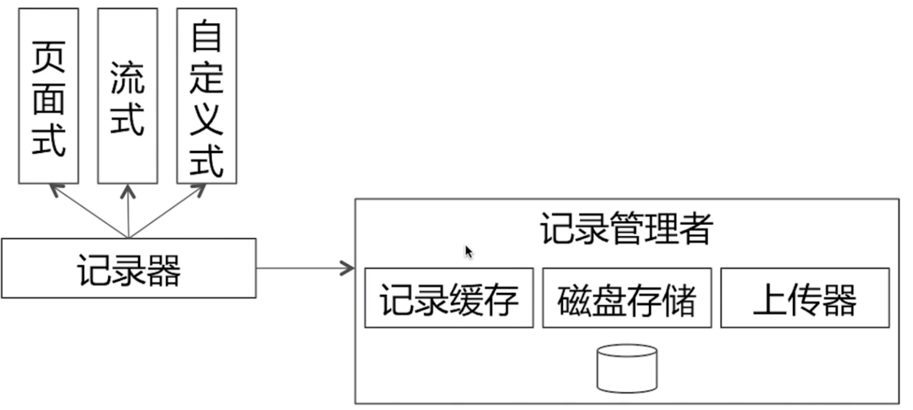
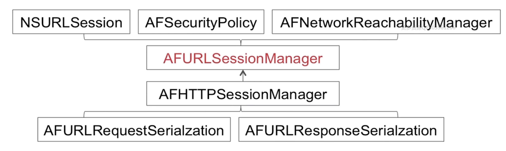
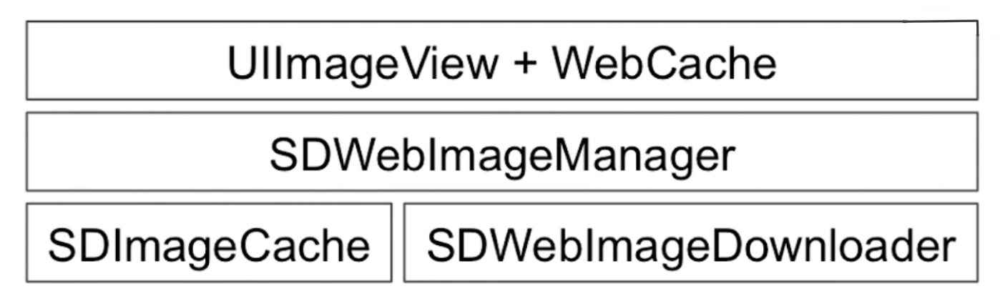
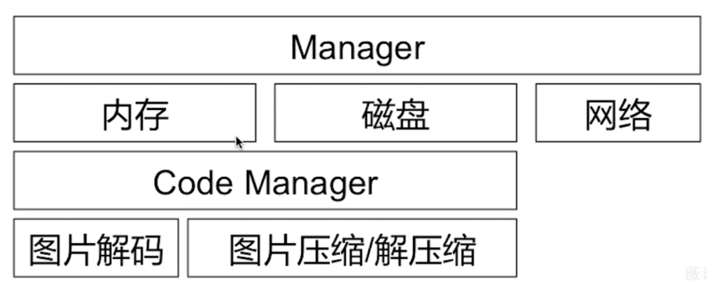
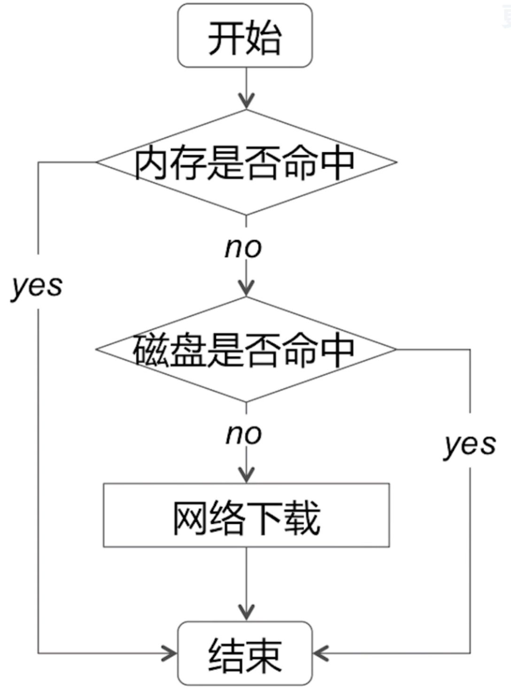
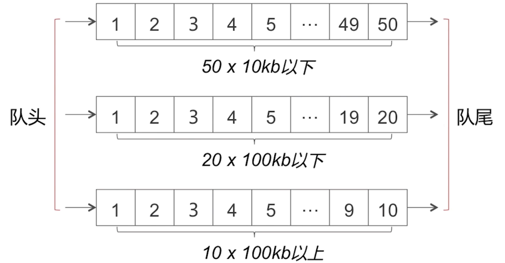
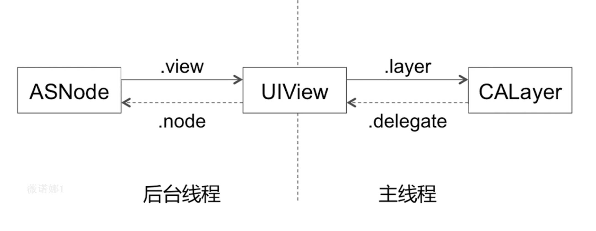
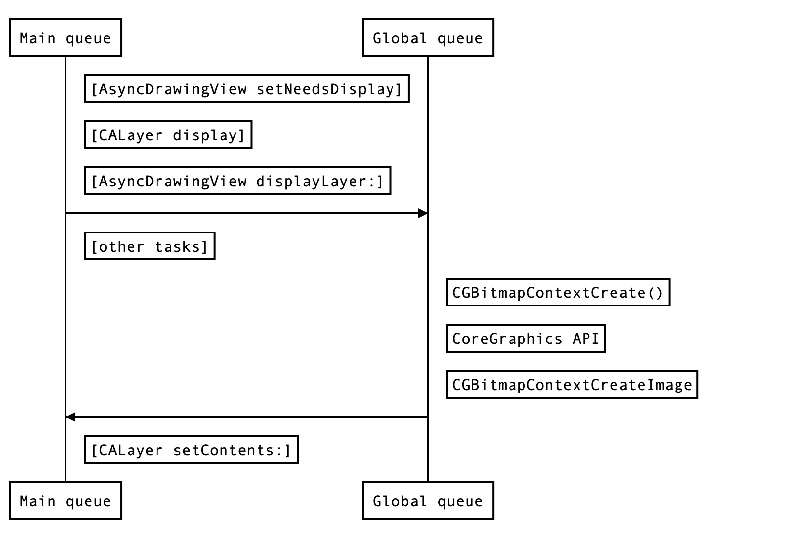

# 框架设计


## 阅读时长记录器



### 记录器种类

- 页面式：普通的 push、pop 页面
- feed 流式：类似 weibo 这种 feed 流式的记录
- 自定义式：可拓展性的体现，面向未来


QA：为什么要有不同类型的记录器？

- 基于不同分类场景提供的关于记录的封装、适配
- 

### 记录数据存储

- 内存缓存
- 磁盘存储


### 准确性

数据收集（存储）、上报（移除）2个核心流程。准确性也和这2个方面息息相关。

- 定时写磁盘 从内存中 flush 到本地磁盘。定时器1分钟 flush 一次
- 限定内存缓存条数。超过该条数，即写磁盘。内存记录每满10条 flush 一次


### 上传策略

思考：

- 需要立马上传吗？每收集到1次页面阅读时长就需要立马上传1次吗？ROI 衡量。性能、线程数
- 关于延时上传的场景有哪些？


上传时机：

- 定时器，比如每5分钟上传1次。
- 前后台切换，比如从后台切换到前台触发1次上传逻辑
- 无网切换到有网


### 网络上传效率

自定义报文，高效传输。

iOS 小端序，网络大端序。


## 复杂页面架构设计
- MVVM
- Redux 数据流


## 客户端架构
```
┌─────────┬─────────┬─────────┬─────────┐
│ App1   │ App2   │ App3 ...            独立的业务 App
└─────────┴─────────┴─────────┴─────────┘
        ↓ 仅依赖上层门面接口
┌─────────┬─────────┬─────────┬─────────┐
│ 业务A   │ 业务B   │ 业务C   │ 业务D  ... 垂直业务层（各业务线独立模块）
└─────────┴─────────┴─────────┴─────────┘
        ↓ 仅依赖下层门面接口
┌───────────────────────────────────────┐
│              业务适配层（门面调度层）     统一路由、接口收口、全局拦截、能力组装
└───────────────────────────────────────┘
        ↓ 调用标准化业务中台能力
┌───────────────────────────────────────┐
│           通用业务层（业务中台SDK）       账号/商品/订单/支付/营销等通用业务基础能力
└───────────────────────────────────────┘
        ↓ 依赖底层纯技术基础设施
┌───────────────────────────────────────┐
│        独立于App的底层通用SDK            网络、数据库、APM、缓存、加密、基础工具库
└───────────────────────────────────────┘
```

### 1. App1/App2/App3 … 
独立业务 App：公司多条完全隔离的客户端产品（如主钱包 App、商家后台 App、WebView 轻应用 App），各自独立打包、独立发版、独立业务团队维护。
- 从属关键：每一个 App 内部，都完整包含下方三层：垂直业务层 + 业务适配层；图视觉上是全局总览，代表所有 App 统一遵守这套分层规范，不是多个 App 共用同一套业务模块。
- 约束：所有 App 内部代码，不允许直接引入通用业务中台 SDK / 底层 SDK，全部通过本 App 私有门面层中转调用。

### 2. 垂直业务层
业务 A/B/C/D…，是面向独立业务线/业务域的独立模块，是业务专属代码，只服务单一业务场景。
比如：商城首页、订单详情、直播、会员中心、活动页、营销活动 H5 容器等；
- 特点：业务隔离，各业务互不侵入，只依赖下层提供的标准能力，可按需模块化插拔、独立打包
- 职责：页面 UI、业务流程、业务交互逻辑、业务专属埋点、业务特有规则

### 2. 业务适配层
核心定位：承接上层垂直业务，对下层通用业务层、底层 SDK 做统一封装、接口收敛、能力编排、路由调度，是上下层的隔离缓冲带。

### 3. 通用业务层
业务中台 SDK，沉淀全 App 复用的业务域基础能力，带业务属性，非纯基础工具：
- 模块示例：账号中心、商品基础、订单基础、支付基础、营销券、用户权益、消息推送业务能力；
- 特点：纯业务基础能力，无页面、无上层业务流程，只输出业务数据与基础操作；
- 依赖：仅依赖最底层独立通用层，不感知上层业务。

### 4. 基础 SDK
独立于 App 的通用层，属于基础设施。无任何业务属性，全端通用底层工具，可独立打包给多 App 复用：
- 模块示例：网络库、本地数据库、缓存、APM 监控、本地配置、图片加载、加密、日志、权限、设备信息、基础 UI 组件；
- 特点：完全脱离业务，任何 App 都能接入，不耦合账号 / 商品等业务概念。


### 另一种更优雅的形式
对于上面的业务适配层。我待过一家公司，是这么设计的：业务团队维护2个 SDK。
- 一个是 API，比如 GoodsModuleAPI，负责梳理和总结上下游链路，提供公共的、需要对外暴露的 API ，只有接口声明
- 一个是 GoodsModule，内部通过 cocoapods 的 subspec 能力分为2个子模块：
 - GoodsCore：负责最基础的纯逻辑能力，比如：Config、Handler、Model、Protocol、ViewModel 等
 - GoodsImpl：负责实现 UI、实现  GoodsModuleAPI 声明的接口
外部业务方不会依赖 GoodsImpl，只会依赖 GoodsModuleAPI，调用公开接口：
- 可能会查询某个数据，比如
```Objective-C
/// DEX hidden or not 
- (BOOL)isDEXFeatureHidden;
````
- 也可能提供参数打开具体页面，比如：
```Objective-c
/// open dex Page
/// @param config Jump parameter configuration
- (NSNumber *)openDexPageWithConfig:(OKWalletDexSkipParamConfig *)config;
```

#### 1. 纯接口门面 SDK
GoodsModuleAPI 纯接口门面 SDK，业务团队维护。
定位：对外唯一契约层、纯头文件声明，无任何.m 实现、无业务逻辑、无 UI、无第三方依赖。
内部只包含：
- 对外暴露的协议/模型 `GoodsDetailQueeryParamConfig`、`GoodsDetailResultModel`
- 门面服务头文件 `GoodsModuleService.h`，只写方法声明，比如：查询商品详情基础信息、判断商品模块是否对当前用户隐藏、跳转商品详情原生页面
```Objective-c
// GoodsModuleService.h
#import <OKBase/OKBase.h>
#import "GoodsDetailQueryParamConfig.h"
#import "GoodsDetailResultModel.h"

@interface GoodsModuleService : NSObject
/// 单例全局入口
+ (instancetype)shared;

/// 查询商品详情基础信息
/// @param config 查询入参配置
/// @param complete 回调：商品详情/错误信息
- (void)queryGoodsDetailWithConfig:(GoodsDetailQueryParamConfig *)config
                           complete:(void(^)(GoodsDetailResultModel *result, NSError *error))complete;

/// 判断商品模块是否对当前用户隐藏
- (BOOL)isGoodsModuleHidden;

/// 跳转商品详情原生页面
/// @param config 商品查询跳转参数
- (void)openGoodsDetailPageWithConfig:(GoodsDetailQueryParamConfig *)config;
@end
```
- 配套文档：接口注释、错误码、业务上下游调用链路说明

强制规则:
- 依赖规则：零业务依赖，仅依赖基础通用模型（Base、Utils 等基础库）
- App 内所有垂直业务模块（直播、购物车、首页）仅允许依赖 GoodsAPI
- 禁止任何业务 Pod 直接引入GoodsSDK/Core、GoodsSDK/Impl
- 版本规范：接口新增、参数变更、方法废弃，单独升级GoodsAPI版本号，作为全公司统一兼容契约


#### 2. 内部实现 SDK
内部拆分双 Subspec：Core + Impl
```yaml
GoodsSDK 仓库目录结构
├─ BaseDependency 聚合依赖Podspec块（统一收拢中台/三方库）
│  ├─ 通用三方：YYKit、FMDB、Masonry、Charts
│  └─ 中台底层SDK：OKNetwork、OKWalletCore、OKUILib、OKAnalytics
├─ subspec Core（纯底层逻辑，无任何UI代码）
│  ├─ Config/        商品全局配置读取
│  ├─ Handler/       商品底层处理器（库存计算、价格校验）
│  ├─ RawModel/      中台原始接口返回数据模型
│  ├─ Adapter/       模型转换器：中台RawModel → GoodsAPI对外Model
│  └─ Protocol/      内部私有业务协议
└─ subspec Impl（UI+接口实现层，依赖Core + GoodsAPI）
    ├─ ServiceImpl/   GoodsModuleService 的.m实现文件
    ├─ Interceptor/   全局统一拦截器（登录校验、APM埋点、风控）
    ├─ Flow/         跨域业务流程（下单结算、批量购商品组合逻辑）
    └─ View/Controller/ 商品详情页、弹窗、卡片视图等UI代码
```

##### 1.分层设计
- Core：纯粹数据、底层业务计算、网络原始请求，无页面、无 App 专属管控逻辑；仅封装中台商品原始 SDK 能力。
- Impl：
 - 完整实现GoodsModuleService.h所有声明方法
 - 注入全 App 统一横切逻辑（登录拦截、埋点、异常兜底）
 - 封装跨业务域串联流程（商品查价 + 优惠券 + 订单创建）
 - 承载商品页面、动态化视图、弹窗等 UI 代码

##### 2. 依赖约束
GoodsSDK/Impl 强绑定固定版本 GoodsModuleAPI，podspec 中锁定精确版本，防止版本不匹配编译报错：
```
s.subspec 'Impl' do |ss|
  # 强制对齐当前API契约版本
  ss.dependency 'GoodsModuleAPI', '0.1.0'
end
```

仅宿主主 App集成GoodsSDK/Impl提供接口真实实现；工具类 App、轻业务模块仅依赖GoodsAPI，不引入完整实现库

##### 3. 完整调用链路
1. 上层垂直业务层（直播 Bundle / 购物车 Bundle，仅依赖 API 库）：
业务页面只导入轻量GoodsAPI，完全屏蔽底层实现细节：
```Objective-c
#import <GoodsAPI/GoodsModuleService.h>
#import <GoodsAPI/GoodsDetailQueryParamConfig.h>

- (void)clickLiveGoodsCard:(NSString *)skuId {
    // 1. 仅组装页面本地参数，不碰任何底层SDK、业务计算
    GoodsDetailQueryParamConfig *config = [[GoodsDetailQueryParamConfig alloc] init];
    config.skuId = skuId;
    config.needRealStock = YES;
    config.sourcePage = @"live_stream_page";
    
    // 2. 仅调用API契约声明的接口，无跨域串联、拦截逻辑
    if (![GoodsModuleService shared].isGoodsModuleHidden) {
        [[GoodsModuleService shared] openGoodsDetailPageWithConfig:config];
    }
}
```

2. 业务适配门面实现层（GoodsSDK/Impl）
GoodsModuleService.m 实现 API 契约，承载统一拦截、能力编排、底层调度：
```Objective-c
@implementation GoodsModuleService
+ (instancetype)shared {
    static GoodsModuleService *instance;
    static dispatch_once_t onceToken;
    dispatch_once(&onceToken, ^{
        instance = [[self alloc] init];
    });
    return instance;
}

- (void)queryGoodsDetailWithConfig:(GoodsDetailQueryParamConfig *)config complete:(void (^)(GoodsDetailResultModel *, NSError *))complete {
    // 1. 全局统一横切拦截（门面层独有，中台SDK无此逻辑）
    if (![LoginInterceptor checkLoginWithJumpPage:YES]) {
        complete(nil, [NSError errorWithDomain:@"goods.login" code:-1 msg:@"请先登录"]);
        return;
    }
    APMTrace *trace = [APMTraceInterceptor startTrace:@"goods.query_detail"];
    
    // 2. 调用Core层纯净底层能力（底层计算全部下沉Core/中台SDK）
    [[GoodsRawHandler shared] requestRawGoodsData:config.skuId needStock:config.needRealStock complete:^(GoodsRawModel *rawModel, NSError *error) {
        if (error) {
            [trace traceFail:error];
            complete(nil, error);
            return;
        }
        // 3. 模型适配：抹平中台原始字段，对外输出统一API模型
        GoodsDetailResultModel *result = [GoodsModelAdapter convertRawToAPI:rawModel];
        [trace traceSuccess];
        complete(result, nil);
    }];
}

- (void)openGoodsDetailPageWithConfig:(GoodsDetailQueryParamConfig *)config {
    // 内置路由、页面初始化、统一弹窗兜底
    // 内部调用上面queryGoodsDetailWithConfig，再跳转商品UI页面
}
@end
```
3. GoodsSDK/Core 纯底层逻辑层
仅做原始网络请求、纯业务计算，无登录拦截、埋点、弹窗等 App 私有逻辑：
```Objective-c
// GoodsRawHandler.m （Core层，无任何横切管控逻辑）
- (void)requestRawGoodsData:(NSString *)skuId needStock:(BOOL)needStock complete:(void(^)(GoodsRawModel *, NSError *))complete {
    // 仅调用中台OKNetwork发起原始请求，计算库存、价格基础数值
    // 无登录校验、无埋点、无页面跳转逻辑
}
```

4. 底层通用中台 SDK
OKNetwork、OKUILib、OKAnalytics 等中台团队维护的纯技术/业务底座，全公司 App 共享。
回过头看看上面的架构图：
- GoodsAPI = 架构图中业务适配层对外契约门面，上层垂直业务唯一调用入口；
- GoodsSDK/Core = 纯净通用业务底层逻辑（中台业务能力）；
- GoodsSDK/Impl = App 私有门面调度实现层，承载拦截、流程编排、UI 页面；
- 底层系列 SDK = 独立于 App 的通用底层技术底座。


#### 3. 总结
-「独立 API 契约 SDK + 业务实现 SDK」是标准组件化方案，完美解决单库 subspec 模式耦合重、管控弱、编译臃肿的缺陷
- 核心设计思想：接口契约与底层实现物理隔离，GoodsModuleAPI作为跨业务、跨 App 的统一门面网关，上层业务只依赖轻量化头文件
- 所有业务逻辑、UI、全局拦截、跨域流程收敛在 GoodsSDK 内部，同时内部再拆分 Core/Impl 隔离纯数据计算与页面实现
- 适配场景：商品/支付这类会被多个 App、多条业务线高频调用，需要严格管控对外接口、区分「轻量查询」和「完整页面交互」两种接入模式的业务域
- 取舍：少量双仓库同步维护成本，换取长期迭代兼容性、代码解耦、多 App 复用、统一架构治理能力，中长期维护成本远低于单库耦合方案

## 业务之间解耦后的通信方式

- openURL
- 依赖注入：中间层


## AFNetworking

### 主要类关系图




 ### AFURLSessionManager

- 创建和管理 NSURLSession、NSURLSessionTask
- 实现 NSURLSessionDelegate 协议代理方法，处理网络请求的重定向、认证、网络数据的处理
- 引入 AFSecurityPolicy，用来保证请求安全
- 引入 AFNetworkReachabilityManager 监控网络状态


## SDWebImage

### 架构图



怎么样设计一饿图片缓存框架

原则：模块化、分层、解耦。


### 图片读写
图片通过什么方式进行读写，过程是怎么样的？

- 图片以 URL 的单向 Hash 值作为 key，来缓存到磁盘中。

图片的访问流程：

计算机存在多级缓存，内存效率最高。比磁盘和网络效率高。


### 内存设计
内存方面的设计需要注意哪些细节？2个维度：存储、淘汰
#### 1. 存储大小
根据实际使用场景：10kb 以下的图片使用频次最高，缓存个数可以多一些；100kb 的图片少一些，缓存个数可以少一点；100kb 以上的图片更少一些，缓存个数可以更少一点
然后整体按照队列的形式进行存储，队列先进先出。




#### 2. 淘汰策略
SDWebImage 是双缓存设计。淘汰策略分2个维度：

##### 1. 内存缓存
**基于 NSCache 实现，无固定过期时长，属于标准 LRU**
- 底层依赖系统 NSCache，内部自动维护 LRU 淘汰队列
- 逻辑：刚访问/新增的图片会被放到队列头部，长期不访问的在尾部
- 触发清理时机：
  - 内存占用超过 totalCostLimit （最大内存缓存大小）
  - 缓存条数超过 countLimit
  - 系统收到低内存警告、App 前后台切换
- 淘汰规则：直接删除队列尾部（最久未被使用）的图片数据
注意：内存缓存一般不会添加30分钟/7天过期时间的淘汰策略，不存在按时间主动清理内存缓存的设计。只要不超出限制，不会出低内存警告。图片内存缓存可以一直存在。


注意：
SDWebImage 在处理缓存的时候，在使用 NSCache 的基础上，享受系统缓存便利的基础上，还使用了 NSMapTable，用了兜底：当 App 进入后台、收到系统的内存警告的时候，可能会被清理、淘汰某些图片资源。这个场景下，为了继续拥有较好的查找速度，使用了 NSMapTable 来兜底磁盘缓存在极端情况下的磁盘资源丢失问题。（注意：这并不是 SDWebImage 的内存缓存，只是磁盘缓存的兜底）

```Objective-c
// `setObject:forKey:` just call this with 0 cost. Override this is enough
- (void)setObject:(id)obj forKey:(id)key cost:(NSUInteger)g {
    [super setObject:obj forKey:key cost:g];
    if (!self.config.shouldUseWeakMemoryCache) {
        return;
    }
    if (key && obj) {
        // Store weak cache
        SD_LOCK(_weakCacheLock);
        [self.weakCache setObject:obj forKey:key];
        SD_UNLOCK(_weakCacheLock);
    }
}
```

##### 2. 磁盘缓存
磁盘缓存才需要设置过期时间阈值，是 LRU + 时间2套规则的叠加：
规则1：配置项 maxDiskAge，默认7天，可以手动30分钟、1天等
- 记录文件最后访问/修改时间
- 清理时先删除所有超过 maxDiskAge 的文件（不管空间有没有超过限制）
- 如果设置 maxDiskAge 为30分钟，30分钟结束没访问过的磁盘内图片自动清理
规则2：容量超限 LUR 清理（过期清理后仍空间不足时执行）
删除过期文件后，如果磁盘总大小仍超过 maxDiskSize：
- 按最后访问时间升序排序（最久未被使用的排在前面）
- 依次删除最旧的文件，直到磁盘缓存容量降低到阈值的一半

磁盘缓存清理的触发时机：
- 前后台切换：SDWebImage 自动异步执行磁盘缓存修剪
- 定时检查：App 活跃时间有定时任务周期性清理
- 每次读写磁盘时，增删图片后触发1次轻量检验
- 手动调用主动清理能力


### 图片解码-策略模式
#### 1. 策略模式
策略模式核心：定义统一策略接口，不同算法（解码逻辑）封装独立策略类，运行时根据场景动态切换策略，上层调用方无需感知具体实现

在 SDWebImage 里具体是指：
- 定义统一策略接口：规定所有解码器都要实现的解码行为规范
- 具体策略：PNG、WebP、JPEG、GIF、HEIC 等不同格式的专属解码器
- 上下文调度器：根据图片格式自动匹配对应的解码器，上层调用只有1个统一入口

#### 2. 顶层策略协议
定义统一抽象接口。SDWebImage 定义了 SDImageCoder 协议（解码策略的统一规范），所有的解码器都需要遵循并实现这个协议，对外暴露的一致的方法：
```Objective-C
@protocol SDImageCoder <NSObject>

// 判断能否处理对应格式的数据（策略匹配依据）
- (BOOL)canDecodeFromData:(NSData *)data;
// 核心解码策略方法：把二进制数据转成UIImage
- (UIImage *)decodedImageWithData:(NSData *)data options:(SDImageCoderOptions *)options error:(NSError **)error;
// 也支持编码的策略方法
- (BOOL)canEncodeToFormat:(SDImageFormat)format;
- (NSData *)encodedDataWithImage:(UIImage *)image format:(SDImageFormat)format options:(SDImageCoderOptions *)options error:(NSError **)error;

@end

```
通过协议把**解码能力**抽象成统一策略。后序新增图片格式的话，只需要新增遵循该协议的策略类即可，上层调用的地方无须改动，符合开闭原则

#### 3. 具体策略类（不同图片格式的专属解码器）
针对不同图片格式，SDWebImage 拆分了独立的策略实现：
1. 系统原生格式策略：SDImageIOCoder
封装苹果 ImageIO 系统框架、处理 PNG、JPEG、TIFF 这些 iOS 原生支持的格式，和静态图片解码逻辑完全隔离
2. 动态 GIF 策略：SDImageGIFCoder
专门实现 GIF 逐帧解析、动画循环逻辑，处理 GIF 的多帧解码，和静态图解码逻辑完全隔离。
3. WebP 格式策略：SDImageWebPCoder
借助 libwebp 第三方库，独立实现 WebP 的编解码，作为可选扩展策略。
4. HEIC/AVIF 策略：SDImageHEICCoder、SDImageAVIFCoder
分别针对高效压缩格式 HEIC、AVIF 做专属解码实现，各自是独立策略。

每一个类都是一个独立的解码策略，只负责自己适配的模式，算法完全内举，互相不耦合。

#### 4. 策略管理器：SDImageCoderManager
策略模式的核心调度中枢，持有解码器策略数组，自动完全策略匹配：
- 内部维护一个有序的 coder 解码器数组，按优先级存放着所有注册过的解码策略
- 上层请求解码时管理器遍历数组，调用每个策略的 `canDecodeFromData:` 方法，判断能否处理图片数据解码
- 找到第一个适配的解码器，就调用它的 `decodeImageWithData:` 方法，执行解码
- 支持运行时增删、调整解码器顺序，灵活切换策略
上册业务（比如 SDWebImageDownloader、缓存读取逻辑）只和 SDImageCoderManager 打交道，完全不需要关心图片格式、也不用关心底层使用了哪种图片解码器

#### 5. 完整调用链路
1. 下载 / 读取到图片二进制NSData，上层调用[SDImageCoderManager.sharedCoder decodedImageWithData:options:error:]；
2. 管理器遍历注册的所有SDImageCoder策略；
3. 依次调用canDecodeFromData:，通过文件头、二进制签名判断图片格式，筛选出适配的解码器；
4. 执行该解码器专属的解码逻辑，返回UIImage；
5. 如果后续要新增 JXL 这类新图片格式，只需要新建一个遵循SDImageCoder的解码器类，注册到管理器数组即可，原有所有上层代码、其他解码器都不用修改。


使用起来如下
```Objective-c
// 1. 获取策略管理器单例
SDImageCoderManager *coderManager = [SDImageCoderManager sharedCoder];
// 2. 可选：自定义新增/调整解码策略优先级
[coderManager addCoder:[[SDImageWebPCoder alloc] init]];
// 3. 上层统一调用，自动匹配对应格式的解码策略
UIImage *image = [coderManager decodedImageWithData:imageData options:nil error:nil];
```

#### 6. 策略模式优点
- 可替换算法：解码不同图片 = 切换不同解码算法，算法封装成独立策略类；
- 统一调用入口：上层永远只调用管理器同一个解码方法，不用区分格式；
- 独立扩展：新增图片格式，只新增策略类，原有代码零修改；
- 完全解耦：GIF 解码代码和 WebP 解码代码互不依赖，修改一个不会影响另一个。


### 网络设计
- 图片请求的最大并发量
- 请求超时策略。超时重试1次，再次超时则取消
- 请求优先级


### 图片解码
对于不同格式的图片，图片解码怎么处理？

应用**策略模式**，对不同图片格式进行解码。一方面可以解码不同格式、另一个方面替换解码算法，对于稳定性有帮助

在哪个阶段进行解码？

磁盘读取后、网络请求返回后


### 线程处理


## AsyncDisplayKit

### 主要处理问题

主要通过减轻主线程压力，尽量将一些可以放到子线程的任务都放到子线程处理，减轻主线程压力

主要分3方面：

- UI 布局 layout：文本宽高计算、视图布局计算
- 渲染 Rendering：文本渲染、图片解码、图形绘制
- UIKit Objects：对象创建、调整、销毁


### 基本原理


AsyncDisplayNode（简称 ASNode）是 Texture（原 AsyncDisplayKit）框架的核心基础组件，核心设计目标是将 UI 渲染、布局、属性修改等耗时操作脱离主线程，彻底解决 iOS 主线程卡顿问题。其整体架构完全对标系统 UIKit 与 CoreAnimation 底层逻辑，同时做了异步化、批量化优化


异步绘制流程中主要生成对应的 bitmap。目的是最后一步，需要将 bitmap 设置为 layer.contents 的值。详细流程如下：

- 主线程调用 UIView 的对象方法 `setNeedsDisplay`，其背后会调用 CALayer 的 `setNeedsDisplay` 方法。CALayer 会将其标记为“需要重绘”（Dirty）
- 主线程 RunLoop 会在本次循环收尾/将要休眠的时候（kCFRunLoopBeforeWaiting），CoreAnimation 的 Observer 触发，在 CATranscation 批量提交（CATransaction 是 Core Animation 用来把一堆 Layer 修改打包，原子性地更新到渲染树的机制）时调用 CALayer 的 `display` 方法，执行真正的绘制流程
- CALayer 调用 `display` 方法，会检查 CALayer 的代理对象 有没有实现相关的代理方法
  - `- (void)displayLayer:(CALayer *)layer;`：先判断有没有实现该方法。如果实现该方法，则全部接管系统的绘制流程。系统不再创建绘制上下文，需要自己创建 CoreGraphics 的上下文；然后调用 CoreGraphics 相关 API 进行绘制；最后也需要自己设置当前 CALayer 的 contents 属性。
  - `- (void)drawLayer:(CALayer *)layer inContext:(CGContextRef)ctx;`：如果没实现 `displayerLayer:` 方法，则系统走默认流程
    - 系统自动创建绘制上下文
    - 调用 `drawLayer:inContext:` ，你只需要关注想绘制的部分
    - 绘制结束后，系统会更新到 CALayer 的 contents 属性里去
  - 如果实现了 `displayLayer:` 方法，那么只走 `displayLayer:`，不再走 `drawLayer:inContext:` 逻辑。
- 设置 CALayer 的 `contents` 属性 `[CALayer setContents:]`，必须在主线程上进行。`contents` 是可动画属性，CoreGraphics、CoreAnimation、UIKit 相关 API 的调用，必须在主线程上进行。


说明：CoreAnimation 的 CATranscation 批量提交中才调用的 CALayer 的 `displayLayer:` 方法。
CATransaction::commit () → 再在 commit 内部执行 [layer display] → 最后把结果打包发给 RenderServer。
```
_ZN2CA11Transaction17observer_callback(...)
└── CA::Transaction::commit()             // 1. 开始提交事务
    ├── CA::Layer::layout_and_display_if_needed()
    │   ├── CA::Layer::layout_if_needed()
    │   └── CA::Layer::display_if_needed()
    │       └── [CALayer display]         // 2. 在这里调用 display
    │           ├── displayLayer:         // 你接管
    │           └── drawLayer:inContext:  // 系统接管
    └── CA::Context::commit_transaction() // 3. 最终打包发给 RenderServer
```

#### 基础层级架构：ASNode、UIView、CALayer 的绑定关系
ASDK 摒弃了传统 UIView 直接承载渲染逻辑的模式，重构了视图层级与代理逻辑，修正原有认知偏差，核心层级规则如下：
1. 核心承载载体为 CALayer：ASNode 内部不直接继承 UIView，而是持有一个专属的 backingLayer（寄宿层），所有渲染、展示、布局的底层能力完全依赖 CALayer 实现，贴合 CoreAnimation 原生渲染机制，保证系统兼容性。
2. UIView 作为轻量代理容器：ASNode 内部的 UIView 仅作为 CALayer 的标准代理，仅承担系统事件响应、手势交互、生命周期回调等轻量任务，不参与任何渲染绘制、布局计算、属性重绘逻辑，从根源减少主线程工作量。
3. 职责完全拆分：CALayer 全权负责图层展示、样式渲染、内容绘制；UIView 全权负责用户交互；ASNode 作为上层逻辑封装，统一接管所有视图配置与更新逻辑，实现业务逻辑与原生渲染层解耦。

#### 核心特性：UI 操作异步化，脱离主线程执行
传统 UIKit 所有视图属性修改（文本、图片、颜色、布局、圆角等）必须在主线程执行，频繁修改会造成主线程阻塞、掉帧卡顿。ASDK 对其做了颠覆性优化：
1. 操作抽象封装：框架将所有针对原生 UIView/CALayer 的属性修改、布局调整、内容更新操作，全部抽象为 ASNode 的配置接口。开发者所有视图操作，均通过 ASNode 封装方法完成，无需直接操作原生视图。
2. 子线程安全执行：所有 ASNode 的配置、修改、布局计算、内容绘制任务，均支持在子线程异步执行。框架内部做了线程安全处理，规避多线程操作 UI 的崩溃问题，极大释放主线程资源，让主线程仅专注于交互响应。
3. 状态临时缓存：子线程中对 ASNode 的所有修改，不会立即同步到原生 CALayer/UIView，而是先缓存到 ASNode 内部的状态容器中，避免多次零散刷新造成的性能损耗。

#### 事务提交机制：对标 CATransaction 的批量提交逻辑
ASDK 借鉴 CoreAnimation 原生 CATransaction（动画事务） 的批量提交思想，重构了视图更新的提交逻辑，杜绝频繁调用 setNeedsDisplay / setNeedsLayout 造成的多次刷新：
1. 自定义异步事务容器：ASDK 维护一个全局的事务容器，所有子线程中 ASNode 的修改、布局、渲染任务，都会被封装为事务任务，统一存入该全局容器，而非立即触发系统刷新。
2. 延迟触发系统刷新：每次 ASNode 完成配置修改后，仅会标记节点为「待更新状态」，触发一次轻量化的 setNeedsDisplay / setNeedsLayout 系统标记，不会立即执行绘制渲染。
3. 合并多次零散操作：同一 RunLoop 周期内，所有针对多个 ASNode 的多次修改操作，会被统一合并、去重、优化，避免单次修改单次刷新的低效问题，实现「多次修改、一次提交」。

#### RunLoop 监听机制：精准时机批量刷新 UI
这是 ASDK 实现高性能渲染的核心核心机制，通过监听主线程 RunLoop 状态，精准选择 UI 刷新时机，最大化保证界面流畅度：
1. 注册 RunLoop 观察者（Observer）：ASDK 在主线程 RunLoop 中全局注册一个常驻 Observer，专门监听 RunLoop 的运行状态，全程无性能损耗。
2. 精准触发时机：KCFRunLoopBeforeWaiting（休眠前）：Observer 仅在当前 RunLoop 周期即将进入休眠、所有即时任务执行完毕、无用户交互事件的节点触发回调。该时机是 UI 刷新的最优时间点，不会抢占交互、触摸、滑动等高优先级任务。
3. 批量同步刷新：在 RunLoop 休眠前，ASDK 一次性取出全局事务容器中，当前周期所有待更新的 ASNode 任务，统一完成三件事：遍历所有待更新节点、将缓存的属性/布局/内容状态一次性同步到原生 CALayer/UIView、统一执行绘制与布局刷新。
4. 清空事务容器：批量刷新完成后，清空当前周期的所有事务任务，等待下一个 RunLoop 周期的任务收集，保证任务不堆积、不重复执行。

```objective-c
+ (void)registerTransactionGroupAsMainRunloopObserver:(_ASAsyncTransactionGroup *)transactionGroup
{
  ASDisplayNodeAssertMainThread();
  static CFRunLoopObserverRef observer;
  ASDisplayNodeAssert(observer == NULL, @"A _ASAsyncTransactionGroup should not be registered on the main runloop twice");
  // defer the commit of the transaction so we can add more during the current runloop iteration
  CFRunLoopRef runLoop = CFRunLoopGetCurrent();
  CFOptionFlags activities = (kCFRunLoopBeforeWaiting | // before the run loop starts sleeping
                              kCFRunLoopExit);          // before exiting a runloop run
  CFRunLoopObserverContext context = {
    0,           // version
    (__bridge void *)transactionGroup,  // info
    &CFRetain,   // retain
    &CFRelease,  // release
    NULL         // copyDescription
  };

  observer = CFRunLoopObserverCreate(NULL,        // allocator
                                     activities,  // activities
                                     YES,         // repeats
                                     INT_MAX,     // order after CA transaction commits
                                     &_transactionGroupRunLoopObserverCallback,  // callback
                                     &context);   // context
  CFRunLoopAddObserver(runLoop, observer, kCFRunLoopCommonModes);
  CFRelease(observer);
}

static void _transactionGroupRunLoopObserverCallback(CFRunLoopObserverRef observer, CFRunLoopActivity activity, void *info)
{
  ASDisplayNodeCAssertMainThread();
  _ASAsyncTransactionGroup *group = (__bridge _ASAsyncTransactionGroup *)info;
  [group commit];
}

- (void)commit
{
  ASDisplayNodeAssertMainThread();

  if ([_containers count]) {
    NSHashTable *containersToCommit = _containers;
    _containers = [NSHashTable hashTableWithOptions:NSHashTableObjectPointerPersonality];

    for (id<ASAsyncTransactionContainer> container in containersToCommit) {
      // Note that the act of committing a transaction may open a new transaction,
      // so we must nil out the transaction we're committing first.
      _ASAsyncTransaction *transaction = container.asyncdisplaykit_currentAsyncTransaction;
      container.asyncdisplaykit_currentAsyncTransaction = nil;
      [transaction commit];
    }
  }
}
```

#### 整体工作闭环与核心优化优势
1. 完整执行闭环
子线程异步修改 ASNode 状态 → 任务缓存至全局事务容器 → 标记视图待刷新 → RunLoop 监听等待空闲时机 → 批量同步所有状态至原生图层 → 一次性完成渲染刷新 → 清空任务，完成闭环。
2. 核心优化亮点
- 彻底解放主线程：布局计算、文本绘制、图片解码、视图配置等所有耗时 UI 操作全部异步化，主线程仅处理交互，从根源解决卡顿。
- 批量合并刷新，减少渲染开销：摒弃 UIKit 实时刷新机制，同一帧内多次修改合并为一次渲染，大幅降低 CPU、GPU 渲染压力。
- 精准时机渲染，优先级合理：避开用户交互、滑动的高活跃时段，在 RunLoop 空闲时刷新，保证界面响应优先级最高。
- 兼容原生渲染机制：底层基于 CALayer + CATransaction 原生能力实现，无黑魔法、无渲染兼容性问题，适配所有 iOS 系统版本。