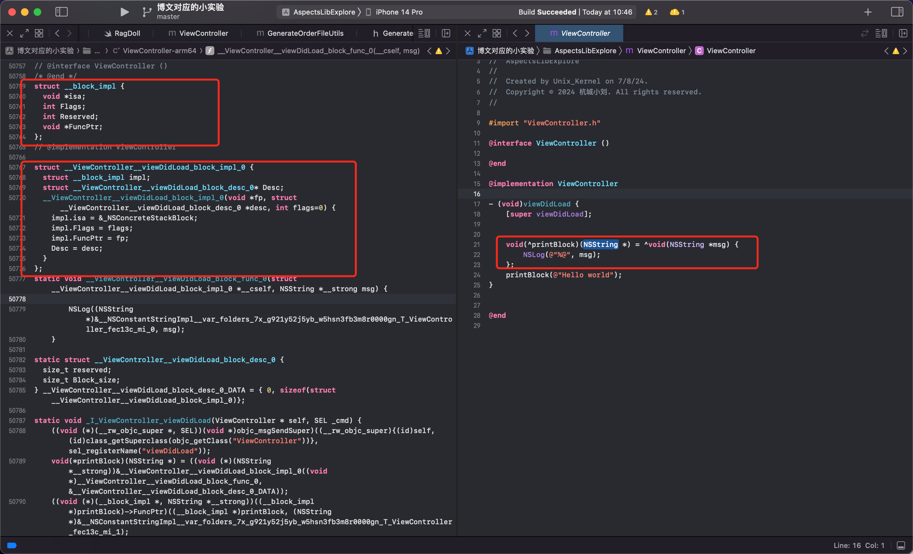
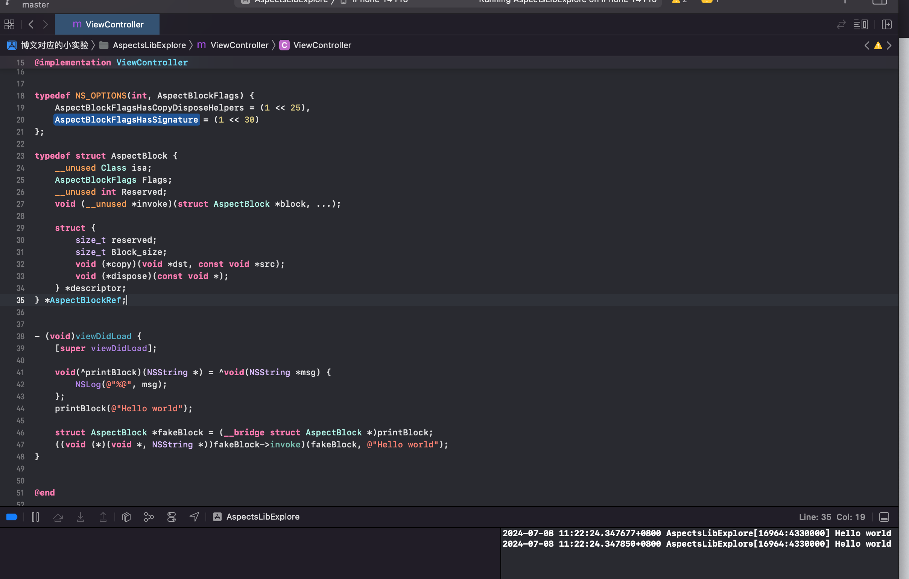
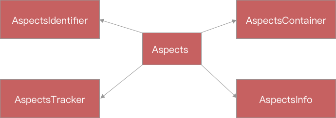
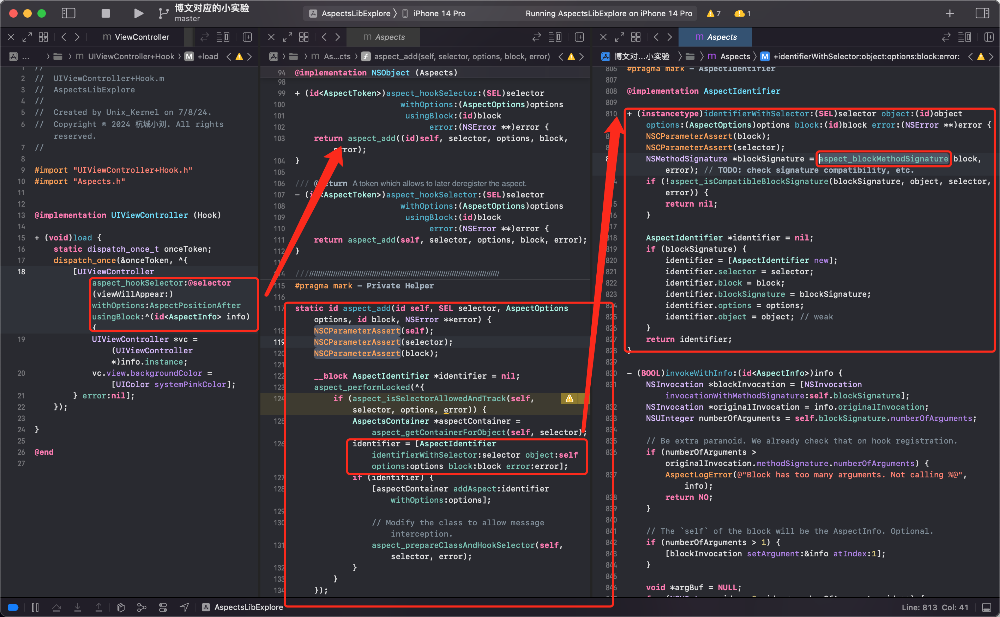
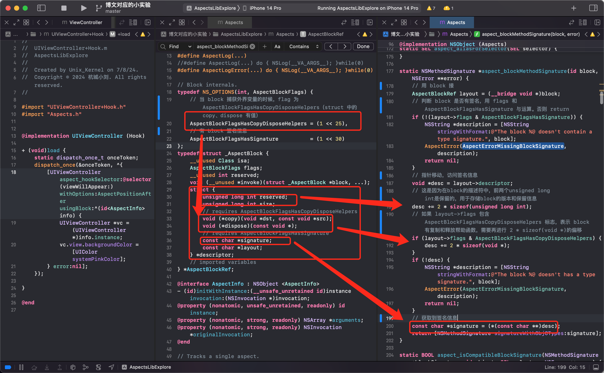
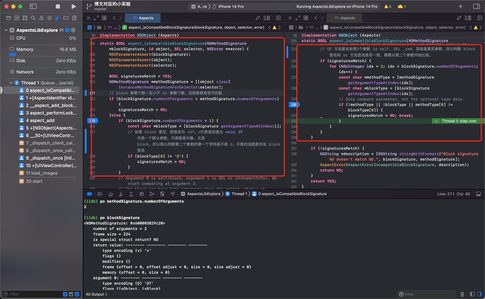
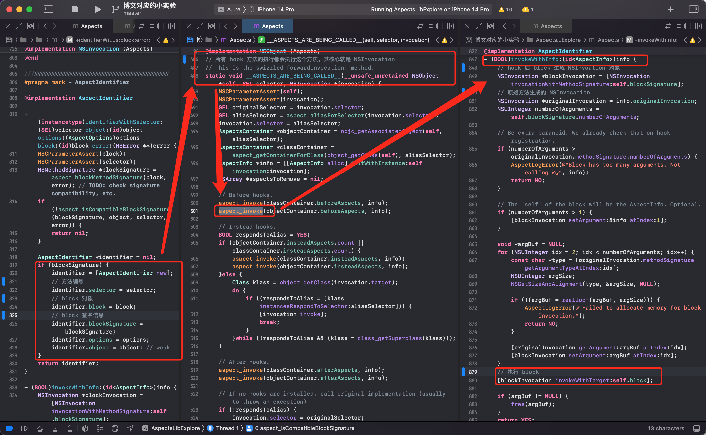
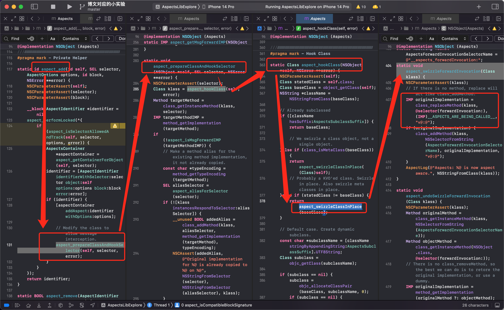
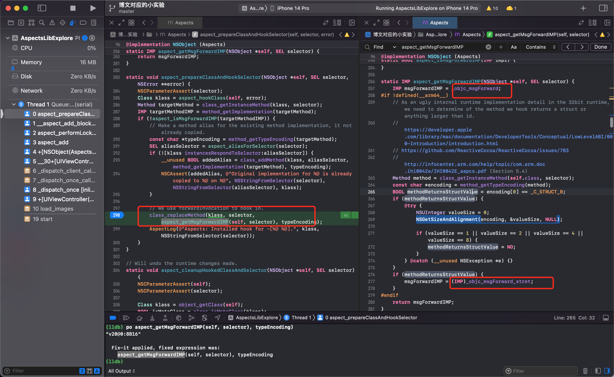
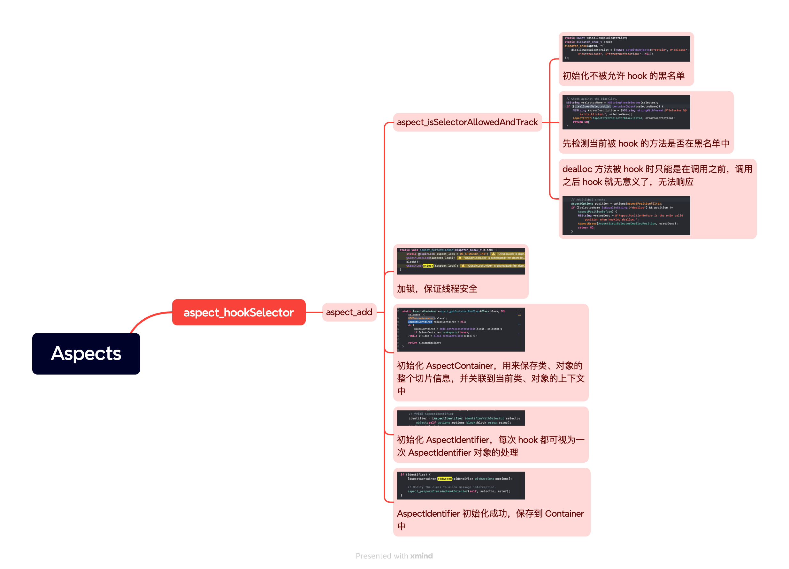

# Aspects

> Aspects 核心原理涉及3个技术点：
>
> - objc_msgForward(触发消息转发机制)
> - NSInvocation
> - block 的本质


## 一、函数指针、指针函数的区别

定义不同：

- 函数指针：本质是一个指针，该指针指向一个函数
- 指针函数：本质是一个函数，函数的返回值是一个指针类型

写法不同

- 函数指针：`int (*fun)(int x,int y)`
- 指针函数：`int* fun(int x,int y)`

用法不同：

- 函数指针

  ```c++
  typedef int (*FuncPtr)(int, int);
  
  int add(int a, int b) {
      return a + b;
  }
  
  FuncPtr addPtr = add;
  int result = addPtr(3, 2);
  ```

- 指针函数

  ```c++
  int (*getAddFunction())(int, int) {
      return add;
  }
  
  int add(int a, int b) {
      return a + b;
  }
  
  int (*addPtr)(int, int) = getAddFunction();
  int result = addPtr(3, 2);
  ```


## 二、block 本质

block 详细探索步骤请查看这篇文章  [block 底层原理](https://github.com/FantasticLBP/knowledge-kit/blob/master/Chapter1%20-%20iOS/1.89.md)。接下去查看建议版本的分析。

第一步：编写一个基础 block

第二步：用 `xcrun --sdk iphoneos clang -arch arm64 -rewrite-objc -fobjc-arc -fobjc-runtime=ios-8.0.0 ViewController.m -o ViewController-arm64.cpp` 转成 c++ 查看原理



分析：可以发现 block 本质就是结构体，和 OC 对象一样，也有 isa 指针。block 传递进去的方法，被包装成 block 的成员变量，是一个叫做 FuncPtr 的函数指针了。

是不是我们可以按照系统定义，来构造一个 struct，承接一个 block，然后发起调用呢？

```objective-c
typedef NS_OPTIONS(int, AspectBlockFlags) {
    AspectBlockFlagsHasCopyDisposeHelpers = (1 << 25),
    AspectBlockFlagsHasSignature = (1 << 30)
};

typedef struct AspectBlock {
    __unused Class isa;
    AspectBlockFlags Flags;
    __unused int Reserved;
    void (__unused *invoke)(struct AspectBlock *block, ...);

    struct {
        size_t reserved;
        size_t Block_size;
        void (*copy)(void *dst, const void *src);
        void (*dispose)(const void *);
    } *descriptor;
} *AspectBlockRef;

void(^printBlock)(NSString *) = ^void(NSString *msg) {
    NSLog(@"%@", msg);
};
printBlock(@"Hello world");

struct AspectBlock *fakeBlock = (__bridge struct AspectBlock *)printBlock;
((void (*)(void *, NSString *))fakeBlock->invoke)(fakeBlock, @"Hello world");
```



思考：我们目前已经用自定义的 struct 来承接了 block 并成功执行了。能否用 NSInvocation 来触发 block？


## 三、NSInvocation 触发 block

一个方法需要成功调用并执行需要3要素：

- 方法名称 `SEL`
- 方法签名（参数个人、参数类型、返回值类型等信息） `Method Type Encoding`
- 方法地址、方法实现 `IMP`

如何从自定义的 block 结构体中获取这些信息呢？





AspectsIdentifier：每做一次方法交换，都会转换为一次 AspectsIdentifier。是核心逻辑。


以一个例子作为源码探索切入口，点击跳转到源码中



可以看到给 NSObject 添加分类，核心 2 个 API。一个对象方法、一个类方法：

```objective-c
+ (id<AspectToken>)aspect_hookSelector:(SEL)selector
                           withOptions:(AspectOptions)options
                            usingBlock:(id)block
                                 error:(NSError **)error;

- (id<AspectToken>)aspect_hookSelector:(SEL)selector
                           withOptions:(AspectOptions)options
                            usingBlock:(id)block
                                 error:(NSError **)error;
```

内部都走到 `aspect_add` 方法中。其中都会生成 `AspectIdentifier` ，看看是如何生成的？


第一步：生成 block 签名。 



QA：从 block 中获取签名的过程是怎么样的？

AspectBlock 结构体里的 descriptor 成员变量依次是：uintptr_t(unsigned long) reserved、uintptr_t(unsigned long) size、copy 函数、dispose 函数、char *signature、char *layout。明明 signature 在第5个成员变量的位置上。为什么源码计算的时候还写了 if 判断？

Block 的 descriptor 描述符头部固定存在两个必选字段：uintptr_t reserved、uintptr_t size，均为指针宽度（8 字节），基础偏移量是 `2 * sizeof(uintptr_t)`。copy、dispose 函数指针是可选字段
- 如果捕获了对象，flags 标记HasCopyDisposeHelpers才会存在，那么还要计算 copy、dispose 2个函数指针大小后，才可以得到签名的地址。即 `+ 2 * sizeOf(void *)`
- 如果没有捕获对象，那么此时得到的就是签名信息所在的内存地址。

第二步：因为我们通过 AOP 给原始方法添加了 block，最后的效果是既可以调用原始方法，又可以调用 block 添加的代码。实现的前提是什么？

比较 block 和 hook 类的方法的签名信息需要 Match。具体逻辑查看注释。



```shell
(lldb) po blockSignature
<NSMethodSignature: 0x600003829c20>
    number of arguments = 2
    frame size = 224
    is special struct return? NO
    return value: -------- -------- -------- --------
        type encoding (v) 'v'
        flags {}
        modifiers {}
        frame {offset = 0, offset adjust = 0, size = 0, size adjust = 0}
        memory {offset = 0, size = 0}
    argument 0: -------- -------- -------- --------
        type encoding (@) '@?'
        flags {isObject, isBlock}
        modifiers {}
        frame {offset = 0, offset adjust = 0, size = 8, size adjust = 0}
        memory {offset = 0, size = 8}
    argument 1: -------- -------- -------- --------
        type encoding (@) '@"<AspectInfo>"'
        flags {isObject}
        modifiers {}
        frame {offset = 8, offset adjust = 0, size = 8, size adjust = 0}
        memory {offset = 0, size = 8}
            conforms to protocol 'AspectInfo'
```


OC 方法签名和 block 方法签名是有区别的

- 比如在 Aspects 框架中，block 方法签名的参数个数是比 oc 方法参数个数少的。oc 方法自带 `id self, SEL _cmd` 2个参数。
- 都使用相同的类型编码系统，但是 block 签名可能包含额外的信息，例如捕获的变量类型。比如上面的 block 方法签名的最后一个参数 `'@"<AspectInfo>"'`，其中的 `AspectInfo` 就代表捕获的变量类型。

比如2个不带参数的 OC 方法签名和 block 方法签名：

- oc 方法签名：`v@:` =  `v`  + `@` +  `:`，返回值 `void`、参数1 `@` 代表对象、参数2 `：` 代表 SEL 类型

- block 方法签名：`v@?` = `v` + `@?`，返回值 `void`、参数1 `@?` 代表既是对象，又是 block





## 四、objc_msgForward

### 1. 如何 hook？

Aspects 的设计很巧妙，可谓骚操作：

- 将待 hook 的方法，和 `objc_msgForward` 进行交换。 `objc_msgForward` 有个神奇的特性：不管对象有没有实现方法，都会触发消息转发流程
- 此时会走 Runtime 的消息转发流程，Aspects 选择了 `forwardInvocation` 流程。且 Aspects 将 `forwardInvocation` 方法指向了 `__ASPECTS_ARE_BEING_CALLED__` 方法。

经历这么一波处理，被 hook 的方法最后都收口到了 `__ASPECTS_ARE_BEING_CALLED__` 方法中。


前面研究过了 `AspectIdentifier`  的逻辑。接下去继续看看后续步骤。



可以看到内部执行 `aspect_prepareClassAndHookSelector`，其内部会调用 `aspect_hookClass`，又会调用 `aspect_swizzleClassInPlace`，最后调用 `aspect_swizzleForwardInvocation` 方法。

```objective-c
static NSString *const AspectsForwardInvocationSelectorName = @"__aspects_forwardInvocation:";
static void aspect_swizzleForwardInvocation(Class klass) {
    NSCParameterAssert(klass);
    // If there is no method, replace will act like class_addMethod.
    IMP originalImplementation = class_replaceMethod(klass, @selector(forwardInvocation:), (IMP)__ASPECTS_ARE_BEING_CALLED__, "v@:@");
    if (originalImplementation) {
        class_addMethod(klass, NSSelectorFromString(AspectsForwardInvocationSelectorName), originalImplementation, "v@:@");
    }
    AspectLog(@"Aspects: %@ is now aspect aware.", NSStringFromClass(klass));
}
```

该方法将被 hook 对象的 `forwardInvocation:` 方法替换为  `__aspects_forwardInvocation:`。

回过头继续看下面的逻辑。



`class_replaceMethod(klass, selector, aspect_getMsgForwardIMP(self, selector), typeEncoding)` 可以实现将被 hook 类的 hook 方法，替换为 `_objc_msgForward` 或者某些版本下需要的 `_objc_msgForward_stret`。


比如 ViewController 的 viewWillAppear hook 流程就是：

`[UIViewController viewWillAppear:]` -> `_objc_msgForward` -> `[UIViewController forwardInvocation:]` -> `__ASPECTS_ARE_BEING_CALLED__` 


### 2. 为什么选择 forwardInvocation?

`objc_msgForward` 会触发 Runtime 的消息转发流程，但消息转发有3个口子：

- resolveInstanceMethod
- forwardingTargetForSelector
- forwardInvocation

为什么只选择了 `forwardInvocation`?

从 Aspects 的功能说起：需要可以替换原方法、或者在方法前后插入一部分逻辑。就这2个诉求是其他2个函数没办法满足的。

#### 1. resolveInstanceMethod

作用：运行时给 SEL 动态绑定 IMP，仅**补充缺失方法**；

局限：

- 只能新增 IMP，无法拦截**已有原生方法**（比如原生存在`viewWillAppear:`，resolve 阶段不会走，因为方法已存在）
- 执行完新增 IMP 后转发流程直接终止，没有办法插入「前置 / 后置环绕回调」
- 拿不到完整调用参数、无法修改参数、不能包装 NSInvocation；

结论：完全不满足 Aspects 多时机（Before/After/Around）Hook 需求，直接排除。


#### 2. forwardingTargetForSelector

作用：返回另一个对象，把消息转发给其他实例

致命缺陷：

- 流程走到这里就**直接截断转发链路**，永远进不到`forwardInvocation:`，无法拿到封装好的 NSInvocation
- 没有办法在原方法执行前后插入自定义逻辑，只能替换消息接收者
- 无法控制原方法调用时机（Around 场景完全做不了）

结论：只能做消息转发代理，不能实现 AOP 切面，Aspects 无法使用。

#### 3. forwardInvocation

只有前两层都不截断转发，才会走到这一步，独有优势：

- 系统自动生成完整`NSInvocation`，包含：target、SEL、全部入参、返回值
- 可自由控制执行顺序：先执行前置 Block → 手动调用原始 IMP → 执行后置 Block
- 支持 Around 场景：把 invocation 传给`AspectInfo`，用户可以手动选择何时执行原方法
- 可读取、修改方法入参 / 返回值
- 统一管理多组 Hook Block，批量调度；

结论：这是唯一能支撑 Aspects 全部 API 能力的转发阶段


### 3. 如何做到基于生命周期的 hook

如何在方法前面添加逻辑、方法替换、方法后面添加逻辑？

#### 1. 数据结构

业务侧使用 Aspects 如下：

```objective-c
[klass aspect_hookSelector:sel withOptions:option usingBlock:^(id<AspectInfo> aspectInfo){
        [fixImpl callWithArguments:@[aspectInfo.instance, aspectInfo.originalInvocation, aspectInfo.arguments]];
    } error:nil];
```

其内部调用的是

```
+ (id<AspectToken>)aspect_hookSelector:(SEL)selector
                      withOptions:(AspectOptions)options
                       usingBlock:(id)block
                            error:(NSError **)error {
    return aspect_add((id)self, selector, options, block, error);
}

static id aspect_add(id self, SEL selector, AspectOptions options, id block, NSError **error) {
    NSCParameterAssert(self);
    NSCParameterAssert(selector);
    NSCParameterAssert(block);

    __block AspectIdentifier *identifier = nil;
    aspect_performLocked(^{
        if (aspect_isSelectorAllowedAndTrack(self, selector, options, error)) {
            AspectsContainer *aspectContainer = aspect_getContainerForObject(self, selector);
            identifier = [AspectIdentifier identifierWithSelector:selector object:self options:options block:block error:error];
            if (identifier) {
                [aspectContainer addAspect:identifier withOptions:options];
                
                // Modify the class to allow message interception.
                aspect_prepareClassAndHookSelector(self, selector, error);
            }
        }
    });
    return identifier;
}

- (void)addAspect:(AspectIdentifier *)aspect withOptions:(AspectOptions)options {
    NSParameterAssert(aspect);
    NSUInteger position = options&AspectPositionFilter;
    switch (position) {
        case AspectPositionBefore:  self.beforeAspects  = [(self.beforeAspects ?:@[]) arrayByAddingObject:aspect]; break;
        case AspectPositionInstead: self.insteadAspects = [(self.insteadAspects?:@[]) arrayByAddingObject:aspect]; break;
        case AspectPositionAfter:   self.afterAspects   = [(self.afterAspects  ?:@[]) arrayByAddingObject:aspect]; break;
    }
}
```

可以看到根据 hook 的时期，分别添加到 self.beforeAspects、self.insteadAspects、self.afterAspects 3个 NSArray 里。


#### 2. 调用

上面分析过，Aspects 的核心工作原理是对要 hook 的对象，hook 其方法，统一替换为 `objc_msgForward` 方法，`objc_msgForward` 方法很特殊，不管方法有没有实现，都会触发运行时消息转发流程。Aspects 根据功能设计，只能选择 Runtime 的 `forwardInvocation`  阶段（上面也分析了为什么 Runtime 的 `resolveInstanceMethod`  和 `forwardingTargetForSelector` 是不满足的）

那么最后调用的时候，`forwardInvocation` 方法被替换为 `__ASPECTS_ARE_BEING_CALLED__` 方法。

```objective-c
 // Before hooks.
aspect_invoke(classContainer.beforeAspects, info);
aspect_invoke(objectContainer.beforeAspects, info);

// Instead hooks.
BOOL respondsToAlias = YES;
if (objectContainer.insteadAspects.count || classContainer.insteadAspects.count) {
    aspect_invoke(classContainer.insteadAspects, info);
    aspect_invoke(objectContainer.insteadAspects, info);
}else {
    Class klass = object_getClass(invocation.target);
    do {
        if ((respondsToAlias = [klass instancesRespondToSelector:aliasSelector])) {
            [invocation invoke];
            break;
        }
    }while (!respondsToAlias && (klass = class_getSuperclass(klass)));
}

// After hooks.
aspect_invoke(classContainer.afterAspects, info);
aspect_invoke(objectContainer.afterAspects, info);
```

上面是省略部分无关逻辑后的代码，可以看到 Aspects 在调用方法的时候，直接按照： Before -> Instead -> After 的顺序进行调用。

```objective-c
#define aspect_invoke(aspects, info) \
for (AspectIdentifier *aspect in aspects) {\
    [aspect invokeWithInfo:info];\
    if (aspect.options & AspectOptionAutomaticRemoval) { \
        aspectsToRemove = [aspectsToRemove?:@[] arrayByAddingObject:aspect]; \
    } \
}
```

aspect_invoke 宏内部，直接遍历 AspectIdentifier 数组，然后调用 NSInvocation 的 invoke 方法。


### 4. `_objc_msgForward` 还是 `_objc_msgForward_stret`

第一类：32 位架构（armv7 /i386）

两套函数完全独立，必须区分使用：

- 方法返回类型不是大结构体 → 替换 IMP 用 `_objc_msgForward`
- 方法返回 CGRect、CGSize 自定义大 struct 等超过 8 字节结构体时，必须用 `objc_msgForward_stret`

如果混用：栈布局错乱、参数读取错位、直接野指针崩溃。

第二类：ARM64

```c++
#if !defined(__arm64__)
|| impl == (IMP)_objc_msgForward_stret
#endif
```

ARM64 ABI 统一了结构体返回规则：无论结构体大小，全部通过通用寄存器传递，**不再区分 stret 版本**，系统不再提供 `_objc_msgForward_stret`，所以代码里用宏屏蔽掉这段判断。

### 5.  hook 当前对象和该类的全局对象

对对象、类的方法 hook 最后都会走到下面的逻辑：

```objective-c
/**
  根据传入对象区分两种Hook模式：
  1. 类方法Hook / KVO动态子类场景：原地swizzle类，全局生效（所有实例）
  2. 普通实例对象Hook：创建动态子类，仅当前单个对象生效
  @param self 待hook的实例对象 / 类对象(Class)
  @param error 错误信息输出
  @return 处理后的目标类（动态子类/原类/元类）
 */
static Class aspect_hookClass(NSObject *self, NSError **error) {
    NSCParameterAssert(self);
    // statedClass：对外暴露的类名，调用 [self class] 会被hook隐藏动态子类
	Class statedClass = self.class;
    // baseClass：读取对象真实isa，拿到底层实际类（KVO子类/Aspects动态子类/元类）
	Class baseClass = object_getClass(self);
    // 真实底层类的类名字符串
	NSString *className = NSStringFromClass(baseClass);

    // 分支1：当前底层类已经是Aspects动态子类（后缀 _Aspects_），直接复用
	if ([className hasSuffix:AspectsSubclassSuffix]) {
		return baseClass;

    // 分支2：baseClass是元类，说明本次是【类方法全局Hook】
    // 调用入口：[XXXClass aspect_hookSelector:]，self是Class元类对象
	}else if (class_isMetaClass(baseClass)) {
        // 原地修改元类forwardInvocation，所有该类实例全局生效
        return aspect_swizzleClassInPlace((Class)self);

    // 分支3：对外展示类 != 真实isa类，说明对象已经被KVO生成动态子类 NSKVONotifying_XXX
    // 不能嵌套双层动态子类，直接在现有KVO子类原地交换forwardInvocation，全局生效
    }else if (statedClass != baseClass) {
        return aspect_swizzleClassInPlace(baseClass);
    }

    // ====================== 默认分支：普通实例对象，创建专属动态子类（仅当前对象生效） ======================
    // 拼接动态子类名称：原类名 + _Aspects_ 后缀
	const char *subclassName = [className stringByAppendingString:AspectsSubclassSuffix].UTF8String;
    // 先查询runtime是否已存在该动态子类，避免重复分配
	Class subclass = objc_getClass(subclassName);

    // 不存在则新建动态子类
	if (subclass == nil) {
        // 分配未注册的子类，父类为当前真实baseClass，无额外实例变量空间
		subclass = objc_allocateClassPair(baseClass, subclassName, 0);
		if (subclass == nil) {
            NSString *errrorDesc = [NSString stringWithFormat:@"objc_allocateClassPair failed to allocate class %s.", subclassName];
            AspectError(AspectErrorFailedToAllocateClassPair, errrorDesc);
            return nil;
        }

        // 给动态子类替换forwardInvocation: 实现，统一接入Aspects调度入口 __ASPECTS_ARE_BEING_CALLED__
		aspect_swizzleForwardInvocation(subclass);
        // 重写实例方法 -(Class)class，对外返回原始类名，隐藏动态子类
		aspect_hookedGetClass(subclass, statedClass);
        // 重写元类的 +(Class)class，类方法调用class也隐藏子类
		aspect_hookedGetClass(object_getClass(subclass), statedClass);
        // 将动态子类注册到Runtime，完成初始化，才能绑定给对象isa
		objc_registerClassPair(subclass);
	}

    // 修改当前对象的isa指针，指向新建的_Aspects_动态子类
    // 仅影响这一个对象，同类型其他实例不受Hook影响
	object_setClass(self, subclass);
	return subclass;
}
```


### 6. hook 可取消

调用 hook api 后，该方法返回一个遵循 AspectToken 协议的对象。且 AspectToken 协议里包含一个 remove 方法。

```objective-c
/// Opaque Aspect Token that allows to deregister the hook.
@protocol AspectToken <NSObject>

/// Deregisters an aspect.
/// @return YES if deregistration is successful, otherwise NO.
- (BOOL)remove;

@end

+ (id<AspectToken>)aspect_hookSelector:(SEL)selector
                      withOptions:(AspectOptions)options
                       usingBlock:(id)block
                            error:(NSError **)error {
    return aspect_add((id)self, selector, options, block, error);
}
```

所以 Aspects 支持 hook 后取消 hook 的能力。比如下面的代码

```objective-c
id<AspectToken> canRemoveHook = [klass aspect_hookSelector:sel withOptions:option usingBlock:^(id<AspectInfo> aspectInfo){
        [fixImpl callWithArguments:@[aspectInfo.instance, aspectInfo.originalInvocation, aspectInfo.arguments]];
    } error:nil];
    
[canRemoveHook remove];
```

remove 的实现本质上是 `AspectIdentifier` 的能力

```objective-c
- (BOOL)remove {
    return aspect_remove(self, NULL);
}

static BOOL aspect_remove(AspectIdentifier *aspect, NSError **error) {
    NSCAssert([aspect isKindOfClass:AspectIdentifier.class], @"Must have correct type.");

    __block BOOL success = NO;
    aspect_performLocked(^{
        id self = aspect.object; // strongify
        if (self) {
            AspectsContainer *aspectContainer = aspect_getContainerForObject(self, aspect.selector);
            success = [aspectContainer removeAspect:aspect];

            aspect_cleanupHookedClassAndSelector(self, aspect.selector);
            // destroy token
            aspect.object = nil;
            aspect.block = nil;
            aspect.selector = NULL;
        }else {
            NSString *errrorDesc = [NSString stringWithFormat:@"Unable to deregister hook. Object already deallocated: %@", aspect];
            AspectError(AspectErrorRemoveObjectAlreadyDeallocated, errrorDesc);
        }
    });
    return success;
}
```

核心逻辑为：

```objective-c
/**
 清理指定对象+SEL对应的Runtime劫持改造，仅当该SEL下所有Hook全部移除后才会彻底还原类/方法
 1. 恢复目标SEL原始IMP（若当前是转发劫持状态）
 2. 注销全局跟踪标记
 3. 容器无任何钩子时：销毁容器、还原实例isa/撤销类原地swizzle
 @param self 被Hook的对象(实例/类元类)
 @param selector 被劫持的目标方法SEL
 */
static void aspect_cleanupHookedClassAndSelector(NSObject *self, SEL selector) {
    // 入参合法性断言，对象与SEL不能为nil
    NSCParameterAssert(self);
    NSCParameterAssert(selector);

    // 获取当前对象实际isa指向的类
	Class klass = object_getClass(self);
    // 判断是否是元类（代表当前Hook的是类方法）
    BOOL isMetaClass = class_isMetaClass(klass);
    if (isMetaClass) {
        // 类方法Hook场景：klass直接赋值为元类本身
        klass = (Class)self;
    }

    // ========== 第一块：如果当前SEL被劫持为消息转发，恢复原始方法IMP ==========
    // 获取klass上目标selector的原生Method（不向上遍历父类）
    Method targetMethod = class_getInstanceMethod(klass, selector);
    // 取出当前该SEL挂载的函数指针IMP
    IMP targetMethodIMP = method_getImplementation(targetMethod);
    // 判断当前IMP是否是Aspects劫持用的 _objc_msgForward
    if (aspect_isMsgForwardIMP(targetMethodIMP)) {
        // 取出方法参数/返回值类型编码，替换IMP时必须保持一致防止崩溃
        const char *typeEncoding = method_getTypeEncoding(targetMethod);
        // 根据原SEL生成备份原始IMP用的别名SEL
        SEL aliasSelector = aspect_aliasForSelector(selector);
        // 从当前类方法列表取出预先备份原始实现的别名Method
        Method originalMethod = class_getInstanceMethod(klass, aliasSelector);
        // 拿到Hook前业务原生的原始函数指针
        IMP originalIMP = method_getImplementation(originalMethod);
        // 强断言：正常流程一定存在备份别名方法，丢失则说明类结构被外部篡改
        NSCAssert(originalMethod, @"Original implementation for %@ not found %@ on %@", NSStringFromSelector(selector), NSStringFromSelector(aliasSelector), klass);

        // 覆盖替换：把目标SEL的IMP从转发函数还原为业务原始实现，撤销消息转发劫持
        class_replaceMethod(klass, selector, originalIMP, typeEncoding);
        AspectLog(@"Aspects: Removed hook for -[%@ %@].", klass, NSStringFromSelector(selector));
    }

    // 从全局哈希表注销「对象+SEL」的Hook跟踪标记
    aspect_deregisterTrackedSelector(self, selector);

    // ========== 第二块：获取存储所有Hook回调的容器，判断是否还有剩余钩子 ==========
    // 通过关联对象取出 当前对象+目标SEL 专属的切面容器
    AspectsContainer *container = aspect_getContainerForObject(self, selector);
    // hasAspects判定：before/instead/after三组数组全部为空才为NO
    if (!container.hasAspects) {
        // 容器内无任何Hook，销毁关联对象，释放所有AspectIdentifier与Block内存
        aspect_destroyContainerForObject(self, selector);

        // 区分两种Runtime改造方式：动态子类 / 原地Swizzle
        NSString *className = NSStringFromClass(klass);
        // 分支1：实例Hook场景，klass是运行时动态生成的_Aspects_临时子类
        if ([className hasSuffix:AspectsSubclassSuffix]) {
            // 剥离后缀，还原原始业务类名
            Class originalClass = NSClassFromString([className stringByReplacingOccurrencesOfString:AspectsSubclassSuffix withString:@""]);
            NSCAssert(originalClass != nil, @"Original class must exist");
            // 修改对象isa指针，从临时子类切回原始类，撤销动态子类劫持
            object_setClass(self, originalClass);
            AspectLog(@"Aspects: %@ has been restored.", NSStringFromClass(originalClass));

            // 不主动销毁动态子类：无法确认是否还有其他实例在使用该子类，销毁会野指针崩溃
            //objc_disposeClassPair(object.class);
        }else {
            // 分支2：类/元类原地Swizzle场景，未创建临时子类
            if (isMetaClass) {
                // 元类Hook（类方法），撤销元类上的swizzle缓存标记
                aspect_undoSwizzleClassInPlace((Class)self);
            }else if (self.class != klass) {
                // 普通类原地swizzle，清理类内部Hook标记缓存
            	aspect_undoSwizzleClassInPlace(klass);
            }
        }
    }
    // 若container.hasAspects=YES：仅注销全局标记，不还原IMP、不销毁容器、不修改isa
}
```

### 7. Aspects 的 bug

看了上面的 hook 取消逻辑，发现存在 bug，问题核心在于 **aspect_cleanupHookedClassAndSelector** 方法里的实现。

```objective-c
if (aspect_isMsgForwardIMP(targetMethodIMP)) {
    // 取出方法参数/返回值类型编码，替换IMP时必须保持一致防止崩溃
    const char *typeEncoding = method_getTypeEncoding(targetMethod);
    // 根据原SEL生成备份原始IMP用的别名SEL
    SEL aliasSelector = aspect_aliasForSelector(selector);
    // 从当前类方法列表取出预先备份原始实现的别名Method
    Method originalMethod = class_getInstanceMethod(klass, aliasSelector);
    // 拿到Hook前业务原生的原始函数指针
    IMP originalIMP = method_getImplementation(originalMethod);
    // 强断言：正常流程一定存在备份别名方法，丢失则说明类结构被外部篡改
    NSCAssert(originalMethod, @"Original implementation for %@ not found %@ on %@", NSStringFromSelector(selector), NSStringFromSelector(aliasSelector), klass);

    // 覆盖替换：把目标SEL的IMP从转发函数还原为业务原始实现，撤销消息转发劫持
    class_replaceMethod(klass, selector, originalIMP, typeEncoding);
    AspectLog(@"Aspects: Removed hook for -[%@ %@].", klass, NSStringFromSelector(selector));
}
```

举个例子：

一个测试类为 TestObject

```objective-c
// TestObject.h
#import <Foundation/Foundation.h>
@interface TestObject : NSObject
- (void)testFunc;
@end

// TestObject.m
#import "TestObject.h"
@implementation TestObject
- (void)testFunc {
    NSLog(@"原生方法执行");
}
@end
```

场景复现

```objective-c
// 1. 创建两个同类型实例 A1、A2
TestObject *A1 = [[TestObject alloc] init];
TestObject *A2 = [[TestObject alloc] init];

id<AspectToken> tokenA1, tokenA2;
NSError *err;

// 2. 给A1 hook testFunc，保存tokenA1
tokenA1 = [A1 aspect_hookSelector:@selector(testFunc)
                       withOptions:AspectPositionBefore
                        usingBlock:^(id<AspectInfo> info) {
    NSLog(@"【A1的Hook执行】");
} error:&err];

// 3. 给A2 hook testFunc，保存tokenA2
tokenA2 = [A2 aspect_hookSelector:@selector(testFunc)
                       withOptions:AspectPositionBefore
                        usingBlock:^(id<AspectInfo> info) {
    NSLog(@"【A2的Hook执行】");
} error:&err];

NSLog(@"===== remove前调用A1.testFunc =====");
[A1 testFunc];
// 预期输出：
// 【A1的Hook执行】
// 原生方法执行

NSLog(@"===== remove前调用A2.testFunc =====");
[A2 testFunc];
// 预期输出：
// 【A2的Hook执行】
// 原生方法执行

// 4. 关键操作：移除A2的Hook
[tokenA2 remove];

NSLog(@"===== 移除A2 hook后，调用A2.testFunc =====");
[A2 testFunc];
// 预期输出（正常）：仅打印「原生方法执行」，A2钩子失效

NSLog(@"===== 移除A2 hook后，调用A1.testFunc（Bug触发点） =====");
[A1 testFunc];
// 【Bug现象】只会打印「原生方法执行」，【A1的Hook完全不执行】
// 设计预期：A1还有有效Hook，应该打印【A1的Hook执行】+原生方法
```

分析：

阶段 1：A1 hook

1. 运行时创建动态子类 `TestObject_Aspects_`
2. 伪装，修改 `A1.isa = TestObject_Aspects_`
3. 在子类新增别名 SEL `testFunc_aspects_alias`，备份原生 `testFunc` IMP
4. 将子类 `testFunc` IMP 替换为 `_objc_msgForward`
5. A1 绑定独立 `AspectsContainer`，存入 A1 的 Hook 记录

阶段 2：A2 hook

1. 复用已存在的 `TestObject_Aspects_`，修改 `A2.isa = TestObject_Aspects_`
2. A2 创建**独立容器**，存入 A2 的 Hook 记录
3. 子类 `testFunc` IMP 保持 `_objc_msgForward`，无改动

阶段 3：执行 `[tokenA2 remove]`（触发 Bug 核心逻辑）

1. 从 A2 专属容器删除 A2 的 Hook，A2 容器内无任何钩子
2. 进入 `aspect_cleanupHookedClassAndSelector(A2, @selector(testFunc))`
3. `klass = TestObject_Aspects_`（A1、A2 共用子类）
4. 判断当前 testFunc IMP 是转发函数，执行 `class_replaceMethod(TestObject_Aspects_, @selector(testFunc), 原始IMP, typeEncoding);` 直接修改共用子类的方法实现，全局覆盖
5. 销毁 A2 的容器，不修改 A1 的容器（A1 容器仍存有效 Hook）

阶段 4：调用 `[A1 testFunc]`，Bug 显现

1. A1.isa 依旧指向 `TestObject_Aspects_
2. 子类 `testFunc` IMP 已恢复原生实现，不再是 `_objc_msgForward`
3. 消息不会进入 `forwardInvocation:`，不会读取 A1 容器里的 Hook
4. 仅执行原生方法，A1 的 Hook 完全丢失

解决思路也很简单，在 remove 的时候，不再执行被 hook 方法的 IMP 还原


## 五、总结

Aspects 是 Runtime 技术应用的一个经典库，处理好核心逻辑后，也做了一些黑名单、线程安全等的保护。也有一些类似日志回放功能的处理。




