# 深入理解 iOS 异常处理：从 c++ 异常模型到 LLVM LandingPad 的全链路防护

> 安全气垫是端上一个老生常谈的话题，技术方案已经是好多年前的产物。本文聊2个问题：
1. 传统技术实现是 hook 可能会抛异常的方法，在替换的方法内，添加 try catch 或者校验异常参数，但问题是：如果新增一种防护类型，都需要代码修改和版本发布，拓展性很差。有没有一种更优雅的方式呢？
2. 技术问题解决后，策略方面存在的问题是：不同公司对于安全气垫在拦截到异常的时候，“做与不做”策略的判断不同。比如数组索引越界的时候要返回一个错误位置的值吗？会不会产生业务异常？要一刀切吗？
那么本文就尝试回答下这两个问题

## 一、经典场景
### 1. Weex 源码的安全设计
Weex 源码中，设计了一个 `WXThreadSafeMutableDictionary`。在字典操作的地方使用锁：
```Objective-C
- (void)setObject:(id)anObject forKey:(id<NSCopying>)aKey
{
    id originalObject = nil; // make sure that object is not released in lock
    @try {
        pthread_mutex_lock(&_safeThreadDictionaryMutex);
        originalObject = [_dict objectForKey:aKey];
        [_dict setObject:anObject forKey:aKey];
    }
    @finally {
        pthread_mutex_unlock(&_safeThreadDictionaryMutex);
    }
    originalObject = nil;
}
```
这么写的价值：**解锁逻辑「绝对执行」，彻底避免死锁**
这是 `@try-finally` 最核心的价值 ——无论 try 块内发生什么（正常执行、提前 return、抛异常），finally 块的解锁逻辑一定会执行

对比无 try-finally 的写法
```Objective-C
// Bad: 若setObject抛异常，unlock不会执行→死锁
pthread_mutex_lock(&_mutex);
[_dict setObject:anObject forKey:aKey];
pthread_mutex_unlock(&_mutex); 
```
问题：`[_dict setObject:anObject forKey:aKey]` 可能抛异常（比如 aKey = nil 时会触发 NSInvalidArgumentException），若没有 finally，锁会被永久持有→其他线程调用 lock 时死锁，整个字典无法再操作。

设计优点：
- `@try-finallly`：即使 try 内逻辑出错，finally 也会执行 pthread_mutex_unlock，保证锁最终释放，这是**线程安全的「兜底保障」**
- 注意，不是 `try...catch...finally`: 如果加了 catch 逻辑，则字典的 key 为 nil 产生的崩溃也会被捕获掉，这属于不符合预期的行为。因为 key 为 nil 产生的原因太多了，可能是业务代码异常，也可能是数据异常，也可能是逻辑错误，如果一刀切直接用 `try...catch...finally` 捕获了异常，但是没有配置异常的收集、上报、处理逻辑，属于边界不清晰，本质是为了解决加解锁不匹配而可能带来的线程安全问题，却"多管闲事"，把字典 key 为 nil 本该向上跑的异常而卡住了。

### 2. property 的多线程竞态问题
运行下面的代码会 Crash，报错信息如下
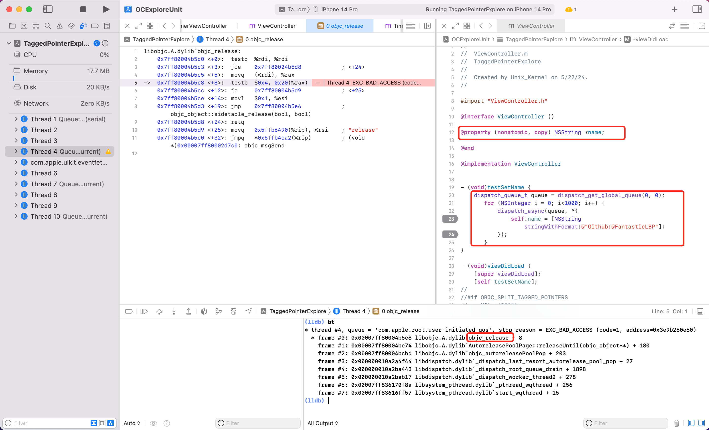
可以看到是由于 `objc_release` 方法造成 crash。


不仔细想可能发现不了问题，看到 `objc_release` 就会想到是在多线程情况下 NSString 的 setter 方法内，ARC 代码经过编译器最后会按照 MRC 去运行。所以 Setter 类似下面代码。

核心原因是 ARC 下针对 nonatomic 修饰的 property，经过 clang 编译为 MRC 模式下的代码，判断新旧值地址不相等，则会对新值 retain，旧值 relase，多线程环境下可能存在对该 property 竞态处理，容易出现 crash 问题。

```objectivec
-(void)setName:(NSString *)name {
    if (_name!=name) {	// 避免对同一个对象多次复制
        [_name release];	// 释放旧值
        _name = [name copy]; // 拷贝并持有新值
    }
}
```

核心就是：多线程资源竞态问题，那怎么改？

改法1：将 property 改为 **atomic** 修饰的。

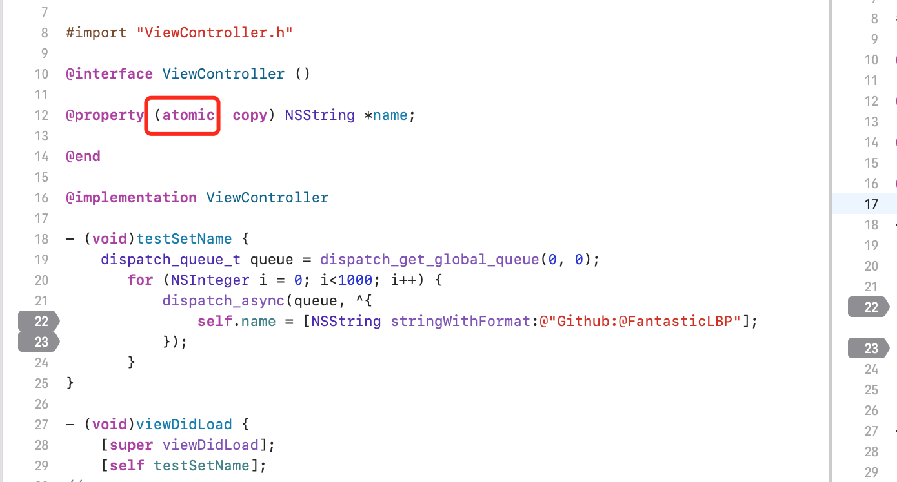

改法2：对 name 加锁

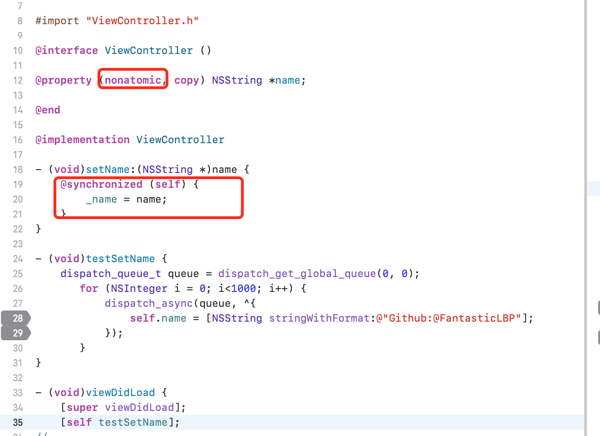


Demo2

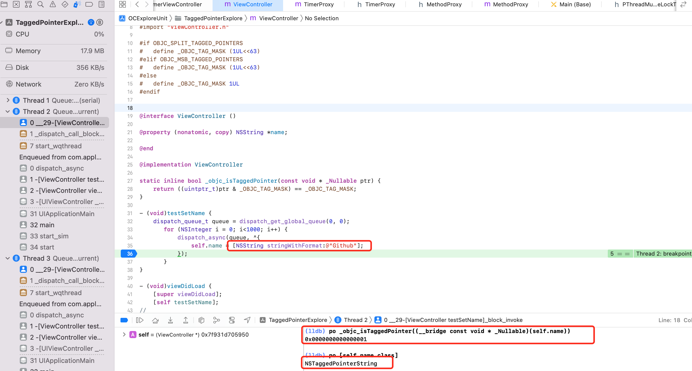


同样的代码字符串变短居然不 crash 了？因为命中 Tagged Pointer 逻辑了，查看类型是 `NSTaggedPointerString`

本问题本质是：

- ARC 代码在编译后真正运行阶段是走 MRC 的，strong、copy 修饰的属性，内部的 setter 实现都会 release 旧的值，copy/retain 新的

  ```objective-c
  - (void)setName:(name) {
  	if (!_name != name) {
  		[_name release];
  		_name = [name copy];
  	}
  }
  ```
- 多线程情况下访问 setter 需要加锁
- 字符串在 NSTaggedPointerString  情况下，不存在像 OC 对象的 setter 方法内的 release、copy 操作。所以多线程下不会 crash


### 3. iOS 26 Property crash 问题

之前偶现的问题，通过 1000次模拟，才偶现，但 iOS 在 iOS 26 引入了新的设计，针对 nonatomic 修饰的非 TaggedPointer Property 增加了哨兵值 0x400000000000bad0 ，而该值可能会被另一个并发访问此属性的线程中被读取，如果代码因访问这个哨兵值而崩溃，则表明正在访问的属性存在线程安全问题。crash 堆栈栈顶可能是 objc_retain 或 objec_release 方法。

核心原因是 ARC 下针对 nonatomic 修饰的 property，经过 clang 编译为 MRC 模式下的代码，判断新旧值地址不相等，则会对新值 retain，旧值 relase，多线程环境下可能存在对该 property 竞态处理，容易出现 crash 问题，之前不一定暴露问题，iOS 26 系统通过哨兵暴露出来了。但只有非 TaggedPointer 对象才会存在，哨兵对象这种设计是系统非常常见的处理方式，比如 AutoreleasePool、Guard Malloc、0xdeadbeef 等经典设计，用一个明确的非法值，把原本隐蔽、偶发的内存 / 线程问题，变成稳定可复现的崩溃，强制开发者修复。

那么针对线上用户怎么办？

利用 fishhook 的能力，hook objc_retain 方法或者 hook objc_retain 方法：
- objc_release: 检测到参数为哨兵地址时，直接返回，不执行任何操作。
- objc_retain：检测到参数为哨兵地址时，中断原始 retain 流程，并向上层返回 nil。

### 4. 编译器对类簇 slowpath 的优化

```objective-c
- (void)testArrayOutOfBounds {
    NSArray *arr = @[@1, @2, @3];
    id obj = arr[10]; // 越界
    NSLog(@"obj = %@", obj);
}

- (void)testStringOutOfBounds {
    NSString *str = @"hello";
    unichar c = [str characterAtIndex:10]; // 越界
    NSLog(@"c = %c", c);
}

- (void)testOrderedSetOutOfBounds {
    NSOrderedSet *set = [NSOrderedSet orderedSetWithObjects:@1, @2, @3, nil];
    id obj = [set objectAtIndex:10]; // 越界
    NSLog(@"obj = %@", obj);
}
分别输出：
2   CoreFoundation                      0x00007ff8004b0019 -[__NSCFString characterAtIndex:].cold.1 + 0

4   CoreFoundation                      0x00007ff800360128 -[__NSCFString characterAtIndex:] + 95


2   CoreFoundation                      0x00007ff8004b0019 -[__NSCFString characterAtIndex:].cold.1 + 0
3   CoreFoundation                      0x00007ff800309dd2 +[__NSOrderedSetI automaticallyNotifiesObserversForKey:] + 0
```

模拟产生 NSException 的时候看到如下报错信息。为什么 NSArray、NSString、NSSet 会产生 **-[__NSCFString characterAtIndex:]** 这样的报错信息？

`NSArray（__NSArrayI）` 越界的代码

```objective-c
// CoreFoundation/Collections/CFArray.c
CF_INLINE CFTypeRef __CFArrayGetAtIndex(CFArrayRef array, CFIndex idx) {
    if (__builtin_expect(idx >= array->count, 0)) {  // fastpath：正常走这里
        __CFArrayRangeException(array, idx); // slowpath：越界，cold
    }
    return array->values[idx];
}

// slowpath 函数，标记 cold
__attribute__((cold, noinline))
static void __CFArrayRangeException(CFArrayRef array, CFIndex idx) {
    CFStringRef reason = CFSTR("*** -[__NSArrayI objectAtIndex:]: index %ld beyond bounds");
    CFThrowRangeException(reason, idx); // 统一抛异常
}
```

`NSString（__NSCFString）` 越界的代码

```objective-c
// CoreFoundation/Strings/CFString.c
CF_INLINE UniChar __CFStringGetCharAtIndex(CFStringRef str, CFIndex idx) {
    if (__builtin_expect(idx >= str->length, 0)) { // fastpath
        __CFStringRangeException(str, idx); // slowpath，cold
    }
    return str->chars[idx];
}

// slowpath，同样 cold、noinline
__attribute__((cold, noinline))
static void __CFStringRangeException(CFStringRef str, CFIndex idx) {
    CFStringRef reason = CFSTR("*** -[__NSCFString characterAtIndex:]: index %ld beyond bounds");
    CFThrowRangeException(reason, idx); // 和数组一模一样的抛异常
}
```

分析：

- **`__builtin_expect(..., 0)`**：明确告诉编译器 **这个分支极少走（slowpath）**

- **`__attribute__((cold, noinline))`**：强制标记为 **cold 函数（冷路径）**，不内联，单独放 `.cold`段

- **`CFThrowRangeException`**：三个容器 **最终调用同一个底层抛异常函数**，参数格式都一样。

- 类簇的设计：公开的类是“壳”，是接口声明。真正干活的是**私有子类**

  ```objective-c
  // 公开头文件（接口）
  @interface NSArray : NSObject <NSCopying, NSMutableCopying>
  - (id)objectAtIndex:(NSUInteger)index;
  @end
  ```

  比如 NSArray 是接口壳，真正干活的是  `__NSArrayI`（不可变数组）

为什么 crash 堆栈统一显示 `__NSCFString characterAtIndex:.cold.1`？

**ICF：Identical Code Folding（相同代码折叠）**。

1. LLVM 会把 把 **所有 `cold` 函数（slowpath）** 单独收集，逐字节比较函数体，**完全相同的函数，合并成一份，只留一个符号**

2. 谁的符号被保留？由**编译顺序决定**。CoreFoundation 编译时：

   - **NSString（CFString.c）最先编译**
   - 然后是 NSArray（CFArray.c）
   - 最后是 NSOrderedSet（CFOrderedSet.c）

   **三个 cold 越界函数完全相同，ICF 只保留第一个：`__CFStringRangeException`**

   → 对应 Objective-C 符号：`-[__NSCFString characterAtIndex:].cold.1`

3. 所以看到 `-[__NSCFString characterAtIndex:].cold.1` 并不代表一定是 NSString 越界，可能是 **任意容器（Array/String/OrderedSet）越界**，但由于 ICF，**所有 cold 越界函数都指向 NSString 的那个合并符号**

4. 怎么在崩溃堆栈里 “识破” 真实原因？别看函数名，看 **exception reason 字符串：reason 字符串不会被 ICF 改，永远真实**


QA：类簇的设计的优点是什么？

- 可以将抽象基类背后的复杂细节隐藏起来。
- 程序员不会需要记住各种创建对象的具体类实现，简化了开发成本，提高了开发效率。
- 便于进行封装和组件化。
- 减少了 if‑else 这样缺乏扩展性的代码。
- 增加新功能支持不影响其他代码。


## 二、传统安全气垫的问题

第一个问题：传统的安全气垫是通过 Method Swizzling 替换 Objective-C 可能会抛异常的系统方法，注入 try-catch 或者校验异常参数，防御已知的、可枚举的崩溃风险点，为 App 提供基础的稳定性保障。但这个方式的问题是拓展不方便，每增加一种新的类型，都需要为其增加 hook 代码和对应的处理逻辑。且需要升级安全气垫 SDK，宿主工程可能也不一定主动愿意去升级（SDK 升级需要对应的测试成本，不能信任 SDK 升级）

第二个问题：另外，对于捕获的异常要设置一个默认值吗？给默认值一些常见会不会产生客诉和资损？

假设我们有一个通用的头像设置方法：

```Objective-C
- (void)setAvatarWithURL:(NSURL *)url {
    // 下载头像
    NSData *data = [NSData dataWithContentsOfURL:url];
    // 解码图片
    UIImage *image = [UIImage imageWithData:data];
    // 设置头像
    self.avatarImageView.image = image;
}
```

这个方法在两个地方被调用：
调用链路 A：首页用户头像展示

```Objective-c
-[HomeViewController viewDidLoad] → -[UserCell setUser:] → -[UserCell setAvatarWithURL:]
```

调用链路 B：用户上传头像后保存到本地

```Objective-c
-[ProfileViewController uploadAvatarSuccess:] → -[UserManager saveAvatar:] → -[UserCell setAvatarWithURL:]
```

如果 imageWithData: 因为图片格式错误抛出异常：
对于调用链路 A：头像展示失败，最多就是用户看不到头像，完全可以兜底，返回 nil，程序继续运行
对于调用链路 B：头像保存失败，如果我们兜底返回 nil，会导致用户以为上传成功了，但实际上本地没有保存，这是严重的业务错误，绝对不能兜底。

所以存在2个问题：

- **防护系统如何增强防护能力，可以以一种更加底层、通用的方式拦截所有奔溃。不用为新增一种未曾见过的奔溃再去写监控代码，推广和引导业务方升级，这个事情阻力很大**
- **有些兜底没有副作用，有些兜底会产生资损、客诉。这个要不要防护、防护后的默认值不能一刀切，需要有个标准的 workflow 让业务方去决策。做到符合预期的“兜住”**


## 三、更全面、安全的防护系统

### 1. 核心技术卡点

若不考虑根因，对 NSException 最常规的防护手段是在其调用链路中添加 try-catch，以捕获异常并恢复程序的执行。一个常见的异常流程如下图所示。

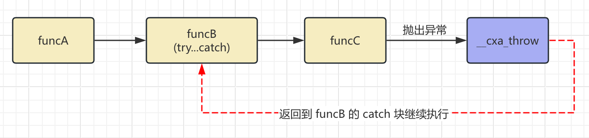

try-catch 的本质是一种控制流转移：它将程序的执行点从异常抛出位置，安全地跳转回上层调用栈。那么，当调用链路不存在 try-catch 时，我们能否在程序即将崩溃的最后时刻，通过运行时干预，手动模拟这一控制流转移，将执行权交还给上层函数？

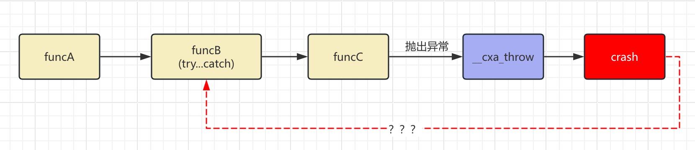

###  2. try...catch 原理

#### 1. 2层 try 的设计

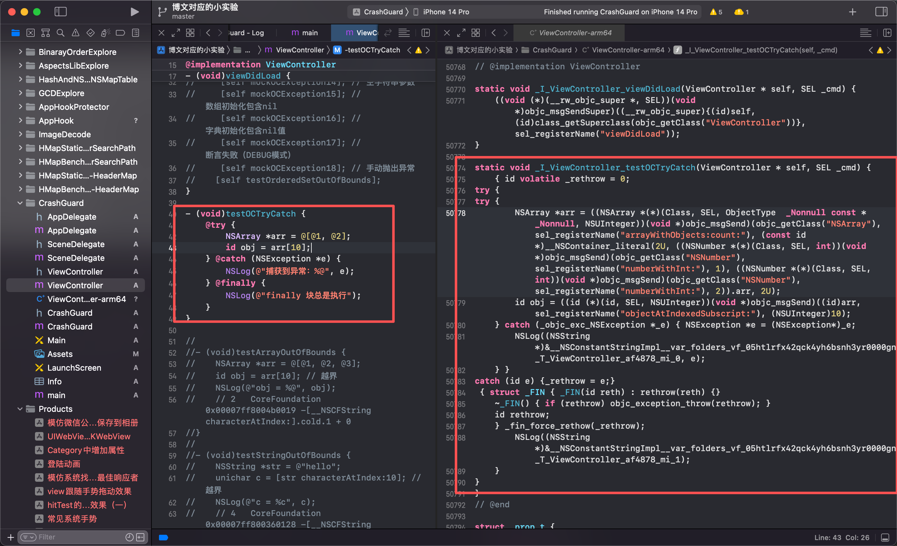

将右侧的代码格式化一下

```c++
static void _I_ViewController_testTryCatch(ViewController * self, SEL _cmd) {
    // 外层作用域：用于保存需要重新抛出的异常
    id volatile _rethrow = 0;

    // 【第二层 try】：捕获所有类型的异常
    try {
        // 【第一层 try】：只捕获我们明确声明的 NSException 类型
        try {
            // 我们写的业务代码
            NSArray *arr = [NSArray arrayWithObjects:@1, @2, nil];
            id obj = arr[10];
        } 
        // 对应我们写的 @catch (NSException *e)
        catch (_objc_exc_NSException *_e) { 
            NSException *e = (NSException*)_e; 
            NSLog(@"捕获到异常：%@", e);
        } 
    }
    // 外层 catch：捕获所有未被内层 catch 处理的异常
    catch (id e) {
        _rethrow = e; // 保存异常，稍后重新抛出
    }

    // 【核心：RAII 实现 finally 语义】
    { 
        // 定义一个局部对象，利用 C++ 析构函数自动执行的特性
        struct _FIN { 
            _FIN(id reth) : rethrow(reth) {}
            ~_FIN() { 
                // 如果有需要重新抛出的异常，在 finally 执行完后抛出
                if (rethrow) objc_exception_throw(rethrow); 
            }
            id rethrow;
        } _fin_force_rethow(_rethrow); // 创建对象，传入需要重新抛出的异常

        // 我们写的 @finally 块代码
        NSLog(@"finally 块总是执行");
    }
}
```

**为什么需要2层 try**？

如果只有一层 `try-catch-finally`，会有一个致命缺陷：**无法处理 `catch` 块内部抛出的新异常**。

比如下面的代码：

```c++
// 这是错误的实现，无法处理 catch 块内的异常
try {
    // @try 块
} catch (NSException *e) {
    // @catch 块
    // 如果这里又抛出了一个新异常怎么办？
    @throw [NSException exceptionWithName:@"NewException" reason:nil userInfo:nil];
} finally {
    // @finally 块
}
```

单层 `try...catch...`  的设计，如果 `catch` 块内部抛出了新异常，`finally` 块会执行，但**原来的异常会被丢失**，而且新异常的传播路径会被破坏。

换句话说：**`try...catch...` 本身也是 `try...catch...`  的业务方**

而2层 `try` 完美解决了这个问题：

- 内层 `try-catch`：处理我们明确声明要捕获的 `NSException` 类型
- 外层 `try-catch`：捕获所有其他异常，包括：
  - `try` 块中抛出的非 `NSException` 异常（如 C++ 异常）
  - `catch` 块内部抛出的任何新异常

C++ 的 try 被 clang 处理后还是一层

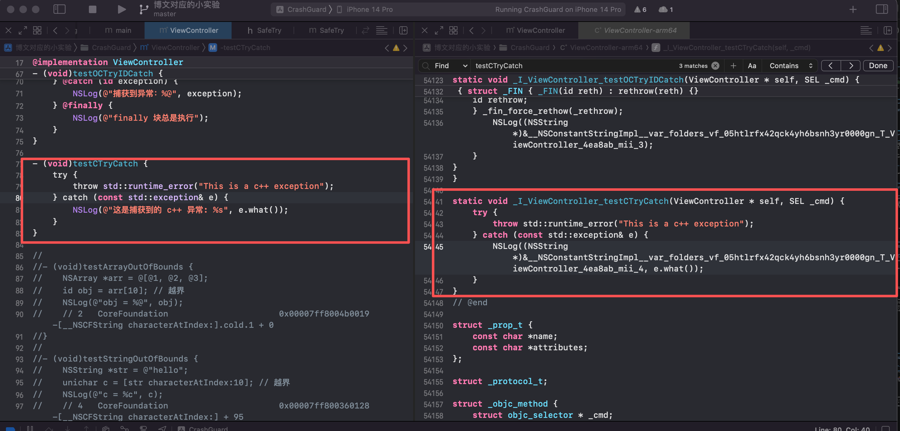

#### 2.  `@catch` 括号里的 NSException 改为 id 可以行拦截 C++ 异常吗

动手试试：

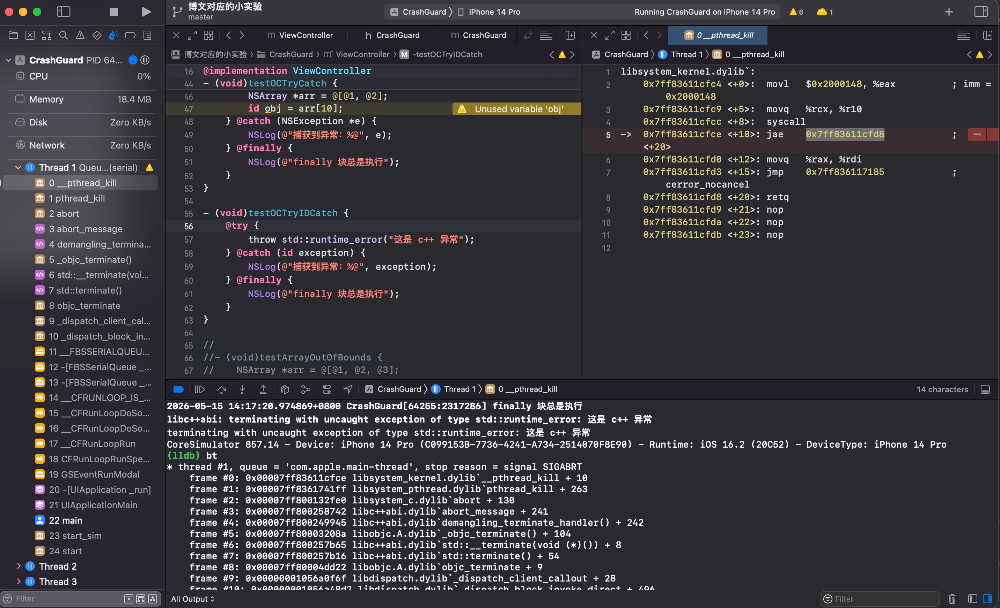

发现不行。为什么？clang 转为 c++ 代码看看

整理下

```c++
static void _I_ViewController_testOCTryIDCatch(ViewController * self, SEL _cmd) {
    // 用来保存“需要重新抛出”的异常
    id volatile _rethrow = 0;

    // 外层 try —— 编译器自动加的！
    // 作用：捕获所有漏网之鱼（C++ 异常、catch 内部抛的异常）
    try {
        // 内层 try —— 我们写的业务代码，包括 try----start
        try {
            // 你写的代码：抛 C++ 异常
            throw std::runtime_error("这是 c++ 异常");
        }
        // 内层 catch —— 你写的 @catch(id)
        catch (id exception) {
            // ❌ 这里永远进不来！
            // 因为 C++ 异常不是 id 类型！
            NSLog(..., exception);
        }
			  // 内层 try —— 我们写的业务代码，包括 try----end
    }

    // 外层 catch —— 编译器自动加的！
    // 作用：捕获所有内层抓不住的异常
    catch (id e) {
        // C++ 异常会跑到这里！
        _rethrow = e;
    }
    // finally 实现区域（RAII 析构函数）
    {
        // 这个对象生命周期结束时，会自动执行析构函数
        struct _FIN {
            _FIN(id reth) : rethrow(reth) {}
            ~_FIN() {
                // finally 执行完后，重新抛出异常
                if (rethrow) objc_exception_throw(rethrow);
            }
            id rethrow;
        } _fin_force_rethow(_rethrow);

        // 我们写的 finally 代码
        NSLog(@"finally 块总是执行");
    }
}
```

分析下完整的流程：

- clang 将我们的代码用另一个 c++ 的 try...catch...finally 包裹
- 进入内层 try，抛出 C++ 异常
- 内层 catch(id) 尝试捕获，但发现类型不匹配，便不捕获
- 异常向外跳
- 进入外层 catch(id) ，外层 catch 捕获到 C++ 异常，保存到 _rethrow 
- 进入 finally 区域，执行 NSLog(@"finally 块总是执行") 
- finally 执行完 
- 析构函数发现 _rethrow 有值，调用 `objc_exception_throw` 重新抛出 C++ 异常 
- 程序崩溃

看完后，有些人会产生这样的疑问：那么可以将 @catch 的参数类型改为 c++ 异常吗？

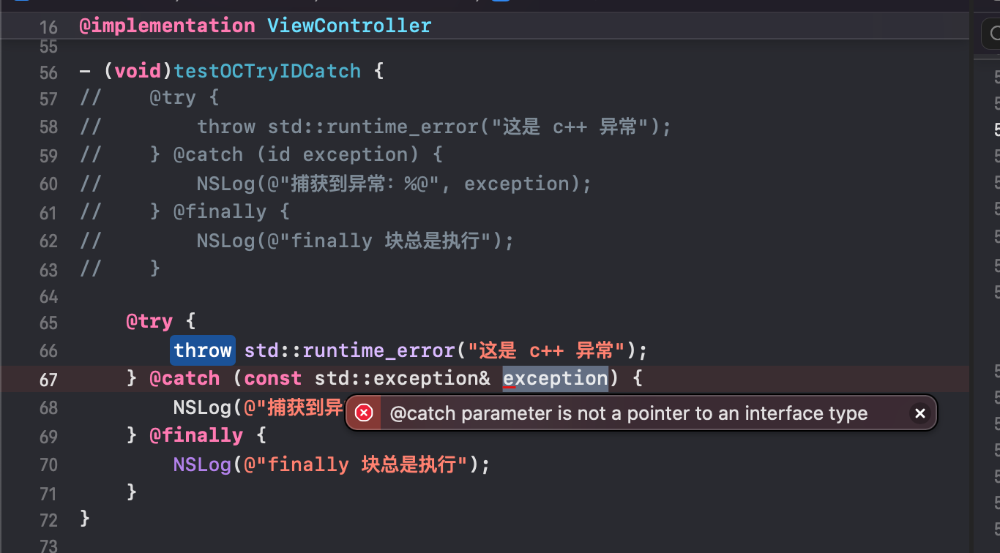

改了下，发现编译器不让。

#### 3. 万能的 try 写法

我们知道 Clang 针对 try 做了什么事情，也就可以模仿设计一个相对安全的 try 封装。

```c++
+ (void)exectueTaskWithSafeTry:(void(^)(void))task {
    if (!task) return;

    try {
        @try {
            task();
        } @catch (NSException *exception) {
            throw exception;
        } @finally {
            NSLog(@"task exectued");
        }
    } catch (NSException *ocException) {
        // OC 异常
        NSLog(@"❌ 捕获 OC 异常");
        NSLog(@"名称: %@", ocException.name);
        NSLog(@"原因: %@", ocException.reason);
    } catch (const std::exception& cException) {
        // C 标准异常
        NSLog(@"❌ 捕获 C++ 异常: %s", cException.what());
    } catch (...) {
        NSLog(@"❌ 捕获未知异常");
    }
}
```

效果如下：

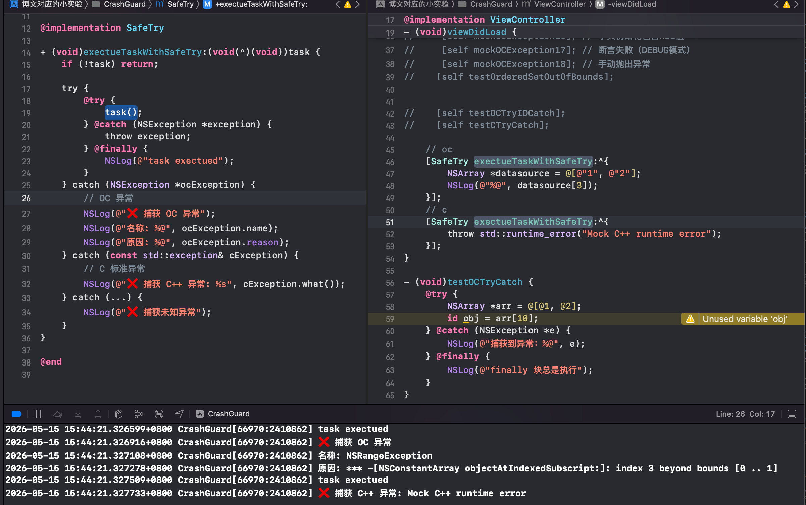

注意：封装的 try 执行框架的能力是基于 c++ try 和 OC try 能力的，自然也无法超越各自的能力。比如 `1 / 0` 这种产生 **EXC_ARITHMETIC** 类型的错误，属于 Mach 层异常。需要其他的能力去 cover。

#### 4. objc_exception_throw 是什么？

我们从 clang 转换为 c++ 后的代码可以看到一个 **objc_exception_throw**，objc_exception_throw 是什么方法？

模拟一个数组越界的 crash 现场。然后添加一个符号断点 `_CFThrowFormattedException`，可以看到数组越界后会抛出异常，调用到 **objc_exception_throw** 方法。

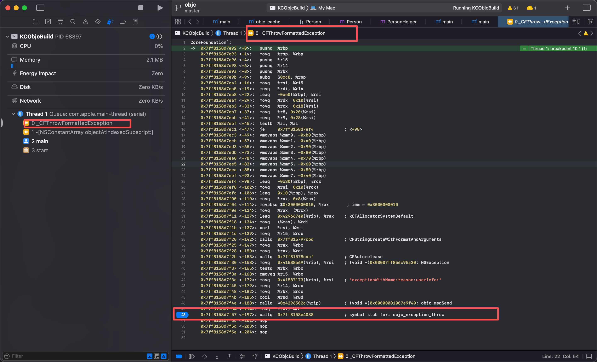

走进函数内部看看执行流程：

可以看到 `exception_preprocessor` 给外部传进来的基础 NSException 补充了案发现场的基础。比如：

- **给异常对象填充调用栈信息**：通过 `NSThread callStackReturnAddresses` 获取当前线程的调用栈，赋值给 `NSException.callStackReturnAddresses` 和 `callStackSymbols`
- **处理异常的用户信息**：补充一些系统级的上下文信息到 `userInfo` 里

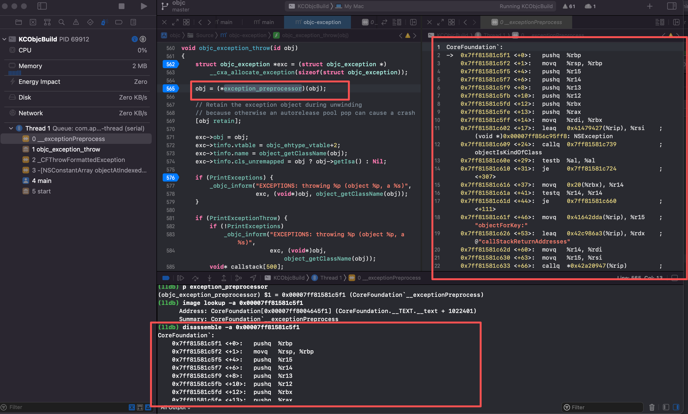

整体看看  objc_exception_throw 内部都做了什么？

```c++
void objc_exception_throw(id obj)
{
	  // 分配异常内存（C++ 异常标准）。意味着：OC 异常本质 = C++ 异常外壳 + OC 对象内核
    struct objc_exception *exc = (struct objc_exception *)
        __cxa_allocate_exception(sizeof(struct objc_exception));
		// 全局异常预处理器调用。如果有自定义的异常处理器，则执行自定义的异常处理器。
    obj = (*exception_preprocessor)(obj);

    // Retain the exception object during unwinding
    // because otherwise an autorelease pool pop can cause a crash
  	// 防止栈展开过程中，autorelease 池把异常对象释放
    [obj retain];

	  // 把 OC 异常 → 塞进 C++ 异常标准格式。
    exc->obj = obj;
    exc->tinfo.vtable = objc_ehtype_vtable+2;
    exc->tinfo.name = object_getClassName(obj);
    exc->tinfo.cls_unremapped = obj ? obj->getIsa() : Nil;

    if (PrintExceptions) {
        _objc_inform("EXCEPTIONS: throwing %p (object %p, a %s)", 
                     exc, (void*)obj, object_getClassName(obj));
    }

    if (PrintExceptionThrow) {
        if (!PrintExceptions)
            _objc_inform("EXCEPTIONS: throwing %p (object %p, a %s)", 
                         exc, (void*)obj, object_getClassName(obj));
        void* callstack[500];
        int frameCount = backtrace(callstack, 500);
        backtrace_symbols_fd(callstack, frameCount, fileno(stderr));
    }
		// 系统埋点（DTrace 探针），纯粹用来日志记录 / 监控 / 调试。告诉外部调试工具（如 Instruments、dtrace、lldb、系统监控）：“现在 OC 抛出了一个异常！”：Instruments（性能分析工具）、dtrace（系统调试工具）、lldb 调试器、系统内核日志、Apple 内部性能监控
    OBJC_RUNTIME_OBJC_EXCEPTION_THROW(obj);  // dtrace probe to log throw activity
  	// 真正抛异常：进入系统底层
    __cxa_throw(exc, &exc->tinfo, &_objc_exception_destructor);
	  // 执行非法指令终止程序
    __builtin_trap();
}
```

其实该函数系统对外提供了接口，可以自定义处理

````c++
static objc_exception_preprocessor exception_preprocessor = _objc_default_exception_preprocessor;

/***********************************************************************
* objc_setExceptionPreprocessor
* Set a handler for preprocessing Objective-C exceptions. 
* Returns the previous handler. 
**********************************************************************/
objc_exception_preprocessor
objc_setExceptionPreprocessor(objc_exception_preprocessor fn)
{
    objc_exception_preprocessor result = exception_preprocessor;
    exception_preprocessor = fn;
    return result;
}
````

所以思路也很清晰了。调用 **objc_setExceptionPreprocessor** 接口，在内部执行我们的逻辑即可。在内部把异常干掉。

### 3. llvm 异常模型

上面聊的是 API 层的实现，最底层的设计是：LLVM 异常处理 LandingPad 处理语言相关的 abi 和 libunwind。

**LLVM 编译期生成 LandingPad + libcxxabi 负责异常对象管理 + libunwind 负责栈回溯与恢复。**这套体系是 **ARM64 + iOS/macOS/Linux ARM** 上的**标准 C++ 异常处理底层规范**（Itanium C++ ABI，跨平台通用）。

举个例子：《LLVM CookBook》书中描述的例子

```c++
// eh.cpp
class Ex1 {};

void throw_exception(int a, int b) {
    Ex1 ex1;
    if (a > b) {
        throw ex1;
    }
}

int test_try_catch() {
    try {
        throw_exception(2, 1);
    }
    catch(...) {
        return 1;
    }
    return 0;
}
```

使用 `clang -c eh.cpp -emit-llvm -S -o eh.ll` 指令转为 IR

```assembly
; ModuleID = 'eh.cpp'
source_filename = "eh.cpp"
target datalayout = "e-m:o-p270:32:32-p271:32:32-p272:64:64-i64:64-f80:128-n8:16:32:64-S128"
target triple = "x86_64-apple-macosx12.0.0"

%class.Ex1 = type { i8 }

@_ZTVN10__cxxabiv117__class_type_infoE = external global i8*
@_ZTS3Ex1 = linkonce_odr constant [5 x i8] c"3Ex1\00", align 1
@_ZTI3Ex1 = linkonce_odr constant { i8*, i8* } { i8* bitcast (i8** getelementptr inbounds (i8*, i8** @_ZTVN10__cxxabiv117__class_type_infoE, i64 2) to i8*), i8* getelementptr inbounds ([5 x i8], [5 x i8]* @_ZTS3Ex1, i32 0, i32 0) }, align 8

; Function Attrs: noinline optnone ssp uwtable
define void @_Z15throw_exceptionii(i32 %0, i32 %1) #0 {
  %3 = alloca i32, align 4
  %4 = alloca i32, align 4
  %5 = alloca %class.Ex1, align 1
  store i32 %0, i32* %3, align 4
  store i32 %1, i32* %4, align 4
  %6 = load i32, i32* %3, align 4
  %7 = load i32, i32* %4, align 4
  %8 = icmp sgt i32 %6, %7
  br i1 %8, label %9, label %12

9:                                                ; preds = %2
  %10 = call i8* @__cxa_allocate_exception(i64 1) #1
  %11 = bitcast i8* %10 to %class.Ex1*
  call void @__cxa_throw(i8* %10, i8* bitcast ({ i8*, i8* }* @_ZTI3Ex1 to i8*), i8* null) #2
  unreachable

12:                                               ; preds = %2
  ret void
}

declare i8* @__cxa_allocate_exception(i64)

declare void @__cxa_throw(i8*, i8*, i8*)

; Function Attrs: noinline optnone ssp uwtable
define i32 @_Z14test_try_catchv() #0 personality i8* bitcast (i32 (...)* @__gxx_personality_v0 to i8*) {
  %1 = alloca i32, align 4
  %2 = alloca i8*, align 8
  %3 = alloca i32, align 4
  invoke void @_Z15throw_exceptionii(i32 2, i32 1)
          to label %4 unwind label %5

4:                                                ; preds = %0
  br label %12

5:                                                ; preds = %0
  %6 = landingpad { i8*, i32 }
          catch i8* null
  %7 = extractvalue { i8*, i32 } %6, 0
  store i8* %7, i8** %2, align 8
  %8 = extractvalue { i8*, i32 } %6, 1
  store i32 %8, i32* %3, align 4
  br label %9

9:                                                ; preds = %5
  %10 = load i8*, i8** %2, align 8
  %11 = call i8* @__cxa_begin_catch(i8* %10) #1
  store i32 1, i32* %1, align 4
  call void @__cxa_end_catch()
  br label %13

12:                                               ; preds = %4
  store i32 0, i32* %1, align 4
  br label %13

13:                                               ; preds = %12, %9
  %14 = load i32, i32* %1, align 4
  ret i32 %14
}

declare i32 @__gxx_personality_v0(...)

declare i8* @__cxa_begin_catch(i8*)

declare void @__cxa_end_catch()

attributes #0 = { noinline optnone ssp uwtable "darwin-stkchk-strong-link" "frame-pointer"="all" "min-legal-vector-width"="0" "no-trapping-math"="true" "probe-stack"="___chkstk_darwin" "stack-protector-buffer-size"="8" "target-cpu"="penryn" "target-features"="+cx16,+cx8,+fxsr,+mmx,+sahf,+sse,+sse2,+sse3,+sse4.1,+ssse3,+x87" "tune-cpu"="generic" }
attributes #1 = { nounwind }
attributes #2 = { noreturn }

!llvm.module.flags = !{!0, !1, !2, !3, !4}
!llvm.ident = !{!5}

!0 = !{i32 2, !"SDK Version", [2 x i32] [i32 13, i32 1]}
!1 = !{i32 1, !"wchar_size", i32 4}
!2 = !{i32 7, !"PIC Level", i32 2}
!3 = !{i32 7, !"uwtable", i32 1}
!4 = !{i32 7, !"frame-pointer", i32 2}
!5 = !{!"Apple clang version 14.0.0 (clang-1400.0.29.202)"}
```

try 区块在 LLVM 中被翻译成 invoke 指令：

```
invoke void @_Z15throw_exceptionii(i32 2, i32 1)
          to label %4 unwind label %5
```

上面的代码告诉编译器，如果 throw_exception 抛出异常，它应该如何处理这个异常。如果 throw_exception 没有抛出异常，正常执行跳转到 `label %4`，抛出异常则跳转到 `label %5`，即 landing pad，这对应了 try/catch中 的 catch 机制。如果程序执行在 landing pad 重新开始，它会接收一个异常结构体，以及与抛出的异常类型对应的选择器的值。这个选择器用于决定哪一个 catch 函数来真正处理这个异常。在本例中，它看起来像这样：

```assembly
%6 = landingpad { i8*, i32 }
          catch i8* null
```

上述模块5里的代码是由编译器生成的 LandingPad 相关逻辑，**是 LLVM 为了实现异常机制必须生成的底层结构**。当 `throw` 发生时，程序不会正常往下走，而是**直接跳转到 landingpad**。作用是：

- 接收**异常对象**
- 接收**异常类型信息**
- 告诉系统：**我准备开始处理异常了**

为什么`l abel 5` 执行完后必须执行 `label 9`？

- label5 是**系统层异常准备**
- label9 是**真正的用户写的 catch 块**

其中：

- `__cxa_thorw`：用于抛出异常的函数
- `__cxa_begin_catch`：接受一个异常结构体的引用作为参数，返回异常对象的值
- `__cxa_end_catch`：处理最近捕捉的异常，减少 handler 计数，如果计数为0则停止异常捕捉

总结：**整个方案的可行性是基于 LLVM 异常模型进行的。分为2层**：

- **LLVM  Clang 在编译期生成 LandingPad + libc++abi 负责异常对象的创建、抛出、管理**
- **libunwind 负责栈回溯与恢复**


在 iOS/macOS 平台上，Clang 为 Itanium ABI 异常模型做了优化，所有 unwind 相关数据都保存在 Mach-O 的三个核心段中，对应 Itanium ABI 定义的三类信息：

- `__TEXT,__unwind_info`：替代了标准 Itanium ABI 中的 unwind table，是 Apple 自研的紧凑格式。记录每个函数的栈帧恢复信息：函数起始/结束地址、栈帧大小、callee-saved 寄存器恢复规则。是 libunwind 遍历栈帧、执行栈展开时的核心查表数据。
- `__TEXT,__gcc_except_tab`：对应 Itanium ABI 中的 Language Specific Data Area（语言相关数据区）。记录每个函数中 try/catch 的代码范围、可处理的异常类型，以及对应的 landing pad 地址。由 personality 函数（如 __objc_personality_v0）在 Phase1 阶段查询，判断当前栈帧能否处理异常。
- `__TEXT,__eh_frame`：标准 Itanium ABI 格式的 unwind table。在 iOS/macOS 上，常规编译会用 __unwind_info 替代它，仅在部分架构或特殊编译选项下存在

如果想了解更多关于 LLVM 异常相关的资料，建议直接查看 [LLVM 文档:Exception Handling in LLVM](https://llvm.org/docs/ExceptionHandling.html) 和 llvm源码:[libcxxabi](https://github.com/llvm/llvm-project/tree/main/libcxxabi)

比如查看：`__cxa_allocate_exception`、`__cxa_throw` 相关逻辑。

也可以查看网上一个关于 LLVM 异常处理相关的博客系列：[LLVM异常实现零 异常的多层结构与实现方式](https://homura.live/2024/10/02/Exception/exception-0/) 


### 4. 函数调用约定

#### 1.  前置知识

寄存器（纯硬件，CPU 物理内置的硬件单元）

- 位于 CPU 内部，**纳秒级速度**；
- 是 CPU 运算的**唯一工作区**：加减、寻址、函数传参、指针、循环变量、中间计算结果，**优先全放寄存器**；
- 容量极小，就几十个，根本放不下所有变量。

栈（内存）的定位，栈是**低速内存**，只干三件脏活累活：

- **寄存器现场备份**：Callee-saved 寄存器 X19~X28 不想被破坏，压栈保存
- **寄存器放不下的溢出变量**：局部变量太多、结构体太大，塞不进寄存器，放栈上
- **函数调用链路记账**：FP 栈帧、LR 返回地址、函数嵌套调用上下文
- 顺便存局部大变量、临时缓冲区

**能放寄存器绝不放栈**，这是编译器优化的第一准则。

虽然寄存器很快，但是**返回地址、栈帧指针非要放慢速内存栈里**。这个设计上位了解决**函数嵌套调用 + 递归调用**

比如：

```shell
A --> B
			B	--> C
						C --> D
```

- 每层都要有自己的**返回地址**、自己的**栈帧 FP**
- 物理寄存器只有**一个 LR、一个 FP**
- 一旦嵌套多层，新调用会直接覆盖旧的 LR/FP，**上层返回地址直接丢了**，函数 return 直接跑飞崩溃

栈的天然优势：栈是**后进先出 LIFO**，完美匹配函数调用嵌套顺序

- 进入新函数：把当前 LR、FP 压栈保存
- 嵌套结束返回：弹出上一层 LR、FP，精准回到上一层

**寄存器存不了多层历史状态，只有栈能存调用链路快照**

#### 2. Prologue/Epilogue

在函数调用过程中，由于寄存器数量有限，调用者（Caller）和被调用者（Callee）可能会使用相同的寄存器，导致数据覆盖。为了解决这个问题，AArch64 架构采用了一套标准的调用约定。该约定将寄存器分为2类： Caller-saved / Callee-saved：

- **Caller-saved（易失寄存器）X0~X18**
  - 子函数可以随便覆盖，不用保存恢复
  - 调用者如果用完还要继续用，**自己提前压栈存好**
- **Callee-saved（非易失寄存器）X19~X28**
  - 子函数**只要敢用**，必须先将寄存器内的值保存到栈上进行备份，在函数返回前再从栈上弹出恢复到寄存器上
  - 调用者放心用，调用完子函数回来，值还在

对  Callee-saved 寄存器的保存和恢复是 clang 编译器在编译阶段自动完成的，编译器会在每个函数的二进制代码中，于入口和出口处分别插入两段标准化的系列机器码指令序幕和尾声。

对  Callee-saved 寄存器的保存和恢复是 clang 编译器在编译阶段自动完成的，编译器会在每个函数的二进制代码中，于入口和出口处分别插入两段标准化的机器码指令序幕和尾声。

这个机制类似 LLVM 为 ARC 内存管理做的自动插入内存管理的 retain/copy/release/autorelease 等代码。

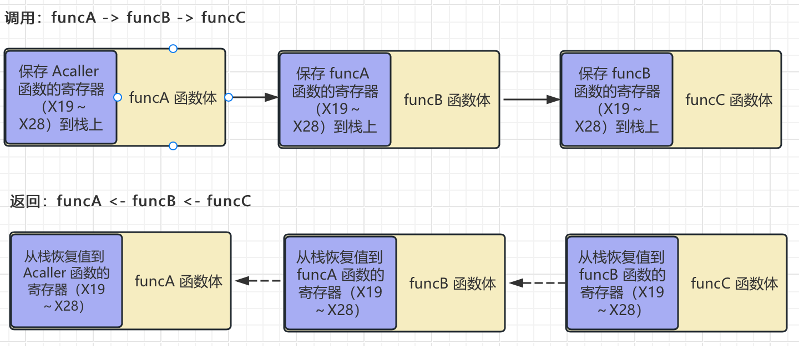

##### 1. Prologue

函数入口做的事：

- **开辟栈空间（调整 SP）**
  - 根据本地变量、临时区、对齐要求，计算总栈大小
  - `SP = SP - N`（AArch64 栈向下生长）
  - 保证栈对齐（AArch64 通常 16 字节）
- **保存 Callee-Saved 寄存器（X18–X28 等）**
  - 按 AArch64 ABI：X19–X28 是必须保存的
  - Prologue 里把它们 **store 到栈上固定位置**

先看看如何计算，再看看汇编代码：

- 必须保存的寄存器：`x19 ~ x28` + `x29(FP)` + `x30(LR)`，共  12 个寄存器 = 12*8 = 96 字节

- 栈必须 **16 字节对齐**

- 由于栈向下增长，sp 一步到位，先把 sp 减去 0x60（96 字节），开辟完整栈帧。然后 把 `x28` `x27` 存在 **[sp]** 位置。stp 指令是 `store pairs` 必须2个一起存

  ```assembly
  stp    x28, x27, [sp, #-0x60]!
  ```

- 由于栈向下增长，再存储 `x26` 和 `x25`。`stp    x26, x25, [sp, #0x10]`，2个寄存器占16个字节

- 依次存储 `[x24 x23]` 和 `[x22 x21]` 和 `[x20 x19] ` 

- 最后把 FP(x29)、LR（x30） 的值保存下来

来看看具体一段示例汇编代码:

```assembly
// ========== iOS ARM64 函数序幕：保存现场 + 建立栈帧 ==========

// 第一步：栈指针向下（减小）开辟 96 字节（0x60）空间，同时保存 x28、x27
// 指令 [!] 表示：先修改 sp，再存数据
// 执行后：sp = sp - 0x60
stp  x29, x30, [sp, #-0x60]!  ; 栈空间向下拓展 0x60 字节（96字节），开辟完整栈帧

// 第二步：依次保存 callee-saved 寄存器（x19~x28）
// 每一对寄存器占 16 字节（0x10）
stp  x28, x27, [sp, #0x00]    ; 把 x28、x27 存入 栈顶 + 0x00 位置
stp  x26, x25, [sp, #0x10]    ; 把 x26、x25 存入 栈顶 + 0x10 位置
stp  x24, x23, [sp, #0x20]    ; 把 x24、x23 存入 栈顶 + 0x20 位置
stp  x22, x21, [sp, #0x30]    ; 把 x22、x21 存入 栈顶 + 0x30 位置
stp  x20, x19, [sp, #0x40]    ; 把 x20、x19 存入 栈顶 + 0x40 位置

// 第三步：保存【调用方的旧FP + 函数返回地址LR】
// 这两个是栈回溯、异常unwind、函数返回的核心
stp  x29, x30, [sp, #0x50]    ; 保存 旧FP(x29) + 返回地址LR(x30) 到栈顶+0x50

// 第四步：设置当前函数的新FP
// FP = 当前栈顶 + 0x50
// 让FP指向栈帧中“旧FP+LR”的位置，形成栈帧链
add  x29, sp, #0x50            ; 设置当前函数新的帧指针 FP
```

- LR：Link Register 链接寄存器的值，x30。函数调用的本质是 **bl funcB地址**，硬件自动把下一条指令的地址存入 LR
- SP：Stack Pointer，栈顶指针，指向栈内保存最新数据的地址（栈向下生长，也就是栈内地址最小的地址）
- FP：Frame Pointer，帧指针，指向当前函数栈的基地址。

此外，还**生成 CFI（Call Frame Information）—— 给 libunwind / 异常用**

- `.cfi_def_cfa_offset`、`.cfi_offset` 等
- 记录：SP/FP 怎么变、寄存器存在栈的哪里
- **没有 CFI，libunwind 无法正确回溯、LandingPad 无法恢复现场**

##### 2. Epilogue

Epilogue 阶段是 Prologue 做的事情全部逆操作，安全释放栈帧、恢复寄存器、返回调用者：

- **恢复 callee-saved 寄存器（必须原样还给调用者）**
  - stp 指令是 store pair，ldp 是 load pairs
  - pairs 需要成对使用
  - stp 和 ldp 顺序需要对应。类似洋葱模型一样，stp 的顺序为：1->2->3，那么 ldp 顺序应该是：3->2->1
- **释放当前函数栈帧（SP 归位）**
- **恢复 LR（x30）并执行 ret，回到调用者**

来看看具体一段示例汇编代码

```assembly
// ========== iOS ARM64 函数尾声：恢复现场 + 释放栈帧 ==========

// 第一步：从栈中恢复【调用方的旧FP + 函数返回地址LR】
// 与 Prologue 最后一步 stp x29,x30, [sp,#0x50] 完全逆操作
ldp  x29, x30, [sp, #0x50]    ; 从栈顶+0x50 恢复 旧FP(x29) + 返回地址LR(x30)

// 第二步：逆序恢复所有 callee-saved 寄存器（x19~x28）
// 注意：恢复顺序必须与 Prologue 保存顺序相反
ldp  x20, x19, [sp, #0x40]    ; 从 栈顶+0x40 恢复 x20、x19
ldp  x22, x21, [sp, #0x30]    ; 从 栈顶+0x30 恢复 x22、x21
ldp  x24, x23, [sp, #0x20]    ; 从 栈顶+0x20 恢复 x24、x23
ldp  x26, x25, [sp, #0x10]    ; 从 栈顶+0x10 恢复 x26、x25
ldp  x28, x27, [sp, #0x00]    ; 从 栈顶+0x00 恢复 x28、x27

// 第三步：释放整个栈帧（0x60 字节），恢复 SP 到函数调用前的位置
// 与 Prologue 第一步 stp x29,x30,[sp,#-0x60]! 完全逆操作
add  sp,  sp, #0x60           ; 栈指针向上（增加）回收 0x60 字节栈帧

// 第四步：函数返回，跳转到 LR 保存的地址
// 至此：FP / LR / SP / x19~x28 全部恢复到调用前状态
ret                           ; 函数返回，跳转到 LR(x30)
```

### 5. linunwind 标准化的堆栈回溯能力

知道 LLVM 对于函数调用做的事情，也知道整个异常模型的工作原理，那么要在异常发生的时候还原到调用函数崩溃前的一个函数，需要做哪些事情？

- 栈帧解析器。读取 FP，计算出上一层 FP/LR
- 函数 Prologue/Epilogue 解析。反汇编函数，知道：
  - 栈帧大小
  - 保存了哪些寄存器
  - 保存在栈的哪个偏移
- 寄存器恢复引擎。模拟 Epilogue 指令：`ldp`、`add sp`, sp, #size`、`mov fp, sp`、`ret`
- 完整上下文重建。恢复 x19~x28、SP、FP、LR、PC
- 还需要关心不同架构指令集和汇编的兼容性。

因此实现崩溃后的栈回溯，修改程序执行流跳转至堆栈中的上层函数，仅修改 PC, LR, SP, FP 寄存器的值是不够的。根据调用约定，必须逐帧回溯，从栈上恢复每一层调用中由被调用者保存的寄存器，重建调用者的寄存器上下文，确保其在恢复执行时，获取到的寄存器的值是正确的。这等同于模拟执行从崩溃点到目标函数之间所有栈帧的“函数尾声”，尾声的职责正是恢复这些寄存器。模拟执行的复杂度极高：它不仅需要精确定位每段尾声的机器指令，还涉及复杂的解释执行。

然而现代编译器的设计是统计更加方便的机制来实现栈回溯的。在编译时，LLVM 会为每个函数生成详细的调用帧信息，并将其存储在可执行文件的 `__unwind_info` 的 section 中（更加通用的叫法是 CFI，Call Frame Information）。所以就可以通过 libunwind 提供的接口来处理了。完全屏蔽了底层细节和不同架构指令集汇编代码的差异（其实类似 libffi 做的事情，都是直接调用接口，库帮我们屏蔽底层差异，可以快速实现我们的需求）

对于 llvm 中 libunwind 源码感兴趣的可以查看 [apple-oss-distributions/libunwind](https://github.com/apple-oss-distributions/libunwind)

核心函数是

```c++
/// Called by __cxa_throw.  Only returns if there is a fatal error.
_LIBUNWIND_EXPORT _Unwind_Reason_Code
_Unwind_RaiseException(_Unwind_Exception *exception_object) {
  _LIBUNWIND_TRACE_API("_Unwind_RaiseException(ex_obj=%p)",
                       (void *)exception_object);
  unw_context_t uc;
  unw_cursor_t cursor;
  __unw_getcontext(&uc);

  // Mark that this is a non-forced unwind, so _Unwind_Resume()
  // can do the right thing.
  exception_object->private_1 = 0;
  exception_object->private_2 = 0;

  // phase 1: the search phase
  _Unwind_Reason_Code phase1 = unwind_phase1(&uc, &cursor, exception_object);
  if (phase1 != _URC_NO_REASON)
    return phase1;

  // phase 2: the clean up phase
  return unwind_phase2(&uc, &cursor, exception_object);
}
```

`_Unwind_RaiseException` 是 libunwind 实现 c++ 异常抛出的总入口，在异常处理流程中，是一个标准的2段式设计：

- Phase1：Searc 搜索，系统会沿着调用栈往上遍历，查找是否存在一个类型匹配的 catch 块能够处理该异常，但不会修改任务状态，一旦成功定位到目标处理程序，系统便会重新从异常抛出点开始，触发第二阶段
- Phase2：clean up 展开，所有位于抛出点和处理程序之间的中间栈帧都将被依次销毁，一层层模拟执行 Epilogue、恢复寄存器、释放栈帧，直到跳转到 catch 代码（LandingPad）

通过二进制文件的 `__unwind_info` 段的元数据来驱动搜索和清理，最终将程序的控制流安全地交给 catch 块的 LandingPad。


`_Unwind_RaiseException` 关键环节：

1. 使用 `__unw_getcontext` 获取当前线程的完整寄存器状态，这是栈回溯的基础

   ```c++
   unw_context_t uc;
   unw_cursor_t cursor;
   __unw_getcontext(&uc);
   ```

2. `unwind_phase1`：从异常点开始向上寻找栈帧，直到找到匹配该异常的 catch 块或者遍历结束。该阶段只查，不 clean up。
    ```c++
    // 异常展开第一阶段：SEARCH 搜索阶段
    // 作用：沿着调用栈向上查找 能处理当前异常的 landing pad（catch）
    // 特点：只读不写，不执行析构、不清理、不修改栈、不恢复寄存器
    static _Unwind_Reason_Code
    unwind_phase1(unw_context_t *uc, unw_cursor_t *cursor, _Unwind_Exception *exception_object) {
        // 初始化栈游标，绑定异常抛出时的 CPU 上下文
        __unw_init_local(cursor, uc);

        // 标记：是否还未找到异常处理器
        bool handlerNotFound = true;

        // 循环向上遍历每一层栈帧，直到找到 handler 或栈底
        while (handlerNotFound) {
            // 游标向上移动一层栈帧（跳过 _Unwind_RaiseException 自身）
            // 返回值 >0：成功上跳
            // 返回值 =0：已到栈顶，无更多栈帧
            // 返回值 <0：遍历失败
            int stepResult = __unw_step(cursor);
            if (stepResult == 0) {
                // 遍历到栈顶都没找到能处理异常的 handler
                return _URC_END_OF_STACK;
            } else if (stepResult < 0) {
                // 栈遍历出错
                return _URC_FATAL_PHASE1_ERROR;
            }

            // 获取当前栈帧的函数信息：LSDA、personality 函数、函数范围等
            unw_proc_info_t frameInfo;
            unw_word_t sp;
            if (__unw_get_proc_info(cursor, &frameInfo) != UNW_ESUCCESS) {
                return _URC_FATAL_PHASE1_ERROR;
            }

            // 如果当前函数有 personality 函数，说明可能能处理异常
            if (frameInfo.handler != 0) {
                // 获取 personality 函数地址（C++/OC 语言相关的异常判断函数）
                _Unwind_Personality_Fn p = (_Unwind_Personality_Fn)(uintptr_t)(frameInfo.handler);
                
                // 调用 personality，标记 _UA_SEARCH_PHASE 表示现在是【搜索阶段】
                // 询问：当前函数是否能处理这个异常？
                _Unwind_Reason_Code personalityResult =
                    (*p)(1, _UA_SEARCH_PHASE, exception_object->exception_class,
                        exception_object, (struct _Unwind_Context *)(cursor));

                // 根据 personality 返回值处理
                switch (personalityResult) {
                    case _URC_HANDLER_FOUND:
                        // ✅ 找到了！当前栈帧可以处理异常（存在 catch / landing pad）
                        handlerNotFound = false;

                        // 读取当前栈帧的栈指针 SP
                        __unw_get_reg(cursor, UNW_REG_SP, &sp);

                        // 把 SP 保存到异常对象中，给 Phase2 使用
                        // 作用：告诉 Phase2 应该在哪个栈帧停止并执行清理
                        exception_object->private_2 = (uintptr_t)sp;

                        // Phase1 搜索完成，成功结束
                        return _URC_NO_REASON;

                    case _URC_CONTINUE_UNWIND:
                        // 当前函数不能处理，继续向上找
                        break;

                    default:
                        // 异常错误
                        return _URC_FATAL_PHASE1_ERROR;
                }
            }
        }

        return _URC_NO_REASON;
    }
    ```

3. `unwind_phase2`：则会循环调用 `__unw_step`，每调用1次，`unw_cursor_t *cursor` 就会根据 `__unwind_info` 中的元数据，向上移动一个栈帧，指向当前的函数调用者。按照 callee register 的规范，做栈回滚和栈上保存的 callee 寄存器值弹出，恢复寄存器的 clean up 逻辑。

   ```c++
    // 异常展开第二阶段：CLEANUP 清理阶段
    // 前提：Phase1 已经找到了能处理异常的栈帧（并保存了 SP）
    // 职责：
    // 1. 再次从异常抛出点向上遍历栈帧
    // 2. 逐层执行 析构函数、cleanup 逻辑
    // 3. 恢复寄存器、栈状态
    // 4. 到达 Phase1 标记的栈帧时，跳转到 landing pad 执行 catch
    static _Unwind_Reason_Code
    unwind_phase2(unw_context_t *uc, unw_cursor_t *cursor, _Unwind_Exception *exception_object) {
    // 初始化栈游标，从抛出异常的上下文开始
    __unw_init_local(cursor, uc);

    // 循环：向上遍历每一层栈帧，直到目标帧并执行 landing pad
    while (true) {
        // 游标向上移动一层栈帧（跳过 _Unwind_RaiseException 自身）
        int stepResult = __unw_step(cursor);
        if (stepResult == 0) {
        // 遍历到栈顶仍未停止，异常错误
        return _URC_END_OF_STACK;
        } else if (stepResult < 0) {
        // 栈遍历失败
        return _URC_FATAL_PHASE2_ERROR;
        }

        unw_word_t currentSP;
        unw_proc_info_t frameInfo;

        // 获取当前栈帧的 SP
        __unw_get_reg(cursor, UNW_REG_SP, &currentSP);

        // 获取当前函数的 unwind 信息（LSDA、personality 等）
        if (__unw_get_proc_info(cursor, &frameInfo) != UNW_ESUCCESS) {
        return _URC_FATAL_PHASE2_ERROR;
        }

        // 如果当前函数有 personality 函数，进入清理流程
        if (frameInfo.handler != 0) {
        _Unwind_Personality_Fn personality = (_Unwind_Personality_Fn)(uintptr_t)frameInfo.handler;
        
        // 默认动作：清理阶段（执行析构、cleanup）
        _Unwind_Action action = _UA_CLEANUP_PHASE;

        // ==============================================
        // 关键：如果当前 SP == Phase1 记录的 SP
        // 说明：到达了能处理异常的目标栈帧！
        // 标记：_UA_HANDLER_FRAME（告诉 personality 这是处理帧）
        // ==============================================
        if (currentSP == exception_object->private_2) {
            action = (_Unwind_Action)(_UA_CLEANUP_PHASE | _UA_HANDLER_FRAME);
        }

        // 调用 personality 函数，执行清理 / 查找 landing pad
        _Unwind_Reason_Code personalityResult = 
            (*personality)(1, action, exception_object->exception_class, 
                            exception_object, (struct _Unwind_Context *)cursor);

        switch (personalityResult) {
            case _URC_CONTINUE_UNWIND:
            // 当前帧仅需清理（析构），无需处理异常，继续向上遍历
            break;

            case _URC_INSTALL_CONTEXT:
            // ==============================================
            // ✅ 核心：跳转到 landing pad 执行 catch 块
            // 恢复所有寄存器、栈状态，正式进入异常处理
            // ==============================================
            __unw_resume(cursor);
            return _URC_FATAL_PHASE2_ERROR;

            default:
            // 未知返回值，异常错误
            return _URC_FATAL_PHASE2_ERROR;
        }
        }
    }

    return _URC_FATAL_PHASE2_ERROR;
    }	
   ```

4. 当 cursor 定位到目标栈帧，执行 `__unw_resume`，其效果类似于 longjmp，利用 cursor 中存储的信息，将所有寄存器恢复到目标栈帧的状态，从而让程序的控制流继续执行。

5. 被恢复执行的目标函数在其代码逻辑中，正等待着获取一个返回值。根据 ARM64 的调用约定，整型或指针类型的返回值默认通过 x0 传递，浮点类型通过 d0 传递（需要注意浮点数的二进制存储格式）。如果我们不主动设置这些寄存器的值，目标函数将会读取到一个未定义的值，可能导致二次崩溃或逻辑错误。因此，在执行跳转前，我们必须为目标函数的执行上下文设置一个符合预期的返回值。

   ```assembly
   unw_set_reg(cursor, UNW_ARM64_X0, "xxx");
   unw_set_fpreg(cursor, UNW_ARM64_D0, "xxx");
   ```

假设在 ViewDidLoad 中调用 mockOCException 方法，在其内部继续调用 mockOCException1 方法。里面数组越界发生 crash。现在需求是：跳过 mockOCException 和 mockOCException1 里的剩余代码，让控制流回到 viewDidLoad 函数，并且让 viewDidLoad 认为 mockOCException 调用成功并返回一个合法的值。

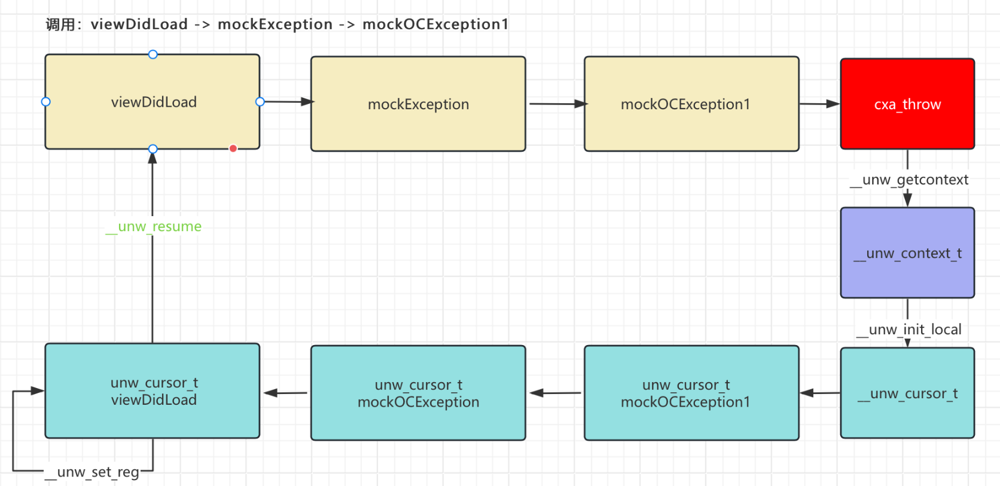

首先，在奔溃点不会上下文 `__unw_context_t`，并初始化一个指向崩溃点的游标 `__unw_cursor_t`

- 第1次调用 `_unw_step` 则崩溃点转移到调用者 mockOCException1
- 第2次调用 `_unw_step` 则崩溃点从 mockOCException1 转移到调用者 mockOCException
- 第3次调用 `_unw_step` 则崩溃点从 mockOCException 转移到调用者 viewDidLoad

还需要模拟处理返回值，调用 `__unw_set_reg` 设置 `x0`，最后调用 `__unw_resume` 撤销（销毁）mockOCException 和 mockOCException1 的栈帧，将寄存器恢复到 viewDidLoad 调用 mockOCException 之后的状态。程序计数器（PC）也指向调用完 mockOCException 之后的下一条指令。

营造了一种，看上去“相安无事”的感觉。就跟 crash 没有发生，返回值也是正确的，PC 指向也完全没问题。


### 6. 筛选已捕获的异常

上面分析了 `exception_preprocessor` 是 hook 切面的入口。可以做到 hook 之后调用 libunwind 的能力去堆栈还原，设置 x0 寄存器的返回值，模仿 Epilogue 做的一些事情。安全气垫的核心是：过滤掉可以被 catch 的异常，也就是筛选出没有被 catch 或者catch 后还是会 crash 的 NSException 出来，然后安全气垫系统介入干预。

那如何筛选呢？其实完全可以模仿系统行为（这个做法也很常见，比如手势场景下寻找合适的响应者则模拟系统调用 `hittest` 方法寻找最佳响应者），异常发生时会 OC 侧会调用 c++ 的 `_cxa_throw` 抛出异常，此时调用 libunwind 的 `_Unwind_RaiseException` 方法：先获取当前线程的完整寄存器状态，然后分为2阶段：

- 第一阶段负责找到匹配的 catch 块，也就是源码中调用 `_Unwind_RaiseException` 内调用 `_Unwind_Reason_Code phase1 = unwind_phase1(&uc, &cursor, exception_object)` 这个方法做的事情 
- 第二阶段模仿 LLVM 为 Epilogue  做的栈帧回退、callee 寄存器值恢复等。也就是源码中调用 `_Unwind_RaiseException` 内调用 `unwind_phase2(&uc, &cursor, exception_object)`   这个方法做的事情

所以我们可以模拟系统行为，通过 phase1 的 search 阶段，通过 unw_context_t 上下文逐帧回溯，获取每一帧的 personality routine 函数（对应源码中的 frameInfo.handler），来判断栈帧是否可以 catch 当前 NSException。如果遍历结束，还没找到任何一个可以处理的 handler，则认为该异常不会被捕获。

下面是精简后的相关代码：

```c++
unwind_phase1(unw_context_t *uc, unw_cursor_t *cursor, _Unwind_Exception *exception_object) {
	// ...
  while (handlerNotFound) {
    int stepResult = __unw_step(cursor);
    
    // See if frame has code to run (has personality routine).
    unw_proc_info_t frameInfo;
    unw_word_t sp;
    if (__unw_get_proc_info(cursor, &frameInfo) != UNW_ESUCCESS) {
    	//...
      return _URC_FATAL_PHASE1_ERROR;
    }

    
    // If there is a personality routine, ask it if it will want to stop at
    // this frame.
    if (frameInfo.handler != 0) {
      _Unwind_Personality_Fn p =
          (_Unwind_Personality_Fn)(uintptr_t)(frameInfo.handler);
      _Unwind_Reason_Code personalityResult =
          (*p)(1, _UA_SEARCH_PHASE, exception_object->exception_class,
               exception_object, (struct _Unwind_Context *)(cursor));
    }
    // ...
}
```


但还有特殊情况，CoreFoundation 和 libdispatch 里存在一些特殊函数，系统往往会 catch 异常，但 catch 内部的逻辑处理完会立即终止程序（terminate）或将异常重新抛出（rethrow）。所以这种特殊情况，只通过 personality routine 找到了异常处理的 handler，误以为该异常会被处理，但实际上该异常还是会造成 App Crash。

比如 `libdispatch-1271.120.2` 的 `object.m` 的 `_dispatch_client_callout` 方法

```c++
#undef _dispatch_client_callout
void
_dispatch_client_callout(void *ctxt, dispatch_function_t f)
{
	@try {
		return f(ctxt);
	}
	@catch (...) {
		objc_terminate();
	}
}
```

所以在获取 personality routine 之后，需要增加一个 filter，判断函数地址所在 image，如果 image 在 libdispatch 中则不认为存在一个有效可以处理异常的 personality routine 函数，还是需要安全气垫系统介入。

CoreFoundation 还更特殊一些，因为 CoreFoundation 内部会存在一个 try...catch... 的异常捕获，但是框架对 personality routine 做的事情仅仅是记录然后继续向上抛，可能开发同学会对其进行 try...catch... 的保护，也可能没有保护。所以 CoreFoundation 内产生的异常至少抛1次，第一次一定是在 CoreFoudation 内，如果存在第二次的话，可能就是在使用 CoreFoudation 的地方并添加了 try...catch...，所以 personality routine 判断存在还不够，还需要判断当前所在 image 是不是 CoreFoundation，如果是，则 continue。如果后续还存在 personality routine，那么就可以判断 CoreFoundation 产生的异常有人处理了。

代码如下：

```c++
static bool exception_can_be_caught(id exception) {
    unw_context_t context = {0};
    unw_getcontext(&context);
    unw_cursor_t cursor = {0};
    unw_init_local(&cursor, &context);

    crashguard_cxa_exception *header = calloc(1, sizeof(crashguard_cxa_exception));
    if (!header) return false;

    while (unw_step(&cursor) > 0) {
        unw_proc_info_t proc_info = {0};
        if (unw_get_proc_info(&cursor, &proc_info) != UNW_ESUCCESS) {
            continue;
        }
        if (proc_info.handler == 0) {
            continue;
        }

        _Unwind_Personality_Fn personality = (_Unwind_Personality_Fn)proc_info.handler;
        _Unwind_Reason_Code result = personality(
            1,
            _UA_SEARCH_PHASE,
            header->unwindHeader.exception_class,
            &header->unwindHeader,
            (_Unwind_Context *)&cursor
        );

        switch (result) {
            case _URC_HANDLER_FOUND: {
                uintptr_t start_ip = strip_ptr((uintptr_t)proc_info.start_ip);
                if (crashguard_addr_in_dispatch(start_ip)) {
                    free(header);
                    return false;
                }


                if (crashguard_addr_in_cf(start_ip)) {
                    continue;
                }
                free(header);
                return true;
            }
            case _URC_CONTINUE_UNWIND:
                continue;
            default:
                break;
        }
    }

    free(header);
    return false;
}
```

hook 函数为

```c++
orig_preprocessor = objc_setExceptionPreprocessor(my_preprocessor);

static id my_preprocessor(id exception) {
    // 第一步：判断异常是否会被业务 catch
    if (exception_can_be_caught(exception)) {
        return orig_preprocessor ? orig_preprocessor(exception) : exception;
    }

    // 第二步：打印完整案发堆栈
    print_full_exception_stack(exception);

    // 第三步：执行栈恢复逻辑
    unwind_to_safe_caller();

    // 第四步：兜底返回原始 preprocessor
    return orig_preprocessor ? orig_preprocessor(exception) : exception;
}
```

调用 libunwind 能力去防护异常

```c++
static void unwind_to_safe_caller(void) {
    unw_context_t context = {0};
    unw_getcontext(&context);
    unw_cursor_t cursor = {0};
    unw_init_local(&cursor, &context);

    int index = 0;
    char func_name[256];
    unw_word_t offset, ip;

    while (unw_step(&cursor)) {
        index++;
        unw_get_reg(&cursor, UNW_REG_IP, &ip);
        unw_get_proc_name(&cursor, func_name, sizeof(func_name), &offset);

        // 跳过前3个系统栈帧
        if (index <= 3) {
            continue;
        }

        // 跳过所有系统库的栈帧，找到第一个业务方法
        bool is_system_frame =
            crashguard_addr_in_cf((uintptr_t)ip) ||
            crashguard_addr_in_image((uintptr_t)ip, "libobjc") ||
            crashguard_addr_in_dispatch((uintptr_t)ip);

        if (!is_system_frame) {
#if __arm64__
            unw_set_reg(&cursor, UNW_ARM64_X0, 0);
#elif __x86_64__
            unw_set_reg(&cursor, UNW_X86_64_RAX, 0);
#endif
            unw_resume(&cursor);
            return;
        }
    }
}
```

来看一个效果：

```objective-c
- (void)viewDidLoad {
    [super viewDidLoad];
    [self mockException];
}

- (void)mockException {
		[self mockOCException1];  // 数组越界
}

- (NSString *)mockOCException1 {
    NSArray *datasource = @[@"OC", @"Swift", @"JS", @"Python", @"Shell"];
    NSString *skill = datasource[6];
    NSLog(@"✅ 数组越界后继续执行，skill = %@", skill);
    return skill;
}
```

安全气垫效果为：

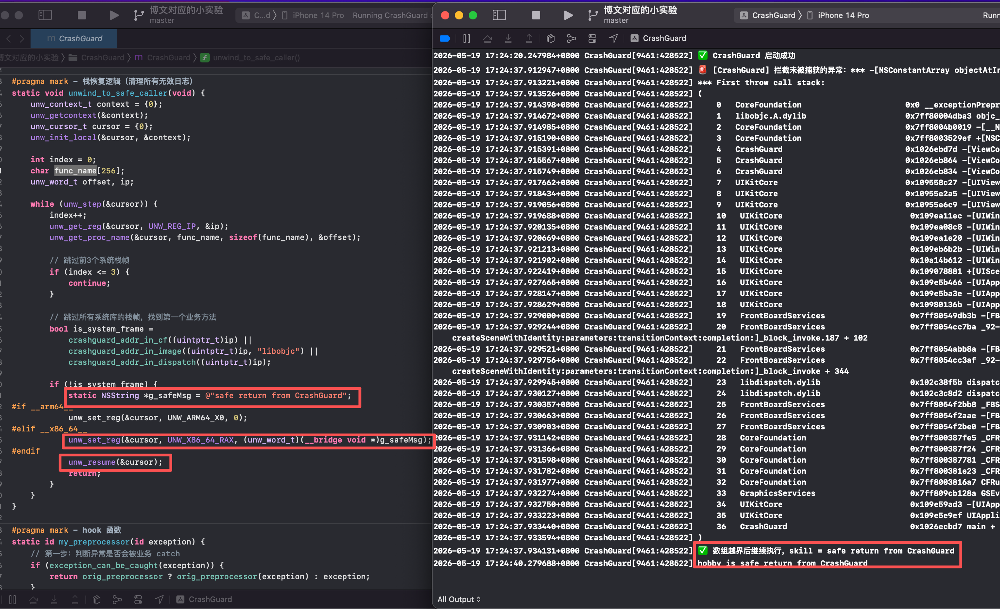

上面给寄存器 x0 设置了一个字符串，只是为了方便演示。真实情况中，返回0或者 nil 即可

```c++
unw_word_t safeReturnValue = (unw_word_t)kSafeNilReturn;
// 检查当前函数是否是 objectAtIndex:
if (strstr(func_name, "objectAtIndex")) {
    // 对于数组越界，返回 nil 是最安全的选择
    safeReturnValue = (unw_word_t)nil;
}
#if __arm64__
		unw_set_reg(&cursor, UNW_ARM64_X0, safeReturnValue);
#elif __x86_64__
		unw_set_reg(&cursor, UNW_X86_64_RAX, safeReturnValue);
#endif
```

完整代码在：[CrashGuard](https://github.com/fantasticLBP/BlogDemos/CrashGuard)


### 7. 为什么说 try...catch 影响 App 性能

#### 1. 性能开销
知道 C++ 异常模型以及工作流程（libunwind 和 libc++ABI），就知道为什么会慢了。因为底层 libunwind 会做两次栈遍历：
- Phase 1（搜索）：异常抛出后，从抛出点往上回溯，遍历每一层栈帧，查 `__unwind_info`、`__gcc_except_tab`，直到遍历结束或者找能处理异常的 Landing Pad，记录能处理的 handler 到异常对象里。该阶段只查不清理。
- Phase 2（展开）：找到后再重新遍历一遍栈帧，执行析构、清理局部资源、按照 callee register 约定，恢复 callee 寄存器，最后跳转到 Landing Pad。

两次遍历 + 查表 + 栈恢复，开销比普通 if/else 大几十倍，属于慢路径。


#### 2. 包体积增大
代码写了 try...catch...,经过 clang 编译器，底层会生成一堆为了配合 C++ 异常模型相关的代码。3大类：
- LandingPad 代码块：异常被 catch 时的入口机器码，每个 try 对应一个
- unwind 元数据：`__unwind_info` 里的栈帧恢复信息
- 异常表项：`__gcc_except_tab` 里记录 try-catch 范围、异常类型、handler 地址。


## 四、产品设计层面

### 1 . 业务方可参与决策的 workflow

安全气垫上线后，需要结合 mPass 的能力，我来描述一个典型的使用场景：

- App 内置了异常捕获能力，可以拦截全部的 NSException
- 在拦截后也会产生调用堆栈，剔除系统库、三方库，只保留 App 主 MachO 的调用堆栈的前6个，然后进行 hash，产生异常 NSExceptionKey
- 第一次收到上报则不处理，如果数据上报达到报警配置策略。比如1分钟内10条、或者影响用户数超过10个，则通过 Lark、邮件、报警给业务域负责人。业务域负责人通过报警详情页的链接，点击跳转打开 mPass 系统页面
- 后台的 mPass 页面可以看到 top的异常列表，每个列表 item 也会显示 NSExceptionKey。每个 NSException 上报，也可以看到堆栈所处的代码 SDK，每个业务域都配置了对应的负责人。top 级的每个 NSException需要每个业务负责人去评估审核“能不能拦，拦截后返回默认值是否安全？”，评估后在 mPass 页面进行操作
- App 会通过一些时机去拉取这个配置。如果发现当前的 NSExceptionKey 命中 allow_hook_return_safevalue 则不会 crash，并且会返回一个默认值。

### 2. 拉取测略设计

#### 1. 拉取时机

|         触发时机         | 优先级 |         执行逻辑          |                  设计原因                  |
| :----------------------: | :----: | :-----------------------: | :----------------------------------------: |
|      **App 冷启动**      |  最高  |  阻塞式拉取，超时时间 3s  | 启动阶段是崩溃高发期，必须保证最新配置生效 |
|  **App 从后台切到前台**  |   高   | 非阻塞式拉取，超时时间 5s | 用户回到 App 时是使用高峰期，及时更新配置  |
| **网络状态从无网变有网** |   中   |       非阻塞式拉取        |        解决无网启动时拉取失败的问题        |
|       **定时拉取**       |   低   |  每 **5 分钟** 拉取一次   |        兜底机制，保证配置最终一致性        |
|       **页面切换**       | ❌ 不做 |         完全不做          |           性能影响太大，得不偿失           |

#### 2. diff 增量更新

##### 1. 版本号机制

- 每个配置都有一个全局递增的版本号 `version`
- App 本地保存上一次拉取成功的版本号 `local_version`
- `每次拉取时带上 `local_version` 参数

##### 2. 服务端返回逻辑

根据首次请求、非首次请求的 diff 部分返回

```js
if (client_version == 0) {
    // 第一次拉取，返回全量配置
    return {
        "type": "full",
        "version": 1234,
        "data": [ ... ] // 完整的白名单列表
    }
} else if (client_version < latest_version) {
    // 有更新，返回增量 diff
    return {
        "type": "diff",
        "version": 1234,
        "add": [ ... ], // 新增的条目
        "update": [ ... ], // 修改的条目
        "delete": [ ... ] // 删除的条目（只包含 NSExceptionKey）
    }
} else {
    // 没有更新，返回空
    return {
        "type": "no_change",
        "version": 1234
    }
}
```

##### 3. 本地合并

端上进行数据合并

```js
// 收到服务器响应后
if (response.type == "full") {
    // 全量更新，直接替换本地配置
    self.localConfig = response.data;
    self.localVersion = response.version;
} else if (response.type == "diff") {
    // 处理新增
    for (ConfigItem *item in response.add) {
        self.localConfig[item.exceptionKey] = item;
    }
    // 处理修改
    for (ConfigItem *item in response.update) {
        self.localConfig[item.exceptionKey] = item;
    }
    // 处理删除
    for (NSString *key in response.delete) {
        [self.localConfig removeObjectForKey:key];
    }
    // 更新版本号
    self.localVersion = response.version;
}

// 保存到本地磁盘
[self saveConfigToDisk];
```


##### 4. 说明

**diff 包的大小通常只有几 KB**

- 每次更新通常只有几个新增或修改的条目
- 流量消耗比全量拉取减少 90% 以上
- 拉取速度极快，几乎不会影响用户体验

**全量兜底机制**

- 如果本地版本号和服务器版本号相差超过 10 个版本，服务器直接返回全量配置
- 避免 diff 累积过多导致合并错误
- 保证配置的最终一致性

**本地磁盘缓存**

- 每次拉取成功后，将配置和版本号保存到本地磁盘
- App 启动时，先加载本地缓存的配置，再去拉取最新配置
- 即使网络完全不可用，也能使用上一次的配置


## 五、核心原则

这是一个经典的策略问题，端上的异常发生时，安全气垫的“做与不做”问题
聊聊类似网易的大白解决方案或者业界其他公司中，安全气垫虽然保证了代码不 crash，影响用户体验，但是比如数组本该越界，现在却不越界：

1. 唯一能做的就是返回一个错误的值，比如数组长度为3，访问4，现在不 crash，返回了 0 的值，那是不是产生了业务异常？比如商品价格
2. 不 crash，也不返回错误位置的值，类似给一个回调，告诉业务方出现了异常，可以做一些业务层面的提醒或者配置(比如开发阶段商品卡片的价格 Label 显示：商品价格获取错误，数组越界)，同时产生的异常案发现场信息和其他的一些数据会上报，用于 APM 平台去分析和定位。

但这也产生一个问题，类似数组越界的场景，可能10000次里面9999次都正常，只有1次异常，业务开发为了这万分之一出现的异常，还需要写一些异常处理的逻辑（比如商品卡片展示价格获取错误，数组越界）。那字典的 key 为 nil 呢？除法的分母为0呢？诸如此类，类似乐观锁和悲观锁的场景

所以：安全气垫并不是一刀切只防护，让 App 不崩溃。

不崩溃 ≠ 假装没问题

**不崩溃 = 优雅降级 + 上报问题 + 业务可感知**。也就是在不破坏业务正确性的前提下，同时兼顾 App 稳定性，又需要即时将问题暴露给开发者，让开发同学可感知、可衡量、可修复。同时让产品更稳定、体验更好。


要解决「安全气垫防崩溃但引发隐性业务异常」「低概率异常导致业务开发冗余逻辑」的核心矛盾，业界的优雅方案核心思路是：「环境差异化策略」+「分层兜底 + 语义化默认值」+「可观测驱动的轻量处理」，既避免线上 Crash，又最小化业务侵入，同时保证问题可被发现和修复。

**开发阶段让问题 “炸出来”，生产阶段让问题 “软落地”**。从源头减少线上低概率异常的发生，业务开发无需为 “万分之一” 的异常写冗余逻辑

| 环境        | 核心目标                           | 策略                                |
| ----------- | ---------------------------------- | ----------------------------------- |
| 开发 / 测试 | 提前暴露问题，杜绝上线             | 「零容忍」：直接 Crash + 详细上下文 |
| 生产        | 避免 Crash + 可观测 + 最小业务影响 | 「软兜底」：语义化默认值 + 全量上报 |


## 六、多个方案

### 方案1：环境差异化 + 开发强感知（网易大白/腾讯 Bugly 核心思路）

对 NSArray、NSDictionary、NSNumber 等基础类做运行时 Hook，区分环境处理异常：
NSArray+DWSafeHook.m

```Objective-C
//  核心逻辑：
//  1. Method Swizzling Hook数组核心读写方法
//  2. Debug环境：越界直接Crash+详细上下文，强制研发修复
//  3. Release环境：拦截崩溃+上报异常+返回语义化空值，避免用户感知
//
#import "NSArray+DWSafeHook.h"
#import <objc/runtime.h>
#import "DWEnvironmentUtils.h"   // 环境判断工具类（自研）
#import "DWCrashReporter.h"      // 崩溃上报工具类（自研）

@implementation NSArray (DWSafeHook)

#pragma mark - 对外入口：初始化Hook
+ (void)dw_setupSafeHook {
    // 防止重复Hook
    static dispatch_once_t onceToken;
    dispatch_once(&onceToken, ^{
        // Hook 只读数组核心方法
        [self dw_swizzleInstanceMethod:@selector(objectAtIndex:) 
                          withNewMethod:@selector(dw_safe_objectAtIndex:)];
        [self dw_swizzleInstanceMethod:@selector(objectAtIndexedSubscript:) 
                          withNewMethod:@selector(dw_safe_objectAtIndexedSubscript:)];
        
        // Hook 可变数组核心方法（写操作）
        [NSMutableArray dw_swizzleInstanceMethod:@selector(addObject:) 
                                   withNewMethod:@selector(dw_safe_addObject:)];
        [NSMutableArray dw_swizzleInstanceMethod:@selector(insertObject:atIndex:) 
                                   withNewMethod:@selector(dw_safe_insertObject:atIndex:)];
        [NSMutableArray dw_swizzleInstanceMethod:@selector(removeObjectAtIndex:) 
                                   withNewMethod:@selector(dw_safe_removeObjectAtIndex:)];
    });
}

#pragma mark - 私有工具：Method Swizzling封装
/// 通用Swizzling方法（避免重复代码）
/// @param originalSEL 原方法SEL
/// @param newSEL 替换后的方法SEL
+ (void)dw_swizzleInstanceMethod:(SEL)originalSEL withNewMethod:(SEL)newSEL {
    Class cls = [self class];
    
    // 获取原方法和新方法
    Method originalMethod = class_getInstanceMethod(cls, originalSEL);
    Method newMethod = class_getInstanceMethod(cls, newSEL);
    if (!originalMethod || !newMethod) {
        NSLog(@"[DWCrashGuard] Swizzling失败：方法不存在 originalSEL: %@, class: %@", 
              NSStringFromSelector(originalSEL), NSStringFromClass(cls));
        return;
    }
    
    // 尝试添加新方法（防止原方法未实现）
    BOOL isAdded = class_addMethod(cls, 
                                   originalSEL, 
                                   method_getImplementation(newMethod), 
                                   method_getTypeEncoding(newMethod));
    if (isAdded) {
        // 替换原方法实现
        class_replaceMethod(cls, 
                            newSEL, 
                            method_getImplementation(originalMethod), 
                            method_getTypeEncoding(originalMethod));
    } else {
        // 交换方法实现
        method_exchangeImplementations(originalMethod, newMethod);
    }
}

#pragma mark - Hook实现：只读数组读操作（核心防越界）
/// 拦截 [array objectAtIndex:] 越界
- (id)dw_safe_objectAtIndex:(NSUInteger)index {
    // 安全校验：索引越界判断
    if (index >= self.count) {
        [self dw_handleArrayOutOfBoundsWithIndex:index method:@"objectAtIndex:"];
        return [NSNull null]; // Release环境返回语义化空值（而非0）
    }
    
    // 正常逻辑：调用原方法（Swizzle后，此处实际是原objectAtIndex:）
    return [self dw_safe_objectAtIndex:index];
}

/// 拦截 array[index] 下标访问越界
- (id)dw_safe_objectAtIndexedSubscript:(NSUInteger)index {
    if (index >= self.count) {
        [self dw_handleArrayOutOfBoundsWithIndex:index method:@"objectAtIndexedSubscript:"];
        return [NSNull null];
    }
    
    return [self dw_safe_objectAtIndexedSubscript:index];
}

#pragma mark - 私有工具：数组越界统一处理
/// 数组越界异常处理（区分环境）
/// @param index 访问的索引
/// @param method 触发异常的方法名
- (void)dw_handleArrayOutOfBoundsWithIndex:(NSUInteger)index method:(NSString *)method {
    // 1. 构建异常上下文（用于上报/调试）
    NSDictionary *context = @{
        @"crashType": @"NSArrayOutOfBounds",
        @"method": method,
        @"arrayCount": @(self.count),
        @"accessIndex": @(index),
        @"arrayDescription": [self description], // 数组内容（便于定位）
        @"callStack": [NSThread callStackSymbols], // 完整调用栈
        @"timestamp": @([[NSDate date] timeIntervalSince1970]),
        @"deviceInfo": [DWEnvironmentUtils deviceInfo] // 设备型号/系统版本等
    };
    
    // 2. 区分环境处理
    if ([DWEnvironmentUtils isDebugEnvironment]) {
        // Debug环境：直接Crash+详细日志，强制研发修复
        NSString *errorMsg = [NSString stringWithFormat:
                              @"【网易大白】NSArray越界崩溃！\n"
                              @"方法：%@\n"
                              @"数组长度：%lu，访问索引：%lu\n"
                              @"数组内容：%@\n"
                              @"调用栈：%@",
                              method, self.count, index, self, [NSThread callStackSymbols]];
        NSAssert(NO, @"%@", errorMsg);
        abort(); // 确保Crash（NSAssert在Release下失效）
    } else {
        // Release环境：拦截崩溃+上报APM平台
        [DWCrashReporter reportCrashWithType:@"NSArrayOutOfBounds" 
                                     context:context 
                                    severity:DWCrashSeverityLow]; // 低优先级（万分之一概率）
        NSLog(@"[DWCrashGuard] 拦截NSArray越界：%@, count:%lu, index:%lu", method, self.count, index);
    }
}

@end

#pragma mark - 可变数组Hook实现（写操作防护）
@implementation NSMutableArray (DWSafeHook)

/// 拦截 addObject:nil 崩溃
- (void)dw_safe_addObject:(id)anObject {
    if (anObject == nil) {
        // 构建异常上下文
        NSDictionary *context = @{
            @"crashType": @"NSMutableArrayAddNil",
            @"callStack": [NSThread callStackSymbols],
            @"timestamp": @([[NSDate date] timeIntervalSince1970])
        };
        
        if ([DWEnvironmentUtils isDebugEnvironment]) {
            // Debug环境：Crash+提示
            NSAssert(NO, @"【网易大白】NSMutableArray添加nil对象！调用栈：%@", [NSThread callStackSymbols]);
            abort();
        } else {
            // Release环境：拦截+上报，忽略nil添加
            [DWCrashReporter reportCrashWithType:@"NSMutableArrayAddNil" 
                                         context:context 
                                        severity:DWCrashSeverityLow];
            NSLog(@"[DWCrashGuard] 拦截NSMutableArray添加nil对象");
            return;
        }
    }
    
    // 正常逻辑：调用原方法
    [self dw_safe_addObject:anObject];
}

/// 拦截 insertObject:atIndex: 越界/nil
- (void)dw_safe_insertObject:(id)anObject atIndex:(NSUInteger)index {
    // 1. 校验nil
    if (anObject == nil) {
        [self dw_handleMutableArrayNilObjectWithMethod:@"insertObject:atIndex:"];
        return;
    }
    
    // 2. 校验越界
    if (index > self.count) { // insert允许index == count（追加）
        [self dw_handleArrayOutOfBoundsWithIndex:index method:@"insertObject:atIndex:"];
        return;
    }
    
    // 正常逻辑
    [self dw_safe_insertObject:anObject atIndex:index];
}

/// 拦截 removeObjectAtIndex: 越界
- (void)dw_safe_removeObjectAtIndex:(NSUInteger)index {
    if (index >= self.count) {
        [self dw_handleArrayOutOfBoundsWithIndex:index method:@"removeObjectAtIndex:"];
        return;
    }
    
    // 正常逻辑
    [self dw_safe_removeObjectAtIndex:index];
}

#pragma mark - 私有工具：可变数组nil处理
- (void)dw_handleMutableArrayNilObjectWithMethod:(NSString *)method {
    NSDictionary *context = @{
        @"crashType": @"NSMutableArrayInsertNil",
        @"method": method,
        @"callStack": [NSThread callStackSymbols]
    };
    
    if ([DWEnvironmentUtils isDebugEnvironment]) {
        NSAssert(NO, @"【网易大白】NSMutableArray插入nil对象！方法：%@，调用栈：%@", method, [NSThread callStackSymbols]);
        abort();
    } else {
        [DWCrashReporter reportCrashWithType:@"NSMutableArrayInsertNil" 
                                     context:context 
                                    severity:DWCrashSeverityLow];
        NSLog(@"[DWCrashGuard] 拦截NSMutableArray插入nil对象：%@", method);
    }
}
@end
```

简化下，逻辑基本为：

```Objective-C
// 伪代码：Hook NSArray的objectAtIndex:
- (id)safe_objectAtIndex:(NSUInteger)index {
    if (index >= self.count) {
        // 开发环境：Crash + 打印完整的案发现场信息 + 调用栈 + 上下文（数组内容、访问索引、业务模块）
        #ifdef DEBUG
            NSAssert(NO, @"数组越界：数组长度%lu，访问索引%lu，调用栈：%@", self.count, index, [NSThread callStackSymbols]);
            abort();
        #else
            // 生产环境：返回语义化空值（而非0）+ 上报APM
            [APMManager reportExceptionWithType:@"数组越界" 
                                      context:@{@"arrayCount": @(self.count), @"index": @(index), @"callStack": [NSThread callStackSymbols]}];
            return [NSNull null]; // 而非0，业务层可统一识别，比如价格展示为: '--'
        #endif
    }
    return [self original_objectAtIndex:index];
}
```
核心优势：
- 开发环境：不仅 Crash，还打印「业务数据上下文」（比如当前是商品详情页、数组是价格数组），开发一眼定位问题
- 生产环境：返回NSNull（而非无意义的 0），业务层只需做一次全局 UI 处理（比如所有 Label 展示时，判断值为NSNull则显示 “--”），无需为每个场景写逻辑
覆盖场景：
- 数组越界：返回NSNull；
- 字典 key 为 nil：setObject:forKey:时忽略 nil key 并上报，objectForKey:时返回NSNull；
- 分母为 0：返回INFINITY（全局工具类判断isinf()，统一返回 “--”）；
- 字符串转数字失败：返回NSNull而非 0

### 方案2：声明式全局兜底 + 业务按需关注（阿里/字节）
避免业务层 “零散处理异常”，而是**全局统一兜底 + 业务选择性注册关注的异常类型**。
- 全局层面：所有基础类异常返回 NSNull，UI 层统一处理 NSNull 为 “--”/“获取失败”；
- 业务层面：仅对 “核心场景”（如商品价格、支付金额）注册异常回调，非核心场景无需处理：

WXExceptionManager.h
```Objective-C
#import <Foundation/Foundation.h>

NS_ASSUME_NONNULL_BEGIN

/// 异常类型枚举（替代字符串，避免硬编码）
typedef NS_ENUM(NSUInteger, WXExceptionType) {
    WXExceptionTypeArrayOutOfBounds, // 数组越界
    WXExceptionTypeDictionaryNilKey, // 字典nil key
    WXExceptionTypeDivideByZero,     // 分母为0
};

/// 异常上下文Key定义（统一常量，避免拼写错误）
FOUNDATION_EXTERN NSString *const WXExceptionContextBizModuleKey; // 业务模块
FOUNDATION_EXTERN NSString *const WXExceptionContextArrayCountKey;// 数组长度
FOUNDATION_EXTERN NSString *const WXExceptionContextAccessIndexKey;// 访问索引
FOUNDATION_EXTERN NSString *const WXExceptionContextCallStackKey; // 调用栈
FOUNDATION_EXTERN NSString *const WXExceptionContextExtraKey;     // 扩展信息

@interface WXExceptionManager : NSObject

/// 单例（全局唯一）
+ (instancetype)sharedManager;

/// 注册异常回调
/// @param type 异常类型
/// @param handler 回调（主线程执行，避免UI操作崩溃）
- (void)registerCallbackForType:(WXExceptionType)type handler:(void(^)(NSDictionary *context))handler;

/// 上报异常（内部Hook调用，业务层无需调用）
/// @param type 异常类型
/// @param context 异常上下文
- (void)reportExceptionWithType:(WXExceptionType)type context:(NSDictionary *)context;

@end

NS_ASSUME_NONNULL_END
```
WXExceptionManager.m
```Objective-C
#import "WXExceptionManager.h"
#import <pthread/pthread.h>

// 上下文Key常量定义
NSString *const WXExceptionContextBizModuleKey = @"bizModule";
NSString *const WXExceptionContextArrayCountKey = @"arrayCount";
NSString *const WXExceptionContextAccessIndexKey = @"accessIndex";
NSString *const WXExceptionContextCallStackKey = @"callStack";
NSString *const WXExceptionContextExtraKey = @"extra";

@interface WXExceptionManager ()
/// 存储不同异常类型的回调（key: WXExceptionType的NSNumber，value: 回调数组）
@property (nonatomic, strong) NSMutableDictionary<NSNumber *, NSMutableArray<void(^)(NSDictionary *)> *> *callbackDict;
/// 线程安全锁
@property (nonatomic, assign) pthread_mutex_t mutex;
@end

@implementation WXExceptionManager

+ (instancetype)sharedManager {
    static WXExceptionManager *instance = nil;
    static dispatch_once_t onceToken;
    dispatch_once(&onceToken, ^{
        instance = [[self alloc] init];
    });
    return instance;
}

- (instancetype)init {
    self = [super init];
    if (self) {
        _callbackDict = [NSMutableDictionary dictionary];
        // 初始化线程锁
        pthread_mutex_init(&_mutex, NULL);
    }
    return self;
}

/// 注册异常回调
- (void)registerCallbackForType:(WXExceptionType)type handler:(void (^)(NSDictionary *))handler {
    if (!handler) return;
    
    pthread_mutex_lock(&_mutex);
    // 按异常类型分组存储回调
    NSNumber *typeKey = @(type);
    if (!_callbackDict[typeKey]) {
        _callbackDict[typeKey] = [NSMutableArray array];
    }
    [_callbackDict[typeKey] addObject:handler];
    pthread_mutex_unlock(&_mutex);
}

/// 上报异常（触发回调+APM上报）
- (void)reportExceptionWithType:(WXExceptionType)type context:(NSDictionary *)context {
    // 1. APM平台上报（模拟：实际对接公司APM，如Bugly/云监控）
    NSLog(@"【APM上报】异常类型：%lu，上下文：%@", type, context);
    
    // 2. 触发注册的回调（主线程执行，避免UI操作崩溃）
    dispatch_async(dispatch_get_main_queue(), ^{
        pthread_mutex_lock(&self->_mutex);
        NSNumber *typeKey = @(type);
        NSArray *handlers = self->_callbackDict[typeKey];
        pthread_mutex_unlock(&self->_mutex);
        
        for (void(^handler)(NSDictionary *) in handlers) {
            if (handler) {
                handler(context);
            }
        }
    });
}

- (void)dealloc {
    pthread_mutex_destroy(&_mutex);
}

#pragma mark - 类方法封装（简化调用）
+ (void)registerCallbackForType:(WXExceptionType)type handler:(void (^)(NSDictionary *))handler {
    [[self sharedManager] registerCallbackForType:type handler:handler];
}

+ (void)reportExceptionWithType:(WXExceptionType)type context:(NSDictionary *)context {
    [[self sharedManager] reportExceptionWithType:type context:context];
}

@end
```
使用的地方
```Objective-C
- (void)viewDidLoad {
    [super viewDidLoad];
    self.view.backgroundColor = [UIColor whiteColor];
    
    // 1. 初始化价格标签
    self.priceLabel = [[UILabel alloc] initWithFrame:CGRectMake(100, 200, 200, 40)];
    self.priceLabel.font = [UIFont systemFontOfSize:18];
    [self.view addSubview:self.priceLabel];
    
    // 2. 模拟业务数据：价格数组（长度3，索引0-2）
    self.priceArray = @[@"99.9", @"199.9", @"299.9"];
    // 标记数组所属业务模块（关键：用于回调筛选）
    self.priceArray.bizModule = @"goodsPrice";
    
    // 3. 注册数组越界异常回调（仅关注价格模块）
    [WXExceptionManager registerCallbackForType:WXExceptionTypeArrayOutOfBounds handler:^(NSDictionary *context) {
        // 筛选：仅处理“价格数组”的越界异常
        if ([context[WXExceptionContextBizModuleKey] isEqualToString:@"goodsPrice"]) {
            NSLog(@"【业务降级】商品价格数组越界，触发UI兜底");
            // 生产环境：展示友好提示（而非错误值）
            self.priceLabel.text = @"价格获取失败";
            // 可选：触发其他降级逻辑（如隐藏价格、显示默认价）
            [self triggerPriceFallback];
        }
    }];
    
    // 4. 模拟异常场景：访问索引3（越界）
    [self testPriceArrayOutOfBounds];
}

/// 模拟价格数组越界访问
- (void)testPriceArrayOutOfBounds {
    // 访问索引3（数组长度3，正常索引0-2）
    id price = [self.priceArray objectAtIndex:3];
    // 正常场景：显示价格；异常场景：price是NSNull，显示兜底
    if ([price isKindOfClass:[NSNull class]]) {
        self.priceLabel.text = @"价格获取失败";
    } else {
        self.priceLabel.text = [NSString stringWithFormat:@"¥%@", price];
    }
}

/// 价格降级逻辑（可选）
- (void)triggerPriceFallback {
    // 比如：隐藏优惠券、显示默认包邮等
    NSLog(@"【降级】隐藏优惠券模块，显示默认包邮文案");
}

@end
```
核心优势：
- 99% 的低概率异常由全局兜底处理（返回 NSNull+UI 显示 --）
- 仅核心业务场景（价格、支付）需写少量回调逻辑，避免冗余
效果，类似针对核心的业务场景做专项化监控和优化。


### 方案 3：静态分析 + CI/CD 前置拦截（从源头消灭异常）
比运行时 Hook 更优雅的是 **“提前拦截”**。通过静态分析工具（Clang Static Analyzer、OCLint、自定义 LLVM 插件），在代码提交/编译阶段检测出：
- 数组越界风险（如array[index]中 index 未做长度校验）
- 字典 key 为 nil（如dict[nil]）
- 分母为 0（如a / b中 b 未判 0）
- 强制类型转换风险（如(NSNumber *)nil）

落地方式：
- 集成到 CI/CD Pipeline，代码提交时触发静态分析，有风险则阻断合入
- 通过编写 LLVM 插件，就可以在 Xcode 有问题的代码上实时提示 “数组越界风险”“字典 key 可能为 nil”。比如
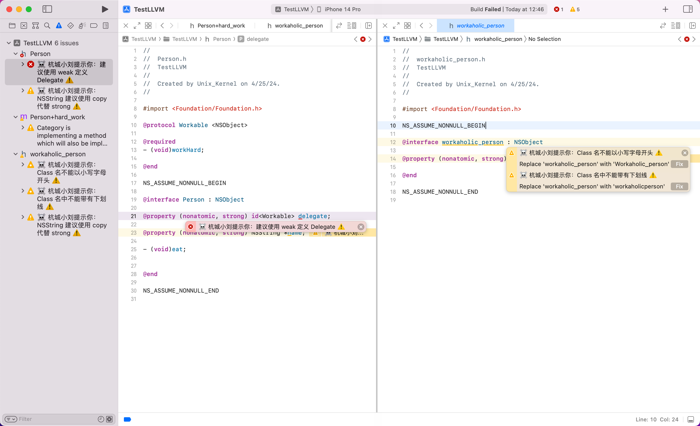

效果：线上低概率异常的根源被提前消灭，问题无法逃逸到现线上，业务层几乎无需处理这类异常（因为代码本身就没有漏洞）

关于如何编写 LLVM 插件，做到在 Xcode 中实时展示代码中存在的问题，可以查看：[LLVM 插件](https://github.com/FantasticLBP/knowledge-kit/blob/master/Chapter1%20-%20iOS/1.102.md) 这篇文章。


### 方案 4：轻量级熔断 / 降级（适合核心业务场景）

对于 “万分之一” 但影响大的异常（如支付金额计算、商品价格），采用「熔断策略」：
第一次出现异常：上报 + 降级为默认值（如价格显示 “--”）；
短时间内多次出现（如 1 分钟内 > 3 次）：触发熔断，建议：展示兜底 UI，提示安抚用户，稍等片刻后尝试（起码不会发生稳定的 crash 或者业务异常）
熔断状态上报 APM，研发收到告警后优先修复。

### 方案 5：语义化默认值 + 业务无感知适配（美团 / 饿了么实践）

返回**业务可识别的语义化空值**，并在 UI 层做统一适配：

| 异常场景         | 兜底值   | UI 层统一处理   | 业务层感知 |
| ---------------- | -------- | --------------- | ---------- |
| 数组越界         | NSNull   | 显示 “--”       | 无         |
| 字典 key 为 nil  | NSNull   | 显示 “暂无数据” | 无         |
| 分母为 0         | INFINITY | 显示 “计算异常” | 无         |
| 字符串转数字失败 | NSNull   | 显示 “--”       | 无         |

**实现方式**：

- 封装全局 UI 工具类（如`WXUILabel+Safe.h`），重写`setText:`方法：

```objective-c
- (void) safe_setText:(id)text {
    if (text == [NSNull null] || text == nil) {
        self.text = @"--";
    } else if ([text isKindOfClass:[NSNumber class]] && isinf([text doubleValue])) {
        self.text = @"计算异常";
    } else {
        self.text = [text description];
    }
}
```

业务层只需使用`safe_setText:`，无需为每个异常场景写判断逻辑。


## 七、最佳实践

1. **开发环境零容忍**：通过静态分析、自定义 LLVM 插件 + 运行时 Hook，让问题在测试阶段暴露，比如异常发生时，通过日志打印案发现场数据，或者在 Xcode 面板上可视化的在有问题的代码地方显示 error，及时 crash 掉，阻塞正常流程，以防止开发偷懒不去及时修复，产生技术债，同时也防止问题逃逸到线上。
2. **生产环境软兜底**：不要一刀切，做到可配置。业务方在配置平台可以针对不同业务域的配置，决定是否开启兜底展示（某些业务域的架构师可能更严格，需要开发在 debug 阶段解决这些问题，线上如果出现就统计为 crash）。如果开启，那么安全气垫就返回语义化默认值（而非无意义的 0），全局 UI 统一处理，业务层零侵入；
3. **可观测驱动修复**：APM 平台统计异常频率 / 影响度，优先处理高频高影响的异常；
4. **核心场景按需关注**：仅对价格、支付等核心场景注册回调，非核心场景无需处理。

虽然机制和策略已经制定了，但是执行还是靠人，难以保证100%解决问题。所以开发解决通过 lint 和 crash 可以拦截到大部分问题，但是逃逸到线上的部分问题，还是需要安全气垫去 cover，线下无限毕竟去清空问题 + 少数逃逸到线上的问题通过安全气垫去 cover 就可以保证相对全面的安全守护。


## 八、平台做些什么

获取到 问题数据是第一步，获取之后问题需要及时上报，需要有一个数据上报系统，数据及时准确、高效的上传到服务端（这就是另一个命题，可以查看这篇文章：[打造一个通用、可配置、多句柄的数据上报 SDK](https://github.com/FantasticLBP/knowledge-kit/blob/master/Chapter1%20-%20iOS/1.80.md)），到 APM 后台。后台产生工单，根据业务模块分配到对应的责任人、群组。根据问题的紧急程度，报警策略和提醒频次也不一样，比如**波动报警、自定义报警策略等（这也是另一个命题：智能报警策略、波动报警策略、业务线自定义可配置责任人等）**。责任人及时解决问题、修改工单状态、热修复或者发布新版本，问题闭环。

线上异常上报后，APM 平台需提供：

- 异常频率（如 “数组越界” 仅 1/10000）；
- 影响用户数（如仅影响 10 个用户）；
- 业务上下文（如 “商品详情页 - 价格数组”）；
- 调用栈 + 设备信息。

**核心逻辑**：

- 低频率、低影响的异常（如 1/10000，影响 10 用户）：暂时无需业务层处理，研发排期修复即可；
- 高频率、高影响的异常（如 1/100，影响 1000 用户）：触发告警，研发紧急修复，业务层临时加兜底。

这样业务开发无需为 “万分之一” 的异常写逻辑，仅需处理 “高频高影响” 的异常。


## 总结

“最佳实践”部分选择的方案既避免了 “安全气垫返回错误值导致业务异常”，又解决了 “业务开发为低概率异常写冗余逻辑” 的问题，是网易、腾讯、阿里等大厂的通用实践 ——**优雅的方案不是 “兜底所有异常”，而是 “让异常可被提前发现、可被观测、最小化影响”**，即使少数逃逸到线上的，再由安全气垫去兜底解决（解决了展示问题、异常上报和案发现场还原问题），一个好的 APM 平台不光是告诉你又问题，还会告诉你哪里有问题。


