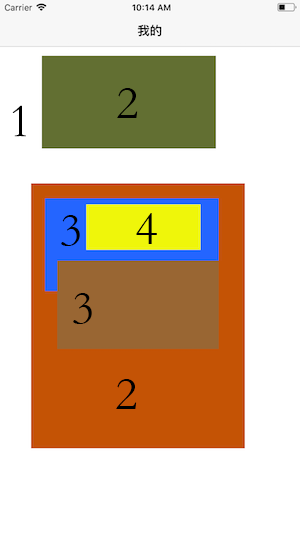
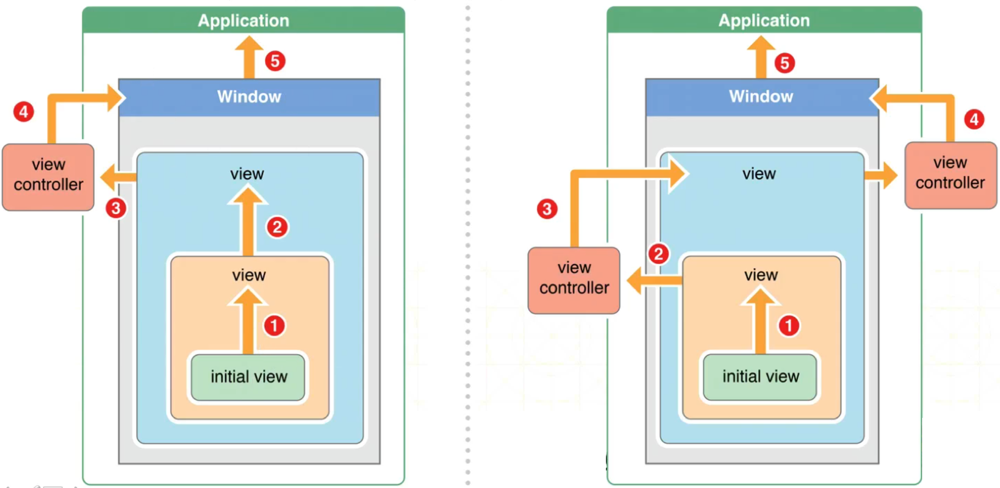

# 事件响应者链

# 一、找到最合适的控件来接收触摸事件

## 1. 实验1

- 定义 BaseView，在里面实现方法 touchBegan，监听当前哪个类调用了该方法
- 定义 KeyWindow，在里面实现 hitTest 方法，监听哪个类调用了该方法，用来追踪判断哪个 view 是最合适的 view
- 在控制器的界面上加5个颜色不同的 view，每个 view 自定义 view 去实现，因此在不同的 view 上的手势就可以由不同的 view 拦截到




```objective-c
//BaseView
#import "BaseView.h"

@implementation BaseView
-(void)touchesBegan:(NSSet<UITouch *> *)touches withEvent:(UIEvent *)event{
		NSLog(@"%@",[self class]);
}
```

```objective-c
//KeyWindow
-(UIView *)hitTest:(CGPoint)point withEvent:(UIEvent *)event{
    UIView *view = [super hitTest:point withEvent:event];
    NSLog(@"fittest->%@",view);
    return view;
}
```

实验现象：

点击了白色1:

```shell
2017-10-11 16:48:52.882547+0800 主流App框架[16295:358790] BrownView--hitTest withEvent
2017-10-11 16:48:59.646610+0800 主流App框架[16295:358790] GreenView--hitTest withEvent
2017-10-11 16:48:59.647145+0800 主流App框架[16295:358790] fittest-><UIView: 0x7f8f23406510; frame = (0 0; 414 736); autoresize = W+H; layer = <CALayer: 0x60c000221840>>
2017-10-11 16:48:59.647575+0800 主流App框架[16295:358790] BrownView--hitTest withEvent
2017-10-11 16:48:59.647702+0800 主流App框架[16295:358790] GreenView--hitTest withEvent
2017-10-11 16:48:59.647880+0800 主流App框架[16295:358790] fittest-><UIView: 0x7f8f23406510; frame = (0 0; 414 736); autoresize = W+H; layer = <CALayer: 0x60c000221840>>
```

点击了蓝色3:

```shell
2017-10-11 16:49:56.331024+0800 主流App框架[16295:358790] BrownView--hitTest withEvent
2017-10-11 16:49:56.331335+0800 主流App框架[16295:358790] BView--hitTest withEvent
2017-10-11 16:49:56.331617+0800 主流App框架[16295:358790] BlueView--hitTest withEvent
2017-10-11 16:49:56.331968+0800 主流App框架[16295:358790] YellowView--hitTest withEvent
2017-10-11 16:49:56.333206+0800 主流App框架[16295:358790] fittest-><BlueView: 0x7f8f23406f10; frame = (19 21; 240 128); autoresize = RM+BM; layer = <CALayer: 0x60c0002218c0>>
2017-10-11 16:49:56.333633+0800 主流App框架[16295:358790] BrownView--hitTest withEvent
2017-10-11 16:49:56.333762+0800 主流App框架[16295:358790] BView--hitTest withEvent
2017-10-11 16:49:56.333893+0800 主流App框架[16295:358790] BlueView--hitTest withEvent
2017-10-11 16:49:56.334005+0800 主流App框架[16295:358790] YellowView--hitTest withEvent
2017-10-11 16:49:56.334185+0800 主流App框架[16295:358790] fittest-><BlueView: 0x7f8f23406f10; frame = (19 21; 240 128); autoresize = RM+BM; layer = <CALayer: 0x60c0002218c0>>
2017-10-11 16:49:56.334644+0800 主流App框架[16295:358790] BlueView
```

那么看出来hitTest方法的作用就是找出最合适的view，那么我们可以指定任何事情的最合适的view为特定的view

结果：点击不同的View打印出不同的类名。

结论：

* 点击了绿色（图上的2级）的view：UIApplication-&gt; UIWindow -&gt; UIViewController的view -&gt; 绿色的view
* 点击了蓝色（图上的3级）的view：UIApplication-&gt; UIWindow -&gt; UIViewController的view -&gt; 红棕色的view -&gt; 蓝色的view
* 点击了黄色（图上的4级）的view：UIApplication -&gt; UIWindow -&gt; UIViewController的view -&gt; 红棕色的view -&gt; 蓝色的view -&gt; 黄色的view
* 触摸事件是从父控件传递到子控件的。

注意：如果父控件不能接收触摸事件，那么这个父控件的子控件也不能接收触摸事件


## 2. 实验2

在KeyWindow中hitTest方法中返回BlueView，那么点击任何色块的view那么都会交给BlueView去处理事件。

```objective-c
//KeyWindow
-(UIView *)hitTest:(CGPoint)point withEvent:(UIEvent *)event{
    return self.subviews.firstObject.subviews.firstObject;
}
```

结果：

```shell
2017-10-11 22:48:46.102793+0800 主流App框架[21498:749663] GreenView
2017-10-11 22:48:46.668595+0800 主流App框架[21498:749663] GreenView
```

分析：因为事件的响应者链条就是当用户操作屏幕会产生一个事件，该事件被系统加入到事件队列中去，UIApplication 对象会将事件队列中最早加入进去的事件传递给 window，然后 window 找到最合适的 view 去处理事件。因此任何事件都会先通过 KeyWindow 对象去判断并找到最合适的 view


## 3. Hit-Test 命中测试

当手指触碰屏幕时：

- 硬件中断 → IOKit → 封装成 IOHIDEvent → 转发给 SpringBoard → 发送到 APP 的 `UIApplication`
- UIApplication 把事件交给 Keywindow
- 从 Keywindow 开始，调用 `hitTest:withEvent:` 方法，来寻找最合适的视图来响应事件
- 递归遍历所有子视图，调用  `-(BOOL)pointInside:(CGPoint)point withEvent:(UIEvent *)event` 方法来判断事件的坐标是否在当前 View 的范围内
- 找到最顶层、可交互、显示、未被遮挡的 View（代码逆序的原因）
- 确定：第一响应者（即 hit-test view）


## 4. hitTest 内部如何判断的

- 如果视图隐藏、不允许交互、alpha <= 0.01 → 直接忽略
- 判断触摸点是否在当前视图范围内 
- 倒序遍历子视图（后添加的在上层） 
- 递归调用子视图 hitTest 
- 如果有子视图返回有效 View → 返回它 
- 没有 → 返回自己

结论：

- hitTest 只会找到一个 View 来响应事件
- 不参与 hitTest 的 View 不可能接受到事件
- 子视图超出父视图，无法命中

# 二、事件响应原理

## 1. 响应者链条

产生的 touch 方法的默认做法是将事件顺着响应者链条向上传递，将事件交给上一个响应者处理。



**事件传递规则**：

- 如果当前这个 view 不是控制器的 view，那么上一个响应者就是父控件 View 
- 最顶层的 View 的 nextResponder 是所在的 ViewController
- ViewController 的 nextResponder 是 UIWindow
- UIWindow 的 nextResponder 是 UIApplication
- UIApplication 不处理事件，则该事件会被丢弃

**事件处理规则**：

- 子视图重写 `touchsBegan:` 等方法，则会自己处理，事件终止
- 不重写 `touchsBegan:` 则事件会继续往上抛
- 所有的响应者都不处理则事件会被销毁

控制器 view 上的子控件的 touch... 方法如果子控件不处理，那么都会顺着响应者链条向上传递给上一层响应者对象，比如可以交给控制器处理。


## 2. 触摸事件的完整流程

- 触摸事件被系统捕获，触发硬件中断

- 被 IOKit 封装为 IOHIDEvent，经过 SpringBoard 转发到 App 进程

- App 进程内：事件被派发到 UIApplication 的事件队列

- UIApplication sendEvent 到 UIWindow（keyWindow）

- 从 UIWindow 开始，逐层递归调用 `hitTest:withEvent:` 方法

  - 判断是否隐藏、是否可交互、透明度是否大于 0.1，不能则直接返回，则代表找不到最佳响应者
  - 能处理，则遍历当前 UIView 的 subViews，逆序遍历
  - 调用每个 subView 的 `hitTest:withEvent:` 方法，找出最佳事件响应者

- 找到最佳响应者后，先让手势识别器 UIGestureRecognizer 优先处理

  - 手势识别成功，则 原生 `touchesBegan:` 会被 cancel，不会走 touches 系列方法
  - 手势识别失败，才进入 `touchesBegan:withEvent:` 等原生方法

- 响应链传递：

  - 判断该 UIView 是否实现了 `touchBegan:` 系列的方法，如果实现则代表找到了事件响应，并实现处理逻辑
  - 如果当前 UIView 没有实现该方法，或者写了但仅在内部调用了 `[super ...]` 方法，则顺着事件响应链向上抛，找到 nextResponder
    - 当前 UIView 存在 superView，那么 nextResponder 就是 superView
    - 如果不存在 superView（当前 UIView 是 UIViewController 的 UIView），那么 nextResponder 就是 UIViewController
    - 如果 UIViewController 也没有实现事件响应方法，那么继续向上抛，交给 UIWindow
    - 如果 UIWindow 还没处理，则继续向上抛，交给 UIApplication
    - 如果 UIApplication 还没处理，则将该事件销毁，说明没有谁可以处理该事件
  - 一直往上抛，直到有人处理，或者直到没人处理，最终事件被丢弃

  

这上面可以分为2个流程：

- `hitTest:withEvent:`负责找到最佳响应者
- Responder Chain 事件响应链：处理事件，处理不了就向上抛


## 3. 手饰事件和点击事件的响应顺序

QA：上面提到了“找到最佳响应者后，先让手势识别器 UIGestureRecognizer 优先处理”，也就是说事件会先被手势识别器处理，手势识别器没有处理才会执行  `touchesBegan` 系列方法，为什么这么设计呢？

因为**手势是高级行为（点击、滑动、捏合、长按），比底层的 touches 更高级，所以优先识别。**

比如：给 View 添加了 **UITapGestureRecognizer 点按**事件，同时你也重写了 **touchesBegan** 方法。

系统会**先让手势判断是不是 “点击”**，一旦确认是点击：

- **touchesBegan /touchesMoved/touchesEnded 直接被取消！**
- 只会触发手势的点击方法


假如给某个 view 所在的父视图添加了手饰识别器。

**手势识别器的优先级**：如果你将 `UITapGestureRecognizer` 添加到了视图上，UIKit 会首先尝试识别手势。如果视图上添加了多个手势识别器，它们的识别顺序将根据它们被添加到视图的顺序或者它们的 `delaysTouchesBegan` 和 `delaysTouchesEnded` 属性来决定。

想要子 view 响应事件而不是被根视图拦截，则需要给手势识别器添加代理，实现代理方法

```objective-c
UIGestureRecognizer *gesture;
gesture.delegate = self;

- (BOOL)gestureRecognizerShouldBegin:(UIGestureRecognizer *)gestureRecognizer {
    return NO;
}
```

如果 `UITapGestureRecognizer` 识别了一个手势，它可以通过设置 `cancelsTouchesInView` 属性为 `YES` 来取消视图上的触摸事件，这样点击事件就不会被进一步传递到视图控制器的 `touchesBegan` 或 `touchesEnded` 方法。


## 4. QA

### 1. 为什么按钮能拦截事件？

因为 **UIControl 会拦截响应链**，事件不会向上传递。

### 2. UIGestureRecognizer 与事件传递关系

- 因为手势识别器优先于 touches 系列的方法
- 如果手势识别成功，则会取消原来的触摸事件

