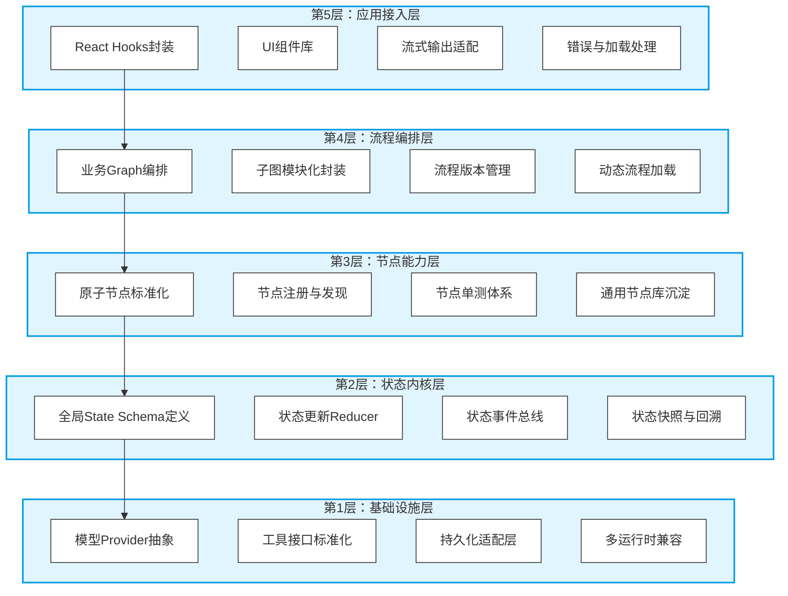
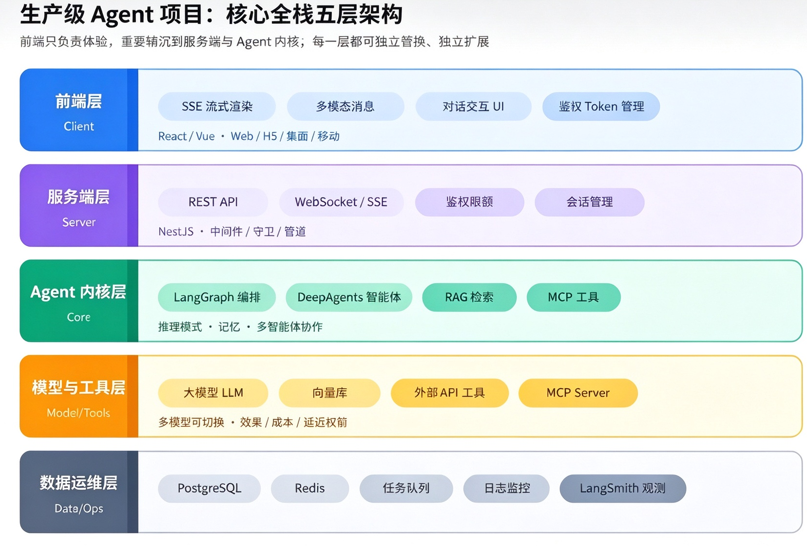
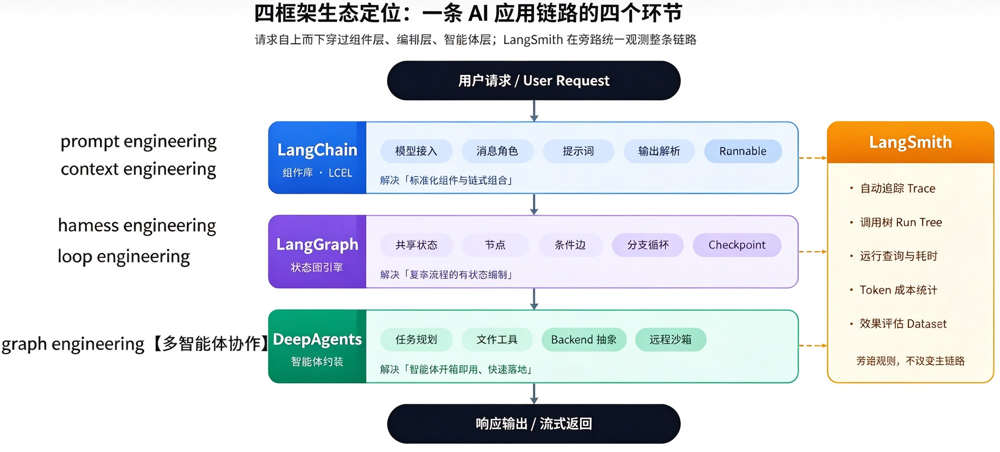

# langchain 与 langgraph 如何选择

Langchain 类比前端体系下的 「jQuery时代」：没有组件化，没有状态管理，所有逻辑混在一起，只能实现简单功能，复杂场景完全hold不住。而LangGraph这类框架，就是AI Agent开发领域的「React + Redux」，彻底解决了这些工程化痛点。


## 一、到底什么是AI Agent？前端友好版定义

很多教程会把AI Agent讲得很玄乎，我们用前端开发者能秒懂的语言给一个精准定义：

> **AI Agent，本质是一个能基于全局状态，自主完成复杂任务的状态驱动型应用。**

它的核心五要素，完全可以和前端知识一一对应：

| AI Agent核心要素 | 前端类比 | 核心作用 |
| :--- | :--- | :--- |
| 状态（State） | Redux全局Store | Agent的唯一可信数据源，存储所有上下文、中间产物、流程控制字段 |
| 记忆（Memory） | localStorage/IndexedDB | 状态的持久化能力，让Agent能记住历史操作，刷新不丢失 |
| 规划（Planning） | 前端路由/条件渲染 | Agent的流程控制逻辑，决定下一步要做什么 |
| 工具调用（Tool Calling） | 前端调用API/浏览器API | Agent调用外部能力的接口，比如代码执行、网络请求、数据库查询 |
| 执行闭环（Action） | React状态更新→视图重渲染 | Agent循环执行「规划-调用-状态更新」的流程，直到任务完成 |

简单来说：普通的LLM应用是「你让它做什么，它就做什么」，是一个被动的工具；而AI Agent是「你告诉它目标，它自己规划步骤、调用工具、循环执行，直到完成目标」，是一个主动的智能体。


## 二、LangGraph这类框架的本质与核心价值

LangGraph是LangChain官方出品的、**JS/TS原生支持的**、基于有限状态机的复杂AI Agent工作流编排引擎，专门为构建循环、分支、多角色协作的复杂智能体设计。

**前端视角的本质解读**
LangGraph就是AI Agent领域的「React + Redux」：

- React解决了前端UI的「组件化复用」和「声明式渲染」问题
- Redux解决了前端「全局状态统一管理」和「状态可预测」问题
- LangGraph解决了AI Agent的「逻辑节点组件化复用」和「全局状态统一管理」问题，同时原生支持复杂流程的声明式编排


### 1. 核心价值（解决了什么问题）
1. 开发范式升级：从命令式编程到声明式编排
告别嵌套的if/else和循环回调，你只需要定义「有什么状态、有什么节点、节点之间的流转规则」，框架帮你处理调度、状态合并、异常处理、持久化这些脏活累活，和React的声明式UI理念完全一致。

2. 统一的全局状态管理
整个Agent只有一个唯一可信的全局State，所有节点的输入都来自State，所有节点的输出都是对State的增量更新，彻底解决上下文传递混乱、状态不可追溯的问题。

3. 原生支持复杂流程控制
循环、条件分支、中断恢复、回溯、人类介入、多角色协作这些复杂场景，一行配置就能搞定，不用自己手写大量胶水代码。

4. 组件化的工程化能力
每个节点都是单一职责的纯函数，可独立开发、测试、复用，团队成员可以并行开发不同节点，互不干扰，彻底解决AI应用无法规模化协作的痛点。

5. 天生适配前端技术栈


### 2. 设计理念的本质差异：定位完全不同

我们用前端开发者最熟悉的类比，给两者一个精准、无歧义的定位：

| 框架 | 核心定位 | 前端友好类比 | 核心解决的问题 |
| :--- | :--- | :--- | :--- |
| **LangChain.js** | LLM应用开发的全栈工具链超市 | jQuery + 前端工具函数库 + UI组件库 | 把LLM应用开发的通用能力（模型调用、工具封装、RAG、向量库集成、输出解析等）封装成开箱即用的积木，解决「LLM应用从零开发太麻烦」的问题 |
| **LangGraph.js** | 复杂AI Agent的工程化架构骨架与流程调度引擎 | React + Redux + 前端路由系统 | 给AI Agent提供一套状态驱动、组件化、可编排的工程化架构，解决「复杂Agent流程不可控、状态混乱、耦合严重、无法规模化开发」的问题 |

以下是图片中的文字内容：

## 三、深入拆解设计范式的核心差异

- LangChain的核心范式：线性Chain链式调用
LangChain的核心设计单元是「Chain（链）」，它的执行逻辑是线性、固定、单向的：你需要提前定义好「第一步做什么、第二步做什么、第三步做什么」，执行时只能按照固定的顺序一步步往下走，就像前端开发中写死的同步代码顺序执行。

它的核心目标是降低简单LLM应用的开发门槛，让你不用从零写大模型调用、Prompt模板、输出解析的胶水代码，快速拼出一个可用的LLM应用。

- LangGraph的核心范式：状态机图状编排
LangGraph的核心设计单元是「State（状态） + Node（节点） + Edge（边）」，它的执行逻辑是动态、可循环、可分支、可中断的：你只需要定义好全局状态、原子能力节点、节点之间的流转规则，框架会自动根据当前状态动态决策下一步的执行路径，就像React的状态驱动渲染——状态变了，视图（执行流程）自动更新。

它的核心目标是解决复杂Agent的工程化落地问题，给你一套可扩展、可维护、可观测的架构体系，支撑复杂业务场景的规模化开发。

以前端视角对比下：
| 对比维度 | LangChain.js | LangGraph.js |
| :--- | :--- | :--- |
| **核心设计范式** | 线性链式调用，面向固定流程 | 状态机图状编排，面向动态状态 |
| **流程控制能力** | 仅支持固定线性流程，无原生循环、条件分支、中断能力，复杂场景需要硬写胶水代码 | 原生支持条件分支、循环、回溯、中断、暂停恢复，无限流程扩展能力，复杂场景开箱即用 |
| **状态管理方案** | 无全局统一状态，上下文通过Chain的输入输出传递，极易出现上下文地狱，无原生持久化机制 | 全局唯一可信状态，增量更新，全链路类型安全，原生支持状态持久化、快照、回溯、时间旅行 |
| **记忆能力** | 仅支持简单的对话历史记忆，无法实现复杂的业务状态记忆、多轮流程记忆 | 全链路状态记忆，支持自定义记忆维度、会话隔离、历史回溯，适配任意复杂的业务记忆需求 |
| **前端适配性** | 流式输出适配复杂，与React/Vue状态管理集成成本高，需要手动封装大量适配代码 | 状态驱动设计，与React/Vue/Redux的核心理念天然契合，流式状态更新与前端UI渲染完美匹配，集成成本极低 |
| **组件化与复用性** | Chain耦合严重，难以拆分复用，不同业务场景的Chain无法通用 | 节点单一职责，纯函数设计，可独立开发、测试、复用，团队可沉淀通用节点库，全业务线复用 |
| **团队协作能力** | 逻辑耦合，无法并行开发，多人协作极易出现代码冲突，无统一的开发规范 | 节点与流程完全解耦，不同开发者可并行开发不同节点、不同业务流程，互不干扰，天然适配团队规模化开发 |
| **可调试性与可观测性** | 黑盒执行，无法查看中间状态变化，出现问题难以排查，无原生调试能力 | 白盒执行，全流程状态变化可追踪、可回溯，支持断点调试、执行日志、状态快照，排错成本极低 |
| **异常处理能力** | 仅支持全局异常捕获，无法实现节点级别的重试、降级、容错，一个环节出错整个Chain崩溃 | 支持节点级别的超时、重试、降级、容错策略，异常不影响全局流程，稳定性极强 |
| **适用场景** | 单轮/线性多轮对话、固定流程FAQ客服、简单单工具调用、轻量级RAG问答、无状态的一次性LLM应用 | 多轮循环推理、代码生成/校验/修复闭环、多角色协作智能体、人类在环审核流程、长链路业务自动化、需要状态持久化的复杂场景、前端低代码Agent平台 |


到这里，我们可以彻底回答「学了LangGraph还要学LangChain吗？」这个问题：**必须学，两者是黄金搭档。**
- LangChain给AI Agent提供了「手脚」：它封装了海量的模型集成、工具调用、向量数据库、RAG、输出解析等原子能力，这些都是Agent和外界交互的核心基础，不用你从零造轮子
- LangGraph给AI Agent提供了「大脑和神经系统」：它负责全局的状态管理、流程调度、任务规划，让Agent能有序、稳定、高效地完成复杂任务
**最佳实践：**用LangChain封装原子能力（模型、工具、RAG等），把这些能力封装成LangGraph的节点；用LangGraph负责全局的状态管理和流程编排。两者各司其职，边界清晰，完全不会冲突。


## 四、选型方法论：如何根据业务复杂度在 LangChain 和 LangGraph 之间做选型
很多开发者会陷入两个极端：要么为了炫技，简单的单轮对话场景硬上LangGraph，过度设计；要么为了省事，复杂的多轮闭环场景硬用LangChain写嵌套循环，最终变成无法维护的屎山代码。

选型的核心，从来不是「哪个技术更火」，而是「哪个技术能最低成本、最高效地解决当前的业务问题，同时支撑未来的业务迭代」。

### 1. 选型第一性原理
**业务流程的动态复杂度，决定了你的技术选型。**
这里的「动态复杂度」，不是指业务功能多不多，而是指业务流程是否需要动态决策、是否有非固定的执行路径、是否需要循环/分支/中断/人工介入。

举个例子：一个RAG问答应用，流程是「用户提问→召回向量→Prompt拼接→LLM回答→输出」，全程是固定的线性流程，哪怕你加了10个向量库、做了复杂的召回逻辑，它的流程复杂度依然很低，优先用LangChain实现即可。

反过来，一个前端代码生成Agent，流程是「用户需求→需求拆解→技术方案设计→代码生成→语法校验→自动修复→重新校验→预览生成」，中间有循环、有分支、有人工介入的可能，哪怕功能很简单，它的流程复杂度也很高，必须用LangGraph实现。

### 2. 核心判断的6个维度
这里有一套可直接落地的选型判断维度，只要满足任意2条及以上「必须用LangGraph」的维度，就直接选LangGraph，不要用LangChain硬写；所有维度都不满足，优先用 LangChain。

| 判断维度 | 优先选 LangChain | 必须选 LangGraph |
| :--- | :--- | :--- |
| **流程固定性** | 业务流程完全固定，执行路径是线性的、提前定义好的，没有动态分支 | 业务流程不固定，需要根据LLM的输出、用户的输入动态决策下一步执行路径，有大量条件分支 |
| **循环执行需求** | 没有循环执行的需求，所有步骤只需要执行一次 | 有循环执行的需求，比如代码校验不通过需要重新生成、方案不符合要求需要重新拆解，需要闭环执行逻辑 |
| **状态持久化需求** | 无状态，单次执行完成即结束，不需要保存执行过程中的状态，不需要中断恢复 | 有状态，需要保存执行过程中的所有状态快照，需要支持中断执行、人工介入、之后从断点恢复执行 |
| **多角色协作需求** | 单角色执行，所有逻辑都在一个链路里完成，不需要多角色分工 | 多角色协作，比如产品经理拆解需求、架构师设计方案、开发写代码、测试做校验，需要多个独立的智能体分工协作 |
| **业务迭代频率** | 业务流程固定，不会频繁改动，长期稳定运行 | 业务流程会频繁迭代、新增功能、调整步骤，需要架构有极强的可扩展性 |
| **团队协作规模** | 单人开发，1-2个人维护整个应用，不需要多人并行开发 | 团队协作，多个开发者并行开发不同的功能模块，需要统一的开发规范和可复用的组件体系 |


### 3. 前端场景选型边界与最佳实践
优先选 LangChain 的场景：
- 固定流程的智能客服、FAQ 问答机器人
- 简单的单轮文案生成、翻译、润色工具
- 轻量级 RAG 知识库问答，流程固定，无复杂的多轮推理
- 简单的单工具调用应用，比如天气查询、IP查询、简单的API调用工具
- 一次性的无状态 LLM 应用，执行完成即结束，无需保存上下文

必须选 LangGraph 的场景：
- 代码生成/校验/修复/格式化的闭环开发工具
- 多角色协作的产品需求→设计→开发→测试全流程 Agent
- 需要人工审核、介入修改的业务流程，比如内容审核、工单审批、方案评审 Agent
- 长链路的业务自动化工具，比如自动化测试、自动化部署、自动化运营工具
- 需要状态持久化、刷新不丢失、多会话管理的Agent应用
- 前端低代码Agent平台，需要可视化流程编排、动态节点扩展
- 多模态交互的复杂智能体，需要结合视觉、语音、端侧能力的动态流程

### 4. 核心架构设计：可解耦、可演进的 Agent 分层架构，支撑团队规模化业务
当你的团队开始规模化落地 AI Agent 业务时，一定会遇到这些致命的架构痛点：
- 耦合严重：LLM 调用逻辑、业务逻辑、UI 逻辑强耦合在一个文件里，加一个小功能就要重构整个代码，迭代成本指数级上升
- 状态混乱 状态散落在各个组件、各个函数里，没有统一管理，出现问题根本无法追溯，线上 bug 排查难度极大
- 无法复用：每个人写的 Agent 逻辑都不一样，代码无法复用，重复造轮子，团队效率极低
- 无法协作：逻辑耦合严重，多人并行开发极易出现代码冲突，没有统一的开发规范，最终变成屎山代码
- 无法演进：业务一迭代，整个架构就要重构，技术债务快速累积，最终只能推翻重写

这些痛点，和10年前前端开发从jQuery时代进入React时代遇到的问题一模一样。解决这些问题的核心，就是分层架构设计，通过明确的职责边界、单向依赖、组件化复用，实现架构的解耦与可演进。


## 五、5层分层解耦 Agent 架构
我们给你一套经过多个前端团队生产环境验证的、完全贴合前端技术栈的5层分层架构，从底层基础设施到上层应用接入，每层都有明确的职责边界、解耦设计、前端类比，可直接落地到你的团队业务中。

先看整体架构的Mermaid图，建立全局认知：




### 1. 基础设施层
核心职责：底层能力的抽象与封装，隔离上层业务与底层实现的耦合，是整个Agent系统的基石。
前端类比：前端项目中的axios请求封装、工具函数库、多环境适配层。
核心设计原则：面向接口编程，上层只依赖抽象接口，不依赖具体实现，底层替换不影响上层业务。

#### 1. 模型 Provider 抽象

兼容 OpenAI、Anthropic、国内通义千问/文心一言等大模型，定义统一的调用接口，上层业务不用关心底层用的是什么模型，实现模型的无缝切换。

```typescript
// interfaces/model.interface.ts
export interface ModelProvider {
  invoke(prompt: string, options?: ModelOptions): Promise<string>;
  stream(prompt: string, options?: ModelOptions): Promise<AsyncIterable<string>>;
}

export interface ModelOptions {
  temperature?: number;
  modelName?: string;
  maxTokens?: number;
}

// providers/openai.provider.ts
import { ChatOpenAI } from "@langchain/openai";
import { ModelProvider, ModelOptions } from "../interfaces/model.interface";

export class OpenAIProvider implements ModelProvider {
  private model: ChatOpenAI;

  constructor(options: ModelOptions) {
    this.model = new ChatOpenAI({
      modelName: options.modelName || "gpt-4o-mini",
      temperature: options.temperature || 0,
      apiKey: process.env.OPENAI_API_KEY,
    });
  }

  async invoke(prompt: string, options?: ModelOptions): Promise<string> {
    const res = await this.model.invoke(prompt, options);
    return res.content as string;
  }

  async stream(prompt: string, options?: ModelOptions): Promise<AsyncIterable<string>> {
    const stream = await this.model.stream(prompt, options);
    return stream;
  }
}

// 上层业务使用：只依赖 ModelProvider 接口，不依赖具体实现
const model: ModelProvider = new OpenAIProvider({ modelName: "gpt-4o" });
// 切换模型：只需要替换实现类，上层业务代码完全不用改
// const model: ModelProvider = new QwenProvider({ modelName: "qwen-max" });
```

2. 工具接口标准化
定义统一的工具注册、调用、权限控制、错误处理接口，所有工具都遵循统一的开发规范，上层节点调用工具时，不用关心工具的具体实现。

3. 持久化适配层
封装 Checkpointer 的统一接口，兼容 Redis、IndexedDB、本地文件、Electron 存储等多种持久化方案，上层业务不用关心底层存储介质。

4. 多运行时兼容
兼容 Node.js、Next.js Edge Runtime、浏览器端、Electron 等多运行环境，封装环境差异，上层业务一套代码多端运行。

#### 2. 解耦核心价值
- 模型切换、存储方案替换、运行环境变更，只需要修改基础设施层的实现，上层业务代码完全不用改动
- 团队可以沉淀通用的基础设施能力，全业务线复用，不用每个项目都重新封装
- 上层业务不用关心底层实现细节，只需要调用统一的接口，开发效率大幅提升


### 2. 状态内核层

核心职责：Agent 全局状态的唯一管理中心，是整个 Agent 系统的「心脏」，所有业务逻辑的执行都围绕状态展开，实现状态的可预测、可观测、可回溯。

前端类比：Redux 的 Store、React 的 useReducer 全局状态管理。

核心设计原则：单一数据源、只读状态、纯函数更新，所有状态变更都可追溯、可预测。

#### 1. 核心模块与代码实现

1. 全局 State Schema 定义

用 Zod 或 TypeScript 定义全局 State 的类型结构，拆分业务状态、流程状态、对话状态，实现全链路类型安全。

```typescript
// state/schema.ts
import { z } from "zod";

// 业务状态：核心业务数据
const BusinessState = z.object({
  userDemand: z.string(),
  demandAnalysis: z.string().optional(),
  techSolution: z.string().optional(),
  sourceCode: z.string().optional(),
  checkError: z.string().optional(),
  previewUrl: z.string().optional(),
});

// 流程控制状态：控制 Agent 执行流程
const FlowState = z.object({
  retryCount: z.number().default(0),
  maxRetryCount: z.number().default(3),
  humanApproved: z.boolean().default(false),
  currentNode: z.string().optional(),
});

// 全局 State Schema
export const AgentState = z.object({
  business: BusinessState,
  flow: FlowState,
});

// 推导 TS 类型，全链路复用
export type AgentStateType = z.infer<typeof AgentState>;
```

2. 状态更新 Reducer
封装纯函数式的状态更新逻辑，所有节点只能通过 Reducer 更新状态，禁止直接修改状态，保证状态变更的可预测性。

3. 状态事件总线
实现状态变更的订阅与发布机制，状态变化时自动推送事件，实现与前端 React 状态管理的双向同步，前端 UI 可以实时响应状态变化。

4. 状态快照与回溯
基于 Checkpointer 实现状态的版本管理、快照保存、时间旅行、分支执行，支持回溯到任意一个历史状态重新执行。

#### 2. 解耦核心价值
- 全局唯一的状态数据源，彻底解决状态混乱、上下文传递错误的问题
- 所有状态变更都可追溯、可观测，线上 bug 排查、调试成本大幅降低
- 状态管理与业务逻辑完全解耦，业务节点只需要读取状态、返回更新补丁，不用关心状态的合并、持久化逻辑
- 与前端状态管理理念完全契合，前端开发者可以无缝对接，实现 Agent 状态与 UI 状态的实时同步


### 3. 节点能力层
核心职责：封装可复用的原子能力节点，每个节点单一职责，是 Agent 系统的「积木块」，可独立开发、测试、替换、复用。
前端类比：React 的通用业务组件、原子组件库。

核心设计原则：单一职责、纯函数、无副作用、可独立测试、可复用。

#### 1. 核心模块与代码实现
1. 原子节点标准化
定义统一的节点接口规范，所有节点都遵循「输入 State -> 处理逻辑 -> 输出状态更新补丁」的纯函数模式，统一的错误处理、日志、超时控制规范。

```typescript
// interfaces/node.interface.ts
import { AgentStateType } from "../state/schema";

export type AgentNode = (state: AgentStateType) => Promise<Partial<AgentStateType>>;

// nodes/demand-analysis.node.ts
import { AgentNode } from "../interfaces/node.interface";
import { ModelProvider } from "../interfaces/model.interface";

// 节点依赖通过参数注入，不硬编码依赖，实现解耦
export const createDemandAnalysisNode = (model: ModelProvider): AgentNode => {
  return async (state) => {
    const { userDemand } = state.business;
    // 单一职责：只做需求拆解，不做其他逻辑
    const result = await model.invoke(`
      你是资深前端产品经理，把用户的产品需求拆解为清晰的用户故事、功能点、验收标准，输出结构化内容
      用户需求：${userDemand}
    `);

    // 只返回需要更新的状态补丁，不修改原状态
    return {
      business: {
        ...state.business,
        demandAnalysis: result,
      },
      flow: {
        ...state.flow,
        currentNode: "demandAnalysisNode",
      },
    };
  };
};
```

2. 节点注册与发现机制
实现节点的动态注册、按需加载、自动发现，团队可以沉淀通用节点库，新增节点不需要修改流程编排代码，实现对扩展开放、对修改关闭。

3. 节点单测体系
基于 Vitest/Jest 实现节点的单元测试，纯函数的节点输入确定则输出确定，非常容易编写单测，保证节点的稳定性。

4. 通用节点库沉淀
团队沉淀通用的原子节点，比如 LLM 推理节点、工具调用节点、代码校验节点、人工审核节点等，全业务线复用，不用重复造轮子。

#### 2. 解耦核心价值
- 节点之间无直接依赖，仅依赖状态内核的接口，团队可以并行开发不同的节点，互不干扰
- 节点可独立替换、独立升级，修改一个节点的实现，不会影响其他节点和业务流程
- 节点可全团队复用，大幅提升开发效率，统一代码质量
- 节点可独立测试，大幅提升整个系统的稳定性，降低线上 bug 率


### 4. 流程编排层
核心职责：基于 LangGraph Graph，编排节点与边，定义 Agent 的业务流程，是 Agent 系统的「施工图纸」，实现流程与能力的解耦，支撑业务的快速迭代。

前端类比：前端的路由系统、React 的页面组件组合、业务流程编排。
核心设计原则：流程与能力解耦，业务流程调整不需要修改节点代码，通过子图实现模块化复用。

#### 1. 核心模块与代码实现
1. 业务 Graph 编排
基于 LangGraph StateGraph，注册节点、定义边，编排业务流程，完全基于节点能力层的通用节点，不写任何业务逻辑实现。

```typescript
// workflows/code-gen.workflow.ts
import { StateGraph, END } from "@langchain/langgraph";
import { AgentState, AgentStateType } from "../state/schema";
import { createDemandAnalysisNode } from "../nodes/demand-analysis.node";
import { createTechSolutionNode } from "../nodes/tech-solution.node";
import { createCodeGenerateNode } from "../nodes/code-generate.node";
import { ModelProvider } from "../interfaces/model.interface";

// 构建业务流程 Graph
export const buildCodeGenWorkflow = (model: ModelProvider) => {
  // 注入依赖，创建节点实例
  const demandAnalysisNode = createDemandAnalysisNode(model);
  const techSolutionNode = createTechSolutionNode(model);
  const codeGenerateNode = createCodeGenerateNode(model);

  // 初始化工作流
  const workflow = new StateGraph<AgentStateType>({
    stateSchema: AgentState,
  })
    // 注册节点，只注册，不修改节点实现
    .addNode("demandAnalysisNode", demandAnalysisNode)
    .addNode("techSolutionNode", techSolutionNode)
    .addNode("codeGenerateNode", codeGenerateNode)
    // 编排流程，定义边，只调整流程，不修改节点代码
    .addEdge("__start__", "demandAnalysisNode")
    .addEdge("demandAnalysisNode", "techSolutionNode")
    .addEdge("techSolutionNode", "codeGenerateNode")
    .addEdge("codeGenerateNode", END);

  // 编译生成工作流
  return workflow.compile();
};
```

2. 子图（Subgraph）模块化封装
把可复用的业务流程封装成子图，比如「代码生成 -> 校验 -> 修复」的闭环流程，可以封装成一个独立的子图，在多个业务流程中复用，就像 React 的业务组件。

3. 流程版本管理
实现业务流程的版本控制、灰度发布、A/B 测试、回滚方案，业务流程迭代不会影响线上稳定，支持多版本并行运行。

4. 动态流程加载
实现运行时动态加载流程、动态新增节点、调整边规则，无需重新部署，支持可视化流程编排平台的低代码开发。

#### 2. 解耦核心价值
- 流程与能力完全解耦，业务流程调整只需要修改边的编排，不需要修改节点的实现代码，迭代成本极低
- 子图模块化复用，通用业务流程可以在多个业务线复用，不用重复编排
- 业务流程可版本管理、灰度发布，大幅降低线上迭代的风险
- 产品经理也可以通过可视化工具调整流程，不需要开发介入，极大提升业务迭代效率


### 5. 应用接入层
核心职责：与前端应用的无缝集成，提供标准化的 API、Hooks、组件，隔离 Agent 业务逻辑与前端 UI 逻辑，是 Agent 系统与前端应用的「桥梁」。

前端类比：React 的业务 Hooks、UI 组件库、API 请求封装层。

核心设计原则：UI 与逻辑彻底解耦，前端开发者无需关心 Agent 底层实现，开箱即用。

#### 1. 核心模块与代码实现

1. React Hooks 封装
把 Agent 的执行、状态管理、流式输出封装成通用的 React Hooks，前端页面只需要调用 Hooks，就能接入 Agent 能力，完全不用关心底层实现。

2. UI 组件库封装
封装通用的 Agent UI 组件，比如对话组件、流程可视化组件、代码预览组件、人工审核组件等，全团队复用，统一 UI 交互体验。

3. 流式输出适配
适配 React Suspense、Streaming SSR、React Server Components，实现极致的前端流式渲染体验，与 Next.js 深度集成。

4. 统一的错误与加载处理
封装统一的错误提示、加载状态、超时处理、用户交互规范，前端页面不用重复写相关逻辑。

#### 2. 解耦核心价值
- Agent 业务逻辑与前端 UI 逻辑彻底解耦，UI 开发者不需要懂 Agent 底层实现，只需要调用 Hooks 和组件，就能快速接入
- 通用 Hooks 和组件全团队复用，统一交互体验，大幅提升前端开发效率
- 与 Next.js 等前端全栈框架深度适配，充分发挥前端技术栈的优势，实现极致的用户体验
- Agent 底层逻辑迭代，不会影响前端 UI 代码，前后端（Agent 逻辑与 UI）可以并行开发


## 六、LangSimth 可组合使用


## 七、场景举例
LangChain 的价值在于把模型调用、工具封装、RAG 检索这些“对外交互能力”标准化，让你快速拼出一个能干活的 LLM 应用。它适合的是线性、固定、无状态或弱状态的场景。

1. 企业文档问答机器人（标准 RAG） 用户提问 → 检索知识库 → 拼 Prompt → 模型回答 → 输出。流程完全固定，没有循环和分支。LangChain 的向量库集成、文档加载器、检索链开箱即用，是最成熟的落地场景。

2. 单工具查询助手（天气/汇率/IP 查询） 用户问“北京明天天气”，Agent 调用一个天气工具，拿到结果直接回复。只需要一次工具调用，不需要多步规划，LangChain 的 create_agent 配一个工具就能跑。

3. 文案生成/翻译/润色工具 输入一段文字，套模板 Prompt，调模型，输出结果。没有状态需要保存，没有分支需要决策，LangChain 的 Prompt 模板和输出解析器正好够用。


LangGraph 的核心是状态机图编排 + 持久化 + 人机协同 + 循环控制。它适合的是流程不固定、需要闭环重试、需要记住进度、需要人工介入的场景。
1. 代码生成/校验/修复闭环工具 流程：需求拆解 → 写代码 → 语法校验 → 如果不通过，回到写代码步骤重试 → 预览生成。这里的关键是循环和条件分支，LangChain 的线性 Chain 做不到“失败了自动回头”。Replit 用 LangGraph 做代码生成类 Agent 的生产落地。

2. 自动化测试生成 Agent（Uber 生产案例） Uber 用 LangGraph 做自动化单元测试生成：分析代码 → 生成测试 → 运行测试 → 如果测试失败，分析原因并重新生成。这是一个典型的闭环迭代流程，需要状态持久化和循环控制。

3. 多角色协作的复杂 Agent 系统 比如“产品经理拆需求 → 架构师出方案 → 开发写代码 → 测试做校验”的多 Agent 流水线。每个角色是一个独立节点，节点之间有条件路由和人工审核介入点。LangGraph 的多 Agent 编排和 human-in-the-loop 能力正好匹配。